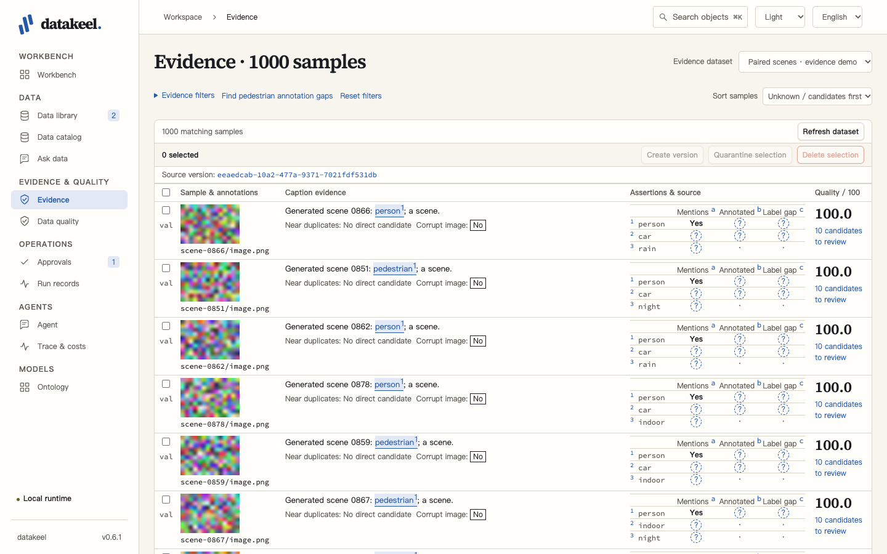
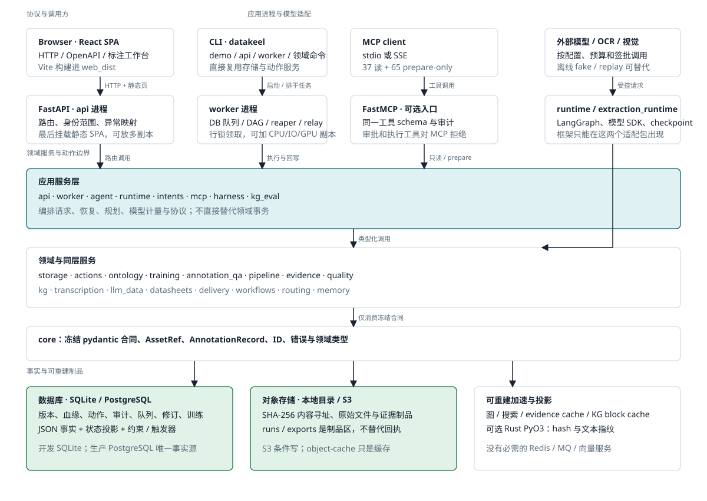

# Datakeel

**An auditable, local-first data and AI dataset workbench — unifying multimodal evidence proofreading, traceable metric Q&A, and human-approved Agent/MCP actions.**

[](https://github.com/chaw1/datakeel/actions/workflows/ci.yml)
[](https://github.com/chaw1/datakeel/releases)
[](pyproject.toml)
[](LICENSE)

English · [简体中文](README.zh.md) · [10-Minute Tour](docs/DEMO.en.md) · [Documentation](docs/README.md) · [API Reference](docs/API_REFERENCE.md) · [Architecture](docs/ARCHITECTURE.md) · [Deployment](docs/DEPLOYMENT.md) · [Changelog](CHANGELOG.md)

---

## Proofreading workspace



Datakeel organizes data engineering and AI dataset workflows into six workspace groups: **Workbench**, **Data**, **Evidence & quality**, **Operations**, **Agents**, and **Models**. Eight object types share a unified archive view with facts, relationships, evidence, and history where every number traces back to its source:

- **Three-state evidence & anchors**: Distinguish `present`, `absent`, and `unknown` evidence (a dot means no assertion); hover or use `j`/`k`, `a`/`r`, and `Esc` to inspect aligned caption spans, image boxes, and concept rows while keeping human review separate from extracted assertions.
- **Source footnotes & approval sheets**: Metric answers bind their definition version, owner, parameterized SQL, source columns, and time range; irreversible or outbound changes pause on an explicit digest-bound approval sheet before execution.
- **Fast navigation & proofreading Copilot**: Press `⌘K / Ctrl+K` to jump across datasets, files, versions, actions, tables, columns, metrics, and terms (full UUIDs shorten to 8 chars; business IDs stay intact), or `⌘J / Ctrl+J` to open the contextual Copilot drawer and inspect or replan action chains.
- **Offline-ready UI**: Bilingual English/Chinese UI with three contrast-verified palettes (`pencil`, `ochre`, `graphite`) and locally bundled OFL fonts ([third-party notices](web/public/THIRD-PARTY-LICENSES.txt)) making zero external requests in demo mode.

---

## Why Datakeel

- **Immutable manifests & traceable numbers**: File versions freeze SHA-256 manifests; metric Q&A compiles deterministic read-only `SELECT` SQL from registered YAML definitions with half-open time windows (`unanswerable` / `clarification` states never guess numbers); seven-chapter datasheets enforce sentence-level citations against frozen facts.
- **Honest evidence (`present` / `absent` / `unknown`)**: Missing annotations or sidecars stay `unknown` rather than false negatives; image quality, point-cloud cleaning, near-duplicate hashing, and knowledge-graph extraction preserve immutable provenance.
- **Frozen plans & human-in-the-loop safety**: State changes prepare a digest-bound plan with expiry, target scope, outbound transfer disclosure, and reversibility. Built-in Agents (LangGraph-checkpointed) and FastMCP servers can prepare plans, never approve or execute irreversible actions on their own.
- **Local-first to small-team deployment**: Runs offline out of the box on SQLite + local files with bundled React assets; scales to PostgreSQL + S3 behind an authenticating reverse proxy with optional Rust acceleration (`datakeel-accel`).

---

## Quick start

Install [uv](https://docs.astral.sh/uv/getting-started/installation/), then run the offline demo from a checkout (`.python-version` selects Python 3.12; Node, Docker, external databases, and model credentials are not required):

```bash
uv sync --locked
uv run datakeel demo
# Web UI:   http://127.0.0.1:8765
# API docs: http://127.0.0.1:8765/api/docs
# Stop both API and worker processes with Ctrl+C
```

The demo starts both `api` and `worker` locally and seeds deterministic fixtures:
- **Field notes · generated demo** (400 PNG/text files across 11 operators and 2 immutable versions),
- **Paired scenes · evidence demo** (1,000 image/caption/annotation samples with 50 conflicts, 30 missing sidecars, and 10 corrupt images across 5 evidence operators),
- **Fictional Kitchen Co.** (4 SQLite sources, 24 tables, 128 fields, 13 metrics, 12 dimensions, 32 terms, 51,992 rows, and 6 classified data assets), plus
- **Business notes · knowledge graph demo** (24 passages, 3 long documents, and recorded image transcriptions).

Follow the **[10-Minute Guided Tour](docs/DEMO.en.md)** for a full walkthrough, or exercise the non-interactive CLI right away:

```bash
uv run datakeel demo --once
uv run datakeel ask '上个季度华东区零售额是多少' --reference-instant 2026-10-01T00:00:00Z
uv run datakeel ask '退货率为什么上升' --reference-instant 2026-10-01T00:00:00Z
uv run datakeel ask '上个季度营业额是多少' --reference-instant 2026-10-01T00:00:00Z
uv run datakeel export --format openlineage --output events.json
uv run datakeel export --format croissant --output croissant.json
```

> Both Chinese and English business questions share the same deterministic time parser, metric/alias normalization, dimension breakdown rules, and refusal guardrails. See [Ask charts and follow-ups](docs/ASK.md) and [API & pipeline reference](docs/API_REFERENCE.md).

---

## What's included

| Area | Capabilities | Deep dives |
| --- | --- | --- |
| **Multimodal evidence & media** | Five-operator evidence DAG (`phash`, caption mentions, annotations, label gaps, 64-bit dHash near-duplicates with optional Rust `datakeel-accel`), image usability & PLY/PCD point-cloud quality, `ffmpeg` audio/video slicing, text & image knowledge graphs, sandboxed custom Python operators | [Media Quality](docs/MEDIA_QUALITY.md) · [Audio & Video](docs/MEDIA.md) · [Knowledge Graphs](docs/KG.md) · [Custom Operators](docs/CUSTOM_OPERATORS.md) · [Rust Accel](docs/RUST_ACCEL.md) · [Fake Vector Kernel](docs/VECTOR_FAKE.md) |
| **Production, splits & LLM data** | Label-set publishing, immutable annotation revisions, EXIF-upright workbench, team cockpit (leases, skill dispatch, AI prelabel & pre-review), offline QA agreement, seeded/stratified training splits with leakage checks & COCO/YOLO/HF/JSONL export, SFT/preference dry-run cleaning, cited datasheets, reproducible delivery & `datakeel reconcile` | [Production](docs/PRODUCTION.md) · [Workbench](docs/ANNOTATION_WORKBENCH.md) · [Annotation QA](docs/ANNOTATION_QA.md) · [Training Sets](docs/TRAINING.md) · [LLM Data](docs/LLM_DATA.md) · [Datasheets](docs/DATASHEETS.md) · [Releases & Delivery](docs/RELEASES.md) |
| **Enterprise catalog & Ask data** | SQLite reflection, `sqlglot` field derivation, dbt / Airflow REST v1 / OpenLineage imports, versioned metric YAML (`update_metric` / `rollback_metric`), traceable Q&A + chart selection + document claims, portable field standards & code lists, table quality rules & alerts, classified data assets & access grants, time-series profiling | [Ask Data](docs/ASK.md) · [Metadata Imports](docs/METADATA_IMPORTS.en.md) · [Standards](docs/STANDARDS.md) · [Quality Rules](docs/QUALITY_RULES.md) · [Data Assets](docs/DATA_ASSETS.en.md) · [Time-Series](docs/TIMESERIES.md) |
| **Actions, Agent, workflows & Copilot** | Digest-bound approval sheets, LangGraph-checkpointed Agent with `fake-demo` offline mode, nested read-only subagent delegation, canary & prompt-injection guards, redacted cross-conversation memory, persistent token/USD budgets, deterministic YAML workflows, beta one-sentence action chains (`⌘J`), registered actor roles | [Controlled Actions](docs/ACTIONS.md) · [Workflows](docs/WORKFLOWS.md) · [Agent & Memory](docs/AGENT.md) · [One Sentence (Beta)](docs/ONE_SENTENCE.md) · [Identity & Access](docs/IDENTITY_ACCESS.md) |

---

## MCP server & model providers

`uv run datakeel mcp` exposes **102 FastMCP tools** (37 audited reads + 65 plan-preparation actions). Approval and execution stay exclusively in the Web UI or CLI; any `approve_plan` or `execute_plan` call over MCP is refused and audited.

For **Claude Desktop** (`claude_desktop_config.json`) or **Cursor** (`.cursor/mcp.json`), replace the absolute paths and keep `DATAKEEL_HOME` aligned with your demo workspace:

```json
{
  "mcpServers": {
    "datakeel": {
      "command": "/absolute/path/to/uv",
      "args": [
        "--directory",
        "/absolute/path/to/datakeel",
        "run",
        "datakeel",
        "mcp"
      ],
      "env": {
        "DATAKEEL_HOME": "/absolute/path/to/datakeel/.datakeel"
      }
    }
  }
}
```

Or run an isolated loopback SSE server with `uv run datakeel mcp --transport sse --host 127.0.0.1 --port 8766`:

```json
{
  "mcpServers": {
    "datakeel": {
      "url": "http://127.0.0.1:8766/sse"
    }
  }
}
```

- **Optional live LLM providers**: Set `DATAKEEL_OPENAI_API_KEY` or `DATAKEEL_ANTHROPIC_API_KEY` (and optional `DATAKEEL_OPENAI_BASE_URL` / `DATAKEEL_ANTHROPIC_BASE_URL`) as environment secrets outside the repository; models must have entries in [`contracts/model-prices.yaml`](contracts/model-prices.yaml). Without keys, the UI runs on the offline `fake-demo` provider.
- **OpenTelemetry trace export**: Export sanitized OTLP/HTTP protobuf spans (no prompts, completions, payloads, or credentials) to OTLP collectors, Phoenix, or Langfuse with `uv run datakeel export-traces [--conversation-id <id>]` (details in [API & pipeline reference](docs/API_REFERENCE.md#opentelemetry-trace-export)).

---

## Architecture



Datakeel is a modular monolith of two stateless/fenced processes (`api` and `worker`) over a single SQLite or PostgreSQL fact store and local or S3-compatible object storage. File versions are immutable SHA-256 manifests, lineage graphs rebuild deterministically from append-only events, and PostgreSQL workers claim shards via `FOR UPDATE SKIP LOCKED` (`BEGIN IMMEDIATE` on SQLite) with heartbeats, lease fencing, and a transactional terminal-event outbox.

```text
datakeel/       Core domain, semantic resolver, operators, evidence, kg, catalog, metrics, ask,
                pipeline, quality, lineage, governance, storage, worker, api, ontology, actions,
                agent, runtime (LangGraph), harness, FastMCP server, and CLI
accel/          Optional Rust PyO3/maturin extension (datakeel-accel)
web/            React + TypeScript + Vite source (compiled assets shipped in datakeel/web_dist)
contracts/      Semantic file-format, operator, evidence, semantic-layer, workflow, and golden specs
sandbox/        Hardened container runtime image for reviewed custom operators
docs/           Architecture, guides, API/verification references, and capacity benchmarks
tests/          Mirrored unit, integration, contract, and repository regression suites
```

See [Architecture decisions](docs/ARCHITECTURE.md), [Persistence schema](docs/PERSISTENCE_SCHEMA.md), and [API & pipeline reference](docs/API_REFERENCE.md).

---

## Deployment & local builds

### Run roles separately

```bash
uv run datakeel db upgrade          # Explicit schema upgrade (db status checks read-only)
uv run datakeel api --port 8765
# In a second terminal with the same DATAKEEL_HOME / DATAKEEL_DATABASE_URL / DATAKEEL_S3_* settings:
uv run datakeel worker
```

### Build local wheel or Docker image

From a source checkout (requires Python 3.12, `uv`, Node.js 22, and Rust 1.96 to build; runtime wheels and containers do not need Node):

```bash
make build-wheel                    # Pure-Python wheel + hashed requirements in dist/
make build-image                    # Builds local non-root image tagged datakeel:local
docker run --rm -p 127.0.0.1:8765:8765 -v datakeel-data:/data datakeel:local
```

Neither command pushes or uploads artifacts to PyPI or Docker Hub.

### Local PostgreSQL stack with Docker Compose

After `make build-image`, run `api`, `worker`, `migrate`, and `postgres:17-alpine` together on a loopback-only binding (`127.0.0.1:8765`):

```bash
docker compose up -d
# Optional one-shot demo seeding into the Compose Postgres + /data volume:
docker compose run --rm api demo --once
```

For multi-user small-team access behind Caddy or nginx + `oauth2-proxy`, see [Small-team deployment](docs/DEPLOYMENT.md) and [SQLite database maintenance](docs/DATABASE_MAINTENANCE.md).

---

## Development & verification

```bash
uv sync --locked
(cd web && npm ci)
uv run pre-commit install
make check                          # Public scan, Rust, Ruff ALL, Pyright strict, import-linter,
                                    # size/schema guards, pytest (>=85%/90% cov), web checks, license audit
uv run python scripts/check_readme.py
bash scripts/ci-check.sh            # Full local CI: make check + README verification + 856 mutations
```

Dual-stack CI runs the complete gate, four pytest shards, and two mutation shards on both SQLite and PostgreSQL. See [Contributing](CONTRIBUTING.md), [Code standards](docs/CODE_STANDARDS.md), [Offline evaluation & quality gates](docs/VERIFICATION.md), and [Test execution speed](docs/TEST_SPEED.md).

---

## Community, security & license

- **Questions & support**: Read [SUPPORT.md](SUPPORT.md) or browse the [Documentation Hub](docs/README.md).
- **Security**: Report vulnerabilities privately via [SECURITY.md](SECURITY.md) — never in public issues.
- **Code of conduct**: Follow [CODE_OF_CONDUCT.md](CODE_OF_CONDUCT.md).
- **Citation**: Metadata for academic or technical citation is provided in [CITATION.cff](CITATION.cff).
- **License**: [Apache-2.0](LICENSE). Complete runtime license inventory and approved exceptions (`certifi`, `orjson`, `regex`, and bundled OFL-1.1 fonts) are audited offline and recorded in [THIRD_PARTY_NOTICES.md](THIRD_PARTY_NOTICES.md) and [`web/public/THIRD-PARTY-LICENSES.txt`](web/public/THIRD-PARTY-LICENSES.txt). No ELv2, BSL, AGPL, or SSPL runtime dependency is included.
