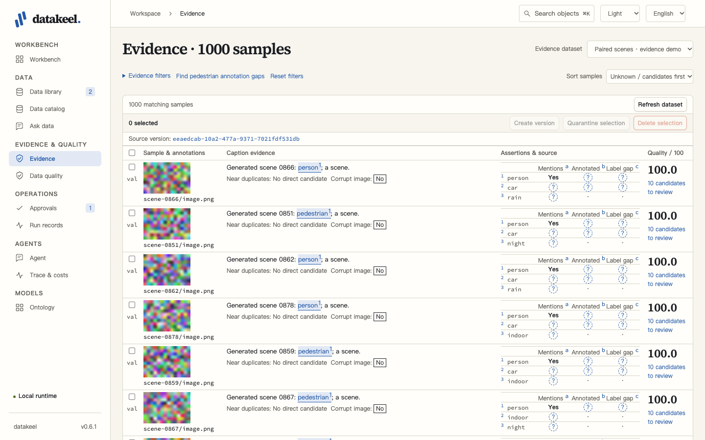
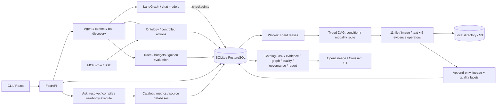

# Datakeel

Version files, inspect evidence and ask business questions against registered metrics—with traceable results and controlled changes.

[Ten-minute tour](docs/DEMO.en.md) · [十分钟导览](docs/DEMO.md)

[Data standards](docs/STANDARDS.md) define fields and code lists, explain mapping suggestions, and report confirmed-column conformance and coverage. Every standard change and mapping confirmation requires approval.


```bash
uv sync
uv run datakeel demo
# Open http://127.0.0.1:8765
# API reference: http://127.0.0.1:8765/api/docs
# Stop both application processes with Ctrl+C
uv run datakeel export --format openlineage --output events.json
uv run datakeel export --format croissant --output croissant.json
uv run pytest
uv run ruff check .
uv run pyright
```

[中文说明](README.zh.md) · [Architecture](docs/ARCHITECTURE.md) · [Code standards](docs/CODE_STANDARDS.md) · [Controlled actions](docs/ACTIONS.md) · [Changelog](CHANGELOG.md)

## Proofreading workspace



The interface organizes work into six groups: Workbench, Data, Evidence & quality, Operations, Agents and Models. Start at the workbench to review pending approvals, running pipelines, recent actions and dataset quality alerts. Eight object kinds share an archive with facts, relationships, evidence and history; each fact links to its source. Related actions with the same name fold into an expandable ×N card, and local graphs remain bounded to 25 visible nodes.

Catalog names with an English translation use it consistently in object titles, breadcrumbs, search results, approval sheets and relationship cards. Names without a translation keep their original spelling.

Catalog objects accept an optional `english_name`; metric, dimension and term definitions accept the same field. Owner display metadata is declared separately in [`owners.yaml`](contracts/semantic-layer/owners.yaml), keyed by the unchanged owner name. English labels take precedence in the English interface; omitted labels retain the existing name fallback. Object IDs show the first eight characters only for complete UUIDs; business IDs such as `retail_revenue` remain complete, and copying always uses the full identity.

- **Three-state marks** distinguish present, absent and unknown evidence; a dot means no assertion. Review status remains separate from the evidence value.
- **Evidence anchors** connect an underlined caption and its superscript to the same numbered concept row and image box. Hovering highlights all three. At 1440×900, the evidence list shows six complete samples; use j/k, a/r and Esc in the detail drawer to navigate, accept, reject and close.
- **Source footnotes** consolidate extractor/version references and connect answer numbers to the metric, SQL, source fields and time range. Clarification candidates rerun the original question with an explicit metric; unavailable answers explain the missing information.
- **Approval sheets** show frozen objects, impact, transfer, reversibility, digest, expiry and signer. Irreversible changes have a red outline and require explicit approval. A changed parameter invalidates the sheet; completed actions link to their receipt.

Press **⌘K / Ctrl+K** to search datasets, files, versions, actions, tables, fields, metrics and terms. Pasting a unique UUID or its first eight characters opens its archive. “Start a conversation” opens an editable draft and does not execute a command. Language and light/dark/system controls remain in the top bar. Latin Source Serif 4 (600/700) and Source Code Pro (400/500) are bundled locally with their [OFL license notices](web/public/THIRD-PARTY-LICENSES.txt); body text uses the system sans-serif stack, and Chinese serif headings fall back to system Songti fonts. The demo UI makes no external requests.

To reproduce the screenshot matrix against an isolated local demo:

```bash
cd web
npm ci
npm run screenshots -- http://127.0.0.1:8765
# 13 pages × English/Chinese × light/dark → artifacts/screenshots/ at repository root
cd ..
```

The script fixes the browser clock and records per-page console errors. The UI smoke additionally exercises controlled changes; start a fresh demo home for each run, then use a second terminal from the repository root:

```bash
DATAKEEL_HOME="$(mktemp -d)" uv run datakeel demo --port 8773
# In the second terminal:
npm --prefix web run smoke:ui -- http://127.0.0.1:8773
# Screenshots and reports → artifacts/ui-smoke/ at repository root
```

Both scripts accept an optional output directory after the demo URL. See [code standards](docs/CODE_STANDARDS.md) for the full development gate and [controlled actions](docs/ACTIONS.md) for the approval and execution rules.

## Quick start

Install [uv](https://docs.astral.sh/uv/getting-started/installation/), then run the first two commands above from this checkout. Python 3.12 is selected by `.python-version`; uv can install it. Node, Docker, external services, and model credentials are unnecessary for the default demo. A compiled React application is included in the Python package.

The demo starts an API and a worker, creates five file datasets, and imports the enterprise catalog described below. **Field notes · generated demo** retains the original 200 PNG images, 200 text files and eleven operators. Two intentionally empty texts are filtered, leaving 398 artifacts in a second version; the original 400 files remain downloadable. **Paired scenes · evidence demo** adds 1,000 image/caption/annotation samples: 800 train and 200 val, with 50 annotation conflicts, 30 missing annotation sidecars and 10 corrupt images. Five deterministic evidence operators run through the same worker and DAG. The command prints URLs, completion time and extraction counters. Repeating it reuses imported datasets and runs evidence extraction against its incremental cache. Use a fresh `DATAKEEL_HOME` for an independent run, or `demo --legacy-only` for the original scenario.

Browse the dataset, switch file versions, download artifacts, inspect a lineage node's event, and read the five quality dimensions and six report chapters. No model is required. `DATAKEEL_LLM_URL` optionally names a chat-completions endpoint; a two-second request limit and failure fallback preserve the complete baseline, with baseline verification appended to generated prose.

The demo also publishes six [data assets](docs/DATA_ASSETS.en.md) across public, internal, request-required and restricted classifications. Open **Asset market** to search, inspect cards, apply with a purpose and expiry, approve through a controlled action, use the grant, and inspect its audit. No grants are issued in advance. Query, export and download scopes are independent; use the same operator identifier when applying and reading (`local-user` for CLI/HTTP defaults; `local` for Agent/MCP).

Reads that include protected resources require grants. In the default demo, an all-lineage export and an unfiltered MCP metric list skip protected entries such as Customer count and report the skipped count, entry IDs and reason; the return-rate question's protected nearby candidates are refused with an application hint. Naming a protected resource directly is refused until you apply for it. A metric list filtered to `retail` and the Retail revenue question remain available. Follow the [asset tour](docs/DEMO.en.md#data-assets-discover-apply-use-and-audit) for the complete approval flow.

## Explore the enterprise catalog and ask data

The same demo also creates **Fictional Kitchen Co.**, a generated kitchen-appliance business with four SQLite sources: ERP, CRM, ecommerce and service. Its 20 tables and four views appear as **24 table objects, 128 fields, 13 metrics, 12 dimensions and 32 terms**. The generator writes 51,992 rows and independent answers in `gold.json`; repeated runs preserve the SQLite `.dump` text and gold bytes. SQLite metadata reflection supplies containment and foreign-key references. Field derivation comes only from parsed view definitions or supplied SQL, using `sqlglot` 30.24.0 (MIT). Other file importers are interfaces only in this release.

Open **Data catalog** to browse sources → tables → fields, table owners, neighboring relationships and consuming metrics. Metrics and the glossary support search and pagination. Each metric card shows its definition, owner, version, caveats and unresolved reference reasons. **Downstream impact** presents a bounded tree of fields, tables, metrics, dimensions and terms. **View lineage** opens the object archive’s relationships tab with `include_catalog=true`, two hops and at most 25 visible nodes; catalog relationships have their own edge kind and nodes occupy columns by object type.

Open **Ask data** and choose `上个季度华东区零售额是多少`. At the demo's fixed reference instant, **2026-10-01T00:00:00Z**, it returns **4,979,475 yuan** for `[2026-07-01, 2026-10-01)`. The answer includes `retail_revenue`, its original version and owner, caveats, parameterized SQL, source tables/fields, highlighted term matches and a lineage link. Expand SQL to inspect bound parameters. **Replay saved answer** reloads the saved result and metric version without executing the query again. These instructions also work without starting the UI:

```bash
uv run datakeel demo --once
uv run datakeel ask '上个季度华东区零售额是多少' --reference-instant 2026-10-01T00:00:00Z
uv run datakeel ask '退货率为什么上升' --reference-instant 2026-10-01T00:00:00Z
uv run datakeel ask '上个季度营业额是多少' --reference-instant 2026-10-01T00:00:00Z
uv run datakeel eval-ask --json
uv run datakeel rebuild-catalog
```

Use the same `DATAKEEL_HOME` and database configuration for each command. Outside the demo/evaluation, omitted `--reference-instant` uses the current instant. Time ranges are half-open; at the fixed reference, “近 30 天” means `[2026-09-01, 2026-10-01)`. In unrestricted fixtures, including `eval-ask`, unknown concepts such as the return-rate question return `unanswerable` with three nearby metrics. Published access policies also cover those disclosed candidates. “营业额” matches competing definitions and returns `clarification` with candidates. Neither state contains a numeric answer or executable SQL. Matching is deterministic; the candidate-ID reranker and its fake provider exist only in unit tests, outside demo, golden and `eval-ask`. There is no `ask --provider` option. The compiler alone produces SELECT queries from registered definitions; execution enforces a read-only connection, statement timeout and row cap.

English questions use the same parser and refusal path as Chinese ones. Month names and abbreviations with a year, `Q2 2026` / `2026 Q2` / `the second quarter of 2026`, `last|this|previous month|quarter|year`, `from … to …` ranges and `as of` / `at the end of` (point-in-time, like 截至) resolve against `--reference-instant`; Chinese also accepts 第N季度, N季度 and `2026年Q3`. Periods that start at or after the reference are refused. `by|per|for each|broken down by` plus a dimension name groups; `in|for` plus a dimension value filters. Dimensions and values take English aliases from the semantic layer (`english_name`, `synonyms` and the optional `value_synonyms`, keyed by declared value). Every answer records an `interpretation`: metric, time range and basis, filters, groups and unconsumed fragments. Any time, filter, grouping or calculation fragment that no parser consumed returns `clarification` or `unanswerable` naming that fragment, never an unconditioned number.

Metric matching first uses registered names and aliases, then normalized identifier words, then conservative name prefixes. `refund_amount`, `refund amount`, `refund-amount` and `Refund Amounts` share an identifier form; normalization is limited to case, separators and regular English `-s`/`-es` plurals. Registered English aliases include their common singular/plural spellings. Competing registered meanings or identifier forms ask for clarification. Stewardship questions such as `Who owns the highest refund amount?` remain knowledge questions without numeric SQL; business rankings retain their existing measurement interpretation.

### Metric definitions and controlled changes

The [semantic layer](contracts/semantic-layer/metrics.yaml) intentionally separates 出货额 (ERP shipment prices, supply-chain owner), 销售额 (CRM booked invoices, finance owner) and 零售额 (completed orders at the paid price, retail owner). This abbreviated YAML illustrates the real schema; the demo loads the complete metric, dimension and term files when initializing an empty metric catalog:

```yaml
metrics:
  - id: retail_revenue
    name: 零售额
    synonyms: [终端零售额, 实付零售额, 营业额]
    description: Completed ecommerce orders at their paid amount, before later refunds.
    owner: 零售运营负责人
    version: 1
    measure:
      table: ecommerce/main/orders
      column: ecommerce/main/orders/paid_amount
      aggregation: sum
    filters:
      - column: ecommerce/main/orders/status
        op: eq
        value: completed
    time:
      column: ecommerce/main/orders/date
      granularity: day
    dimensions: [retail_region, retail_channel, retail_category]
    caveats:
      [
        "Synthetic amounts in yuan; shipment, invoiced and retail amounts differ.",
      ]
```

`time` is required. Aggregations are `sum`, `count`, `count_distinct`, `avg`, `min`, `max`; filter `op` is `eq`, `ne`, `in`, `gte` or `lte`, with a list value only for `in`. Dimensions bind a registered `column` and may list static `values`; terms use `means: {kind: metric|dimension|column, id: ...}`. Neither `grain` nor `values_source` is accepted. IDs use `source/schema/table[/column]`, with `main` for SQLite and percent-encoded separators/whitespace within names. Missing references make a metric `unresolved` with reasons and prevent query execution.

The catalog owns metric versions. YAML `version` is an expected current version checked during import, not a way to overwrite history. Rerunning the demo preserves existing metric edits. In **Data catalog → Metrics → Edit definition**, change the amount field, filters or business wording, then **Review change** to prepare `update_metric`. Inspect the plan before **Execute action**; the receipt records the result and a successful update creates the next version. Changing `retail_revenue` from `paid_amount` to `list_amount` makes the same demo question return **5,255,975**. `rollback_metric`, the declared `inverse_of`, restores an earlier definition as another new version. Prepare it through `POST /api/actions/rollback_metric/prepare` with `metric_id` and the historical `version`, then execute its returned plan through the existing action endpoint. **View version history (JSON)** opens [`GET /api/catalog/metrics/retail_revenue/history`](http://127.0.0.1:8765/api/catalog/metrics/retail_revenue/history), including `plan_id`, actor and from/to versions. Term changes likewise use `update_term` / `rollback_term`.

Source imports use `import_catalog` / `restore_catalog`. An explicit unchanged prepare+execute import returns `unchanged` without adding catalog events; receipts include `parse_failures`. `rebuild-catalog` reconstructs catalog objects and edges from events and compares canonical hashes including the projector version; `--expected-hash` accepts a previously saved hash. Question assets and the registered `ask.answers_with`, `ask.matched_term`, `ask.unanswerable` assertions reuse evidence provenance, review and `rebuild-evidence`. Catalog and question assets never enter file-selection manifests.

## Inspect and select evidence

Open **Evidence**, choose **Paired scenes · evidence demo**, and apply the example filter: val samples whose caption mentions `person`, with no `annotated_as/person=present` assertion and a direct train near duplicate. The unchanged generated dataset returns **47 samples**, including one with unknown annotation state. A missing annotation file does not prove that a person is absent.

Rows show versioned thumbnails, caption highlights, annotation boxes, a compact assertion matrix, candidate counts, quality score (the existing five-dimensional file score, 0–100), and direct near-duplicate candidates. A shared source version appears once above the table; extractor/version references are consolidated in source footnotes. Filters cover concept, scene presence, label gaps, split, quality and train/val neighbors. Select displayed rows to **Create version**, **Quarantine selection**, or **Delete selection**. Version creation and quarantine execute through reversible actions; deletion stops at an approval sheet. The plan freezes the selected file IDs and source version. Later assertion reviews do not silently change its membership; file-state changes still invalidate stale plans.

The detail drawer accepts, rejects or resets an assertion to `candidate`. `decide_assertions` changes only its review status and appends an audit entry; evidence content and provenance remain immutable. Queries use candidate/accepted assertions by default, while detail views retain rejected assertions for review. **View evidence subgraph** opens the file archive’s relationships tab, whose legend and edge styles distinguish `lineage`, `semantic` and catalog relationships.

When a source version contains paired-sample metadata but has not been extracted, **Prepare evidence extraction** prepares a `run_pipeline` plan pinned to that displayed source version. Review the frozen input and select **Execute action** explicitly; the page shows the task and action receipt, polls progress, and refreshes the evidence after successful completion. Ordinary file datasets instead explain the pairing requirements under **Generate or import paired samples locally**: put each scene under `train/` or `val/`, with its image and optional `caption.txt` / `annotations.json` sidecars. Follow the shown local generator/importer commands using the same `DATAKEEL_HOME` and `DATAKEEL_DATABASE_URL` as the service; for existing samples, skip generation and point the importer at their directory. The paired importer preserves those references without running extraction. Refresh the data library, select the imported dataset in Evidence, and prepare its extraction plan. Missing sidecars remain unknown evidence.

The five operators are `evidence.image_phash`, `evidence.caption_mentions`, `evidence.annotation_labels`, `evidence.label_gap` and `evidence.near_duplicate`. The [lexicon](contracts/evidence/lexicon.yaml) maps `pedestrian`, `行人` and annotation aliases to canonical `person`; scene concepts such as `night` use the same `mentions` predicate. Caption-derived observations are `present` or `unknown`; missing sidecars remain unknown. A label gap is `present` only when a caption mentions a concept and a supplied annotation file omits it. Only directly measured `corrupt` observations can be `absent` in this release. Text spans use NFC-normalized Unicode code points, `[start, end)`; image boxes use original-pixel `xyxy` with original width/height.

The [near-duplicate contract](contracts/evidence/near_duplicate.yaml) fixes 64-bit dHash and Hamming distance ≤8. The default `mode: prefix` compares hashes within four-bit prefix buckets and can miss pairs across buckets. `mode: exact` uses disjoint-segment indexing to recover every pair within the threshold, with additional indexing and comparison cost. Each direct pair is stored once and queried in both directions; there is no transitive expansion or automatic merge. The optional `datakeel-accel` package runs the same integer comparisons in Rust; `DATAKEEL_ACCEL=auto|off|required` selects its use, with Python fallback in `auto`. See [build instructions, measured performance and implementation reports](docs/RUST_ACCEL.md). The model-extractor interface and fake adapter have unit tests only; neither runs in the extraction DAG, evidence evaluation or model budget.

## Extract and review a text knowledge graph

The demo includes **Business notes · knowledge graph demo**: 24 recorded passages, three clearly labelled scripted long documents and one deliberate truncation. Open **Knowledge graph**, search for `Vivo`, and inspect the pending-review relation. The evidence sentence is present; the tail entity is not. Reject it through the existing review action and confirm the graph shows a rejected edge. Source verification and human review remain separate.

Entities retain all mention positions. Relations merge repeated evidence across chunks and documents, preserve extractor/model attribution, and expose read-only schema proposals. Extraction reports show successful, cached, failed and unexecuted blocks. The default replay and fake scripts are offline; external profiles require approval of a frozen destination, model, input and budget before worker execution. Agent and MCP share `query_kg`, `explain_relation` and the controlled `run_kg_extraction` action; Agent discovers these tools on demand.

```bash
uv run datakeel eval-kg --json
uv run datakeel eval-kg --profile replay-flash --json
```

The report separates original recording scores from actual product-candidate scores, including verified-only subsets and excluded-relation reasons. Replay incurs no model tokens or charges. [Schema, profiles, external cases, optional local extraction and the outbound threat model](docs/KG.md) explain how to use your own authorized text and endpoints.

## Deterministic workflows and routing

Open **Workflows** to choose **Dataset health check**, **Metric definition change**, or **Low-quality sample cleanup**. Review the generated input form, start explicitly, and follow each step's output and status in the saved timeline. Cleanup automatically quarantines matching files, pauses for deletion approval, then continues only when you return and click **Continue after approval**. Use the [tour's independent three-file dataset](docs/DEMO.en.md#8-run-a-cleanup-workflow-and-approve-it-1-minute) to try deletion safely without changing the original 400-file demo.

Agent conversations suggest a matching workflow and show the selected model tier and any backup attempt. A suggestion opens a prefilled form; it does not run automatically. Explicit conversation models stay pinned; `model: auto` uses the configured tier. The default fake provider remains offline.

```bash
uv run datakeel workflow list
uv run datakeel workflow validate contracts/workflows/low-quality-cleanup.yaml
uv run datakeel routing validate
uv run datakeel eval-route
```

[YAML, CLI, HTTP/SSE, recovery and routing reference](docs/WORKFLOWS.md) describes the contracts and failure behavior. A separate `datakeel api` process needs `datakeel worker` for queued pipelines. Failed or disconnected runs do not retry from the middle; only approval pauses can resume.

## Offline chat demo

Open **Agent**, select **Field notes · generated demo**, and create a conversation. New UI conversations use provider `fake` / model `fake-demo`. This is a deterministic local demo provider, not a live language model. Try these messages in one conversation:

1. `Find text files with quality below 60`.
2. `Quarantine those files and create a version` — reversible actions execute automatically and return receipts.
3. `Delete those files` — execution stops at an approval sheet. Inspect the object count, bytes, expiry and frozen parameters, then select **Approve and delete files** or **Return**. Approval executes once; returning the plan changes no files.

The Chinese equivalent of step 2 is `把质量低于 60 分的文本样本隔离并生成新版本`. Search uses the original source-file assets, including the two empty texts; derived artifacts remain separately versioned. A receipt links to its lineage node. The quality page can filter by quarantine state; **Approvals**, **Run records** (select **Action** under **Run type**), **Ontology**, and **Trace and cost** expose the same persisted facts.

For evidence chat, create a conversation on **Paired scenes · evidence demo** and ask `Find val samples whose caption mentions a pedestrian but has no person annotation, with a train near duplicate`. Then try `Explain the evidence`, `Create a new version from these samples`, or `Delete these samples`. The offline provider calls the real `query_evidence` and `explain_sample` functions. It displays at most **two samples per response** and acts only on those returned IDs and their source version; use Evidence pagination for the full result set. Explanations distinguish unknown from absence. This is a bounded deterministic demo of these intents, not a general language understanding benchmark.

Enable **Dry run** when creating a conversation to prepare every action without executing it. Complete conversation messages, tool results, plans and receipts are stored in the database. Reloading restores the stream and refreshes human decisions; it does not submit the message again. The built-in Agent never receives `approve_plan` or `execute_plan` as model-callable tools.

The Agent runs on LangGraph with synchronous checkpoints in the same SQLite or PostgreSQL database. A plan that requires approval pauses at a durable checkpoint, so the conversation can continue after a process restart. After a human approval, clients can resume the pending plan without adding a user message; an action already executed through the approval sheet reuses its receipt. A new message instead invalidates the old pause and records that decision. The [action guide](docs/ACTIONS.md#resuming-a-paused-agent--恢复暂停的-agent) describes the resume request and approval checks.

Conversation and daily limits cover both tokens and USD and persist across restarts. Defaults are 100,000 tokens / USD 1 per conversation and 1,000,000 tokens / USD 10 per UTC day; the conversation form exposes these limits. Input is reserved conservatively before a remote call. Trace segments sum to observed input tokens, with cache-read/write subsets recorded separately. If a dispatched request fails without usage, its trace shows `billing_status=unknown`: observed usage stays zero, while `accounted_tokens` and estimated cost charge the reservation to the budget. Actual usage over budget is recorded before stopping further tool execution. Fake-provider costs use the disclosed test tariff in `contracts/model-prices.yaml`; no money is spent.

Discover `delegate_agent` through `tool_search`, or try `Delegate a catalog review` in the offline demo. Independent child conversations appear as collapsible steps with tools and tokens; all calls charge the root budget. The catalog analyst, evidence reviewer and metric manager cannot prepare irreversible actions. Tool data enters compact data-only JSON envelopes; a canary leak stops the reply before persistence or tool execution. Injected data can still induce reversible actions; irreversible changes always require human approval.

The **Memory** page supports explicit creation, dataset filtering and confirmed deletion, with email/phone redaction before storage. Relevant entries are retrieved across conversations using decayed strength, and Agent shows which entries were used. Delete an entry and repeat the question in a new conversation to verify it is no longer retrieved. See the [Agent reference](docs/AGENT.md) for definitions, parameters, APIs and golden formats.

### Optional provider configuration

The runtime supports OpenAI chat-completions and Anthropic messages. Configuration is optional: the offline demo and tests never call those services. Store `DATAKEEL_OPENAI_API_KEY` or `DATAKEEL_ANTHROPIC_API_KEY` outside the repository as environment secrets, then explicitly set `provider` and `model` in `POST /api/agent/conversations` (`openai` / `gpt-4.1-mini`, or `anthropic` / `claude-haiku-4-5-20251001`). These models are listed in `contracts/model-prices.yaml`; the UI creates offline conversations by default. Use `DATAKEEL_OPENAI_BASE_URL` (normally ending in `/v1`) or `DATAKEEL_ANTHROPIC_BASE_URL` (the server root) for endpoint overrides. An OpenAI-compatible base URL can point to another compatible provider; its model must have a price entry before use. `DATAKEEL_PROVIDER_TIMEOUT` defaults to 30 seconds. The deprecated complete-endpoint settings `DATAKEEL_OPENAI_URL` and `DATAKEEL_ANTHROPIC_URL` remain compatible for one release only when they end in `/chat/completions` and `/v1/messages`, respectively; explicit base URLs take precedence. Selecting a real provider and sending a message would make a billable external request. These adapters use LangChain chat models and are verified with local HTTP fixtures only. Automatic model retries are disabled. LangSmith tracing is forcibly disabled even when `LANGSMITH_TRACING` or `LANGCHAIN_TRACING_V2` is set; this release has no tracing opt-in. The older `DATAKEEL_LLM_URL` controls report enrichment independently.

## How it fits together



The database is the fact store. A version is an immutable file manifest with SHA-256 hashes; the networkx graph is rebuilt from events. PostgreSQL workers claim one shard using `FOR UPDATE SKIP LOCKED`; SQLite claims serialize with `BEGIN IMMEDIATE`. Heartbeats, bounded retries, lease fencing, and a transactional terminal-event outbox protect task completion.

```text
datakeel/
  core/          Asset and event models
  semantic/      Generated contract snapshots and resolver
  operators/     file/, image/, text/, evidence/ operators and schemas
  evidence/      Assertions, anchors, queries and extraction contracts
  kg/            Text chunks, schema checks, entity identity and source verification
  kg_eval/       Independent benchmark scoring and product-path evaluation
  extraction_runtime/  Typed adapters for explicitly selected model transports
  catalog/       SQLite reflection, SQL field lineage and catalog imports
  metrics/       YAML definitions, resolution and read-only SQL compilation
  ask/           Deterministic questions, evidence and isolated evaluation
  sample_enterprise/  Packaged deterministic enterprise sources and gold
  pipeline/      Typed-slot validation and concurrent DAG execution
  quality/       Five-dimensional scoring and six-chapter reports
  lineage/       Idempotent events, graph projection and exports
  governance/    Standards, metadata validation and compliance
  storage/       Database models and local/S3 object stores
  worker/        Claims, leases, reaper and outbox
  api/           HTTP routes and read-only /admin view
  ontology/      Versioned types, queries and read-only functions
  actions/       Frozen plans, approvals and execution policy
  agent/         Conversations, context, tool discovery, guards and metering
  runtime/       LangGraph execution, LangChain chat adapters and checkpoint saver
  harness/       Persistent budgets, traces and golden evaluation
  mcp/           FastMCP tools over stdio or SSE
  cli/           demo, api, worker, migrate, export, ask, eval, eval-evidence, eval-ask, eval-kg,
                 rebuild-evidence, rebuild-catalog, mcp
web/             React + TypeScript + Vite source
contracts/       Operator/evidence contracts, semantic layer, question/golden corpora
examples/        Regeneratable sample-data entry point
tests/           Unit, integration and regression tests
scripts/         Snapshot generation and repeatable verification
docs/            Architecture, code standards and user guides
```

Ontology is an interface over existing facts: `AssetRef` remains the identity, versions remain manifests, and object sets freeze revisions for controlled execution. Approvals bind a plan digest and expire; changed parameters or targets invalidate execution. Successful and failed actions retain attributable audit and lineage evidence.

## Run the roles separately

```bash
uv run datakeel migrate
uv run datakeel api --port 8765
# In another terminal, with the same configuration:
uv run datakeel worker
# Noninteractive fixture generation and execution:
uv run datakeel demo --once
```

`DATAKEEL_HOME` defaults to `.datakeel` and holds the database, objects, generated samples, and isolated execution attempts. `DATAKEEL_DATABASE_URL=postgresql://user@127.0.0.1:5432/datakeel` selects PostgreSQL. `DATAKEEL_S3_BUCKET` selects S3 and `DATAKEEL_S3_ENDPOINT` optionally selects a compatible endpoint; normal AWS environment/profile discovery supplies access settings outside the repository. API and worker processes must share the same object store.

For a new local PostgreSQL instance (Docker required):

```bash
docker run -d --name datakeel-local-pg -p 127.0.0.1:55438:5432 -e POSTGRES_USER=datakeel -e POSTGRES_DB=datakeel -e POSTGRES_HOST_AUTH_METHOD=trust postgres:17-alpine
export DATAKEEL_DATABASE_URL=postgresql://datakeel@127.0.0.1:55438/datakeel
export DATAKEEL_HOME=.datakeel/postgres
uv run datakeel demo
```

The example binds the trust-enabled test instance only to loopback. Multi-user authentication and production deployment are outside this release; the local actor is `local`.

## API workflows

The interactive [local API reference](http://127.0.0.1:8765/api/docs) includes all request schemas.

| Workflow               | Endpoints                                                                                                                                                                                |
| ---------------------- | ---------------------------------------------------------------------------------------------------------------------------------------------------------------------------------------- |
| Dataset and imports    | `GET/POST /api/datasets`, `GET /api/datasets/{id}`; imports accept a list of `{filename, content_base64}`                                                                                |
| Versions and downloads | `GET /api/datasets/{id}/versions`, `/files?version={version_id}`, `/files/{file_id}/download`                                                                                            |
| Execution              | `POST /api/tasks`, `GET /api/tasks`, `/api/tasks/{id}`, `/api/tasks/{id}/artifacts`                                                                                                      |
| Lineage                | `GET /api/lineage/graph?asset={id}&direction=upstream&depth=3`, `POST /api/lineage/events`                                                                                               |
| Evidence               | `POST /api/evidence/query`, `GET /api/evidence/assets/{asset_id}?version_id={version_id}`, `POST /api/evidence/assertions/decide`                                                        |
| Evidence subgraph      | `GET /api/lineage/graph?include_semantic=true&asset_id={id}&hops=2&max_nodes=100`                                                                                                        |
| Catalog                | `GET /api/catalog/{collection}`; collections: `sources`, `tables`, `columns`, `metrics`, `dimensions`, `terms`, `owners`; filters: `limit`, `offset`, `search`, `parent_id`, `source_id` |
| Table and metric       | `GET /api/catalog/tables/{asset_id}`, `GET /api/catalog/metrics/{id}`, `GET /api/catalog/metrics/{id}/history`                                                                           |
| Ask and replay         | `POST /api/ask`, `GET /api/ask/{id}`                                                                                                                                                     |
| Catalog relationships  | `GET /api/catalog/neighbors?asset_id={id}`, `GET /api/catalog/impact?asset_id={id}&max_nodes=100`                                                                                        |
| Catalog subgraph       | `GET /api/lineage/graph?asset_id=retail_revenue&hops=2&max_nodes=30&include_catalog=true`                                                                                                |
| Quality                | `GET /api/datasets/{id}/quality`, `PUT /api/datasets/{id}/quality/config`                                                                                                                |
| Governance             | `PUT /api/datasets/{id}/template`, `GET/PUT /metadata`, `GET /metadata/changes`, `GET /compliance`                                                                                       |
| Agent conversations    | `POST/GET /api/agent/conversations`, `GET /api/agent/conversations/{id}`, `POST /api/agent/conversations/{id}/messages` (SSE)                                                            |
| Agent resume           | `POST /api/agent/conversations/{id}/resume` with `{plan_id, idempotency_key}` (SSE); `GET /api/agent/conversations/{id}/audit` exposes recovery audit |
| Controlled actions     | `POST /api/actions/{type}/prepare`, `POST /api/approvals/{plan_id}`, `POST /api/actions/{plan_id}/execute`, `GET /api/actions/runs`                                                      |
| Ontology and metering  | `GET /api/ontology`, `POST /api/ontology/object-sets/evaluate`, `GET /api/harness/traces`, `GET /api/harness/costs?group_by=conversation`                                                |
| Reports and export     | `GET /api/datasets/{id}/report`, `GET /api/export?format=croissant&dataset_id={id}`                                                                                                      |

Task submission takes `dataset_id`, an `idempotency_key`, optional `version_id`, `pipeline`, `shards` and `queue`. Without `version_id`, tasks replay the imported snapshot. An explicit version consumes that immutable snapshot. A task's input list is frozen when submitted. The default is one shard: exact and approximate deduplication see the whole dataset. Explicit multi-shard execution is suitable for independent transforms; deduplication is local to each shard, with no global reduction step. Queue names `cpu`, `io`, and `gpu` are supported; this release ships CPU/IO operators.

See [the contract guide](contracts/README.md) for the typed DAG JSON format and generated operator manifest. Each operator emits an event even for an empty routed batch. Rejecting an invalid DAG happens before it enters the queue.

Evidence extraction uses the existing `run_pipeline` action. Supply the complete preset returned by `datakeel.pipeline.evidence.evidence_pipeline()` as its `pipeline` parameter, with `dataset_id` and `shards=1`. The operator manifest lists the five evidence operators. Global near-duplicate extraction rejects multiple shards. Omitting `pipeline` retains the original default pipeline.

Each extraction reports `inputs`, `skipped_cached`, `extracted` and `failed`, both overall and per operator. For the fresh default corpus these are 5,000 inputs, 4,990 extracted and 10 image-decode failures; unchanged reruns cache all 5,000 inputs and extract zero. The cache includes actual input content, selector, extractor ID/version, schema version and both evidence-contract hashes. Changing only the caption extractor version re-extracts its 1,000 inputs, with other operators cached and old caption assertions invalidated with an audit.

`POST /api/evidence/query` accepts a flat ObjectSet 1.1 plus `cursor` and `page_size` (default 50, maximum 200). Results sort by asset ID; pass `next_cursor` for the next page. Replace the dataset ID below with the paired dataset's ID from `GET /api/datasets`:

```bash
DATASET_ID="replace-with-paired-dataset-id"
curl --fail http://127.0.0.1:8765/api/evidence/query \
  -H 'Content-Type: application/json' --data-binary @- <<EOF
{
  "schema_version": "1.1",
  "dataset_id": "${DATASET_ID}",
  "split": "val",
  "assertion_filters": [
    {"predicate": "mentions", "concept": "person", "value": "present"},
    {"predicate": "annotated_as", "concept": "person", "value": "present", "operator": "not_exists"}
  ],
  "has_near_duplicate_in": "train",
  "page_size": 20
}
EOF
```

`not_exists` above means no matching annotation assertion; it includes unknown cases. To select confirmed gaps only, require `label_gap/person=present`. Legacy ObjectSet 1.0 manifests remain readable with their original serialization. Assertion filters are evaluated when preparing an action, and the resulting objects are frozen.

The existing lineage endpoint supports `include_semantic`, `asset_id`, `hops` (1–3) and `max_nodes` (1–1,000); semantic neighbors use deterministic BFS ordered by asset type and ID. `near_duplicate_of` projects to the existing `similar_to` link type. Extraction events reference content-addressed knowledge bundles; assertion bodies stay outside the event table. Rebuild the assertion/cache projection and replay review audits with:

```bash
uv run datakeel rebuild-evidence
```

The command reports before/after canonical hashes including `PROJECTOR_VERSION`, and exits nonzero if they differ. After manually clearing a disposable projection, pass its saved hash with `--expected-hash` to compare against the original state.

Quality returns all five dimension objects. Unannotated data excludes the annotation dimension by default and renormalizes 25/20/15/25/15 weights. For example, `{"min_size_bytes":999999}` lowers completeness; `{"thresholds":{"excellent":99}}` changes grade boundaries. Consistency groups by modality; distribution uses Shannon evenness.

Templates accept JSON Schema or a `fields` mapping with required/enum/pattern constraints. A template can be bound before completing metadata. Saving invalid metadata is rejected atomically; accepted field changes record before/after/source/reason and refresh 40/30/30 directory/naming/metadata compliance. Template references are local-only.

`export --format openlineage` emits a JSON array; **each array element** is validated against the official RunEvent schema. Croissant 1.1 describes original source files and download URLs. Set `DATAKEEL_BASE_URL` for CLI exports served from a different address; HTTP exports derive the address from the request.

## MCP clients

`uv run datakeel mcp` starts the stdio server; a client owns its stdin/stdout lifecycle. It exposes **54 tools**: nineteen read functions (including `list_quality_rules`, `get_table_quality`, `query_standard_coverage`, `list_standard_usage`, `query_kg`, `explain_relation`, `query_evidence`, `get_evidence`, `explain_sample` and the four below), thirty-three action tools that **prepare plans only** (including quality-rule edits/runs, issue assignment, `publish_release`, `submit_custom_operator`, data-asset publication and grants, standards imports and mappings, `run_kg_extraction`, `decide_assertions`, catalog imports/restores, metric updates/rollbacks and term updates/rollbacks), and explicit `approve_plan` / `execute_plan` controls. Every invocation records status, asset references and caller attribution. An external MCP host must keep approval decisions under human control; the built-in Agent uses the UI approval flow above. See [Quality rules](docs/QUALITY_RULES.md) for table contracts, worker cron, issue recovery and signed alerts.

The Agent and MCP share `ask_data`, `list_metrics`, `explain_metric` and `impact_of`. `ask_data` reads source data and persists its answer/evidence in Datakeel. Calls involving assets retain their `asset_refs`; an empty `list_metrics` result may have no references. Tool and action schemas come from the same typed models as HTTP.

For Claude Desktop, merge this entry into `claude_desktop_config.json` through **Settings → Developer → Edit Config**. For Cursor, use the same JSON in the project's `.cursor/mcp.json` or the user's `~/.cursor/mcp.json`. Replace both absolute paths; `DATAKEEL_HOME` must match the demo's home to share its datasets. See the official [Desktop setup](https://modelcontextprotocol.io/docs/develop/connect-local-servers) and [Cursor MCP configuration](https://cursor.com/docs/mcp).

```json
{
  "mcpServers": {
    "datakeel": {
      "command": "/absolute/path/to/uv",
      "args": [
        "--directory",
        "/absolute/path/to/datakeel",
        "run",
        "datakeel",
        "mcp"
      ],
      "env": {
        "DATAKEEL_HOME": "/absolute/path/to/datakeel/.datakeel"
      }
    }
  }
}
```

For a separate local SSE process, run:

```bash
uv run datakeel mcp --transport sse --host 127.0.0.1 --port 8766
```

A Cursor SSE configuration can instead use:

```json
{
  "mcpServers": {
    "datakeel": {
      "url": "http://127.0.0.1:8766/sse"
    }
  }
}
```

Use the same database/object-store settings as the API and worker. The service uses the single local identity and defaults to loopback; it does not provide multi-user authentication. Connecting a desktop model client is optional and separate from Datakeel's offline demo.

## Evaluation and verification

```bash
uv run datakeel eval --provider fake
uv run datakeel eval --provider fake --json
uv run datakeel eval-evidence
uv run datakeel eval-evidence --json
uv run datakeel eval-ask
uv run datakeel eval-ask --json
uv run datakeel eval-kg --json
uv run python scripts/mutate.py --output mutation-results.json
```

The 44 golden cases retain the twelve original cases covering reads, actions, approvals, loops, budgets, cross-turn references and dry-run, plus the four evidence cases for queries, unknown-state explanations, selected-version creation and deletion approval. Four enterprise cases cover an answer, clarification, refusal and an answer changed by a controlled metric update. Twelve advanced cases cover delegation, canary leaks, injection approval and cross-conversation memory. Four graph cases cover queries, missing-endpoint explanations, automatic replay and external approval with zero conversation executions. Four knowledge-question cases check candidate labels, missing catalog assets, subject ambiguity and rejected claims using actual tool-result JSON. Three image cases preserve transcription evidence boundaries, and one asset case checks that an ungranted Agent directs the user to apply without leaking data. Two standards cases verify the least compliant table and confirmed standard usage. Each executes real local services against isolated generated fixtures with scripted model replies. A second run reports the previous run ID and changes in passed cases, tokens and cost; `--json` emits the full report. Failed cases return a nonzero exit status. `--provider openai` and `--provider anthropic` opt into real paid evaluation and are not run by offline checks.

The mutation script requires all 46 mutations to be `KILLED` in temporary source copies. For missing-annotation `unknown → absent`, production assertion validation first rejects the malformed value; an explicitly recorded bypass only in the temporary mutant then lets the real `explain_sample` result reach its golden content check, which must fail. Raising the near-duplicate threshold by four is killed by an actual-image chain test: A–B and B–C have distance 6, A–C has distance 12. Two enterprise mutations test the candidate-ID boundary against model-supplied SQL and reject numeric guesses in an unanswerable answer. These are focused production-boundary tests, not a live model path. Runtime checks also cover signed resume authorization and tool-call idempotency. Workflow and routing checks cover signed workflow resume, the intent score margin, graph cycle detection, and settling the failed attempt before a fallback. Five advanced mutations remove the canary, delegation depth, tool scope, memory hard-delete and per-question memory reinforcement guards. Three graph mutations remove endpoint verification, discard pending-review candidates and omit the model from cache identity. Four knowledge mutations alter candidate review labels, split whole identifiers, route unsupported knowledge questions to metric values, and discard relationships after rejecting the other endpoint association. Structured goldens and focused regressions must catch all four. Eight asset mutations remove missing-grant, expiry, revocation, exact-scope, tool-cache replay, source-manifest, Agent message replay and version-producer checks. Two standards mutations reverse compliance ranking and discard confirmed mappings; the corresponding golden cases must fail. Additional mutations protect normalized metric identity and ambiguity, the person-question boundary, flow argument slots, bounded classifier choices, literal verification, request negation and workflow write confirmation. Each isolated subprocess retains its 300-second limit. Setup failures do not count as a successful mutation kill.

`eval-evidence` generates a fresh 1,000-sample corpus in an isolated local process and runs the production extraction DAG. It measures the 15 questions in [questions.yaml](contracts/evidence/questions.yaml): four near-duplicate, four conflict, four corrupt-image and three missing-annotation queries. The baseline uses labels, paths and existing quality facts; the evidence expression adds assertions and direct neighbors. The report includes each query's precision/recall, macro averages, pair metrics, three-state counts, extraction counters and elapsed times. It records `provider=evidence` in the existing `eval_runs` table, with the question file's SHA-256 as `suite_digest`. The temporary corpus is discarded; its report and gold digest remain. `--questions path.yaml` selects an alternative validated question suite.

With the default `prefix` mode on the bundled synthetic corpus and question file, the measured macro precision is **0.336567 → 1.000000** and macro recall **0.933333 → 0.989542**. Direct pairs are **48/52**, precision 1.0 and recall 0.923077; val-to-train pairs are **47/51**, recall 0.921569. The resulting `threshold_met` is true (recall gain ≥0.05, precision drop ≤0.02, pair precision ≥0.9 and pair recall ≥0.8). The macro recall gain comes mainly from `missing-car`, whose label-only baseline cannot identify cars without annotations. These are measurements on this generated corpus and declared baselines, not evidence of generalization to real datasets. Every result, including `threshold_met: false`, is persisted and printed; an unmet metric threshold does not fail the command. Execution or validation errors still fail. No model extraction, model token count or model charge is part of this benchmark.

Run `uv run datakeel eval-evidence --mode exact --json` to evaluate the same generated corpus without prefix misses. The measured exact-mode direct pairs are **52/52** and val-to-train pairs **51/51**, both precision/recall **1.0**; the evidence macro precision/recall are both **1.0**. The report records `near_duplicate_mode` and the near-duplicate operator's actual implementation/version. These measurements use the generated fixture, not real-world data.

`eval-ask` creates fresh local enterprise sources and compares [20 questions](contracts/ask/questions.yaml) with the generator's independent gold: 14 answerable (`ok-`), four unanswerable (`ua-`) and two clarification (`cl-`). The reference instant is fixed at `2026-10-01T00:00:00Z`. Numeric tolerance is 0.5%; evidence checks depend on answer state, requiring metric/SQL/tables/fields/matches for answered questions and the appropriate assertions/candidates for refusals or clarification. Reports record each answer, correctness, evidence completeness, elapsed time and suite/gold digests in `eval_runs` with `provider=ask`. The report threshold is at least 13/14 correct, 4/4 refusals and 20/20 complete evidence; clarification counts are reported separately. `threshold_met=false` is persisted and printed without failing the command. Invalid suites and execution failures outside individual question evaluation still fail. `--questions path.yaml` selects another validated suite; no model call, token budget or charge is involved.

For the complete repository gate (Node is needed for frontend development):

```bash
uv run python scripts/generate_semantic.py
uv run pytest tests/semantic
(cd web && npm ci && npm run build)
make check
uv run python scripts/check_readme.py
bash scripts/ci-check.sh
```

`make check` enforces formatting, Ruff ALL, strict typing, import boundaries, source size, coverage and all frontend checks. Install hooks with `uv run pre-commit install`. `bash scripts/ci-check.sh` is the local CI equivalent: the same gate plus README execution and mutation tests. Set `DATAKEEL_TEST_DATABASE_URL` to a fresh local PostgreSQL database to repeat the same gate on PostgreSQL; otherwise it uses SQLite.

The frontend build copies deployable assets into `datakeel/web_dist`. Vite development serves on port 5173 and proxies `/api` to 8765. Rebuild after changing frontend source. Both generated semantic snapshots have drift tests; the official OpenLineage schema is pinned and tested offline.

Run `uv run python scripts/verify_acceptance.py --base-url http://127.0.0.1:8765` against the demo. For database tests, set `DATAKEEL_TEST_DATABASE_URL` to the new local PostgreSQL instance; each fixture creates and removes only its own uniquely named schema. `scripts/verify_acceptance.py --workers` starts two real worker processes and verifies eight shards complete with one attempt each. Stop any other worker on that test database first.

S3 has a client-contract test; a live S3-compatible service is not required or automatically contacted. Successful LLM enrichment is tested with a local fixture; external provider behavior is not part of the offline demo. Interrupted attempt artifacts are retained for inspection; automatic artifact garbage collection is deferred.

## License

Apache-2.0. All sample content is generated locally. Direct Python runtime packages use Apache, MIT-family or BSD-family licenses. Permissive transitive components also include PSF, ISC, Zlib and CC0. FastMCP uses Apache-2.0; email-validator uses the permissive Unlicense. Exact Python package exceptions cover unchanged `certifi` root-certificate data (`MPL-2.0`), unchanged `orjson` (`MPL-2.0 AND (Apache-2.0 OR MIT)`) and `regex` (`Apache-2.0 AND CNRI-Python`). The [runtime notices](THIRD_PARTY_NOTICES.md) include the complete transitive inventory and license evidence. The frontend also bundles the explicitly approved Source Serif 4 and Source Code Pro Latin fonts under SIL Open Font License 1.1 (OFL-1.1), unchanged from their `@fontsource` packages. Their copyright and license notices are included alongside the React runtime notices in `THIRD-PARTY-LICENSES.txt`, distributed with the compiled application. No ELv2, BSL, AGPL or SSPL runtime is introduced. Upstream notices are retained.

### Ask about ownership and dependencies

The offline demo also imports **企业文档 · Enterprise documents**, six fictional documents with attributed recorded extraction. In Ask data, the three knowledge examples ask `出货额谁负责？`, `库存量从哪来？` and `orders 表的下游有哪些？`. You can also enter `营业额谁负责？` for subject clarification. Answers separate **System records** from **Document claims**, showing original evidence, source documents, human-review and verification labels. Knowledge graph entity details show reviewable catalog associations. See [association and question rules](docs/KG.md#catalog-associations-and-knowledge-questions--对应资产与知识问数).

`eval-ask` additionally runs 23 knowledge/route cases in both initial and reviewed states. The original 20 metric cases and thresholds remain separate; `knowledge.states` contains every new answer and `knowledge.threshold_met` requires both groups to pass completely. Numeric answers can also include up to five related document claims. Linking and answering use deterministic rules without model calls or new runtime dependencies.

## Image knowledge graphs

Import screenshots, scans or diagrams, then select an image transcription profile and a text extractor in **Knowledge graph**. Choose `auto` for local OCR first with visual fallback only when confidence or image structure requires it; per-image mode choices take priority. Approval lists every potentially outbound image and its worst-case cost, while reports show actual transfers and reasons. Candidate relationships retain transcript quotations and OCR or validated visual evidence rectangles; missing image locations and handwritten names require review. The demo includes recorded images and an explicitly scripted failure. Run `uv run datakeel eval-kg --suite image --json` for the packaged, offline 60-image benchmark. See [image setup, provenance and consent](docs/KG.md#images-and-scans--图片与扫描件).

Local OCR requires user-installed third-party packages: `pip install rapidocr==3.10.0 onnxruntime`. They are not Datakeel dependencies and are outside its license audit. Some OpenCV prebuilt packages (including macOS wheels) bundle GPL codecs such as x264/x265; ONNX Runtime includes MPL-2.0 Eigen. Assess these licenses yourself before redistribution. Offline replay needs none of these packages.

See [table and time-series profiling](docs/TIMESERIES.md) for a one-command generated sensor week, deterministic detection rules and controlled catalog profiles.

## Custom operators

Submit a Python file in **Custom operators**, review its complete source and static findings, approve its SHA-256 version, then run it in a container sandbox through the normal pipeline. The container runtime is user-installed; submitted code never falls back to unsafe local execution. See the [bilingual operator and security reference](docs/CUSTOM_OPERATORS.md) and [guided example](docs/DEMO.en.md#11-write-review-and-run-a-sandboxed-operator-3-minutes).
