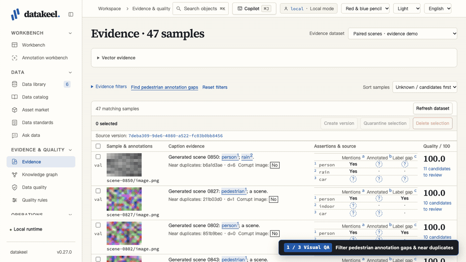
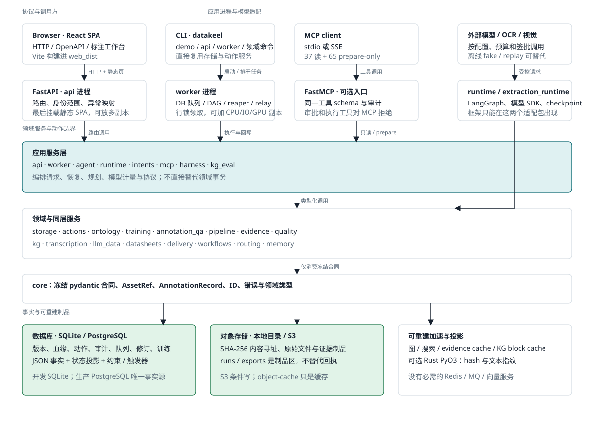

<!-- mcp-name: io.github.chaw1/datakeel -->
<p align="center"></p>
<h1 align="center">Datakeel</h1>
<p align="center"><strong>A local-first workbench for auditable AI datasets, traceable business metrics, and human-approved agents</strong></p>
<p align="center">Proofread multimodal training samples, freeze verifiable SHA-256 releases, trace every metric answer back to registered SQL and lineage, and gate Agent/MCP writes behind human sign-off.</p>

<p align="center">
  <a href="https://pypi.org/project/datakeel/"></a>
  <a href="https://datakeel.jiawis.com/"></a>
  <a href="https://github.com/chaw1/datakeel/releases"></a>
  <a href="https://github.com/chaw1/datakeel/actions/workflows/ci.yml"></a>
  <a href="pyproject.toml"></a>
  <a href="LICENSE"></a>
</p>

<p align="center">
  <a href="README.zh.md">简体中文</a> ·
  <a href="https://datakeel.jiawis.com/">Website</a> ·
  <a href="#quick-start">Quick start</a> ·
  <a href="docs/DATASET_DELIVERY.md">5-min leakage &amp; delivery guide</a> ·
  <a href="docs/DEMO.en.md">Guided tour</a> ·
  <a href="docs/README.md">Documentation</a> ·
  <a href="CHANGELOG.md">Changelog</a>
</p>



*18-second live demo walkthrough: visual QA & evidence anchors, traceable metric SQL, and digest-bound human approval. Want a 5-minute hands-on test? Try [Detect train/test duplicate images & verify delivery offline](docs/DATASET_DELIVERY.md) with the downloadable 3-image sample.*

## Quick start

Install [uv](https://docs.astral.sh/uv/getting-started/installation/) and launch the offline demo in one command (or run `uv sync --locked && uv run datakeel demo` from a source checkout). The demo starts the API and worker, serves the bundled web UI, and seeds generated samples in local SQLite. Model calls use the bundled offline provider.

```bash
uvx datakeel demo
# Web UI:   http://127.0.0.1:8765
# API docs: http://127.0.0.1:8765/api/docs
# Ctrl+C stops both processes.
```

Start with **Evidence** to inspect an image alongside its caption and annotations. In **Ask data**, try “What was retail revenue in East China last quarter?” with the demo reference date `2026-10-01`. The guided tour uses the same generated samples. [Guided tour](docs/DEMO.en.md)

<details>
<summary>Run the demo and queries from the command line</summary>

```bash
uv run datakeel demo --once
uv run datakeel ask '上个季度华东区零售额是多少' --reference-instant 2026-10-01T00:00:00Z
uv run datakeel ask '退货率为什么上升' --reference-instant 2026-10-01T00:00:00Z
uv run datakeel ask '上个季度营业额是多少' --reference-instant 2026-10-01T00:00:00Z
uv run datakeel export --format openlineage --output events.json
uv run datakeel export --format croissant --output croissant.json
```

The demo includes four generated collections for file processing, paired image evidence, enterprise metrics, and knowledge graphs. The evidence collection has 1,000 sample images with known annotation conflicts, missing sidecars, and corrupted files.

</details>

## What you can do

| Workflow | What you can verify | Guide |
| --- | --- | --- |
| Detect train/test image leakage & verify delivery | Download the 3-image sample, catch exact/dHash duplicates across splits, save a 2-image corrected version, and verify offline with `datakeel reconcile`. | [5-min leakage & delivery guide](docs/DATASET_DELIVERY.md) |
| Review samples | Follow a candidate issue to a caption, annotation, image, or source event. Evidence distinguishes present, absent, and unknown. | [Evidence review](docs/DEMO.en.md#2-review-a-sample-and-create-a-version-2-minutes) |
| Prepare training data | Compare immutable versions, inspect split leakage, and export training sets in COCO, YOLO, Hugging Face, or JSONL formats as applicable. | [Training sets](docs/TRAINING.md) |
| Deliver a dataset | Sign a frozen release plan, download a reproducible package, and verify its manifest with `datakeel reconcile`. | [Dataset releases](docs/RELEASES.md) |
| Explain a business metric | Inspect its definition version, source fields, parameterized SQL, and time range. Ask for a breakdown or follow the metric to its lineage. | [Ask data](docs/ASK.md) |
| Review an Agent proposal | Inspect the affected objects, outbound scope, and cost. The Web UI and CLI handle approval and execution. | [Controlled actions](docs/ACTIONS.md) · [MCP](#mcp-and-models) |

The bilingual UI includes a keyboard-driven evidence review panel, global search with `⌘K / Ctrl+K`, and a contextual Copilot with `⌘J / Ctrl+J`. [UI design](docs/design/UI-DIRECTION-B.md)

For labeling production, audio and video processing, LLM dataset checks, knowledge graphs, and semantic catalog imports, use the [documentation hub](docs/README.md) or browse the [documentation site](https://datakeel.jiawis.com/docs/).

## Where Datakeel fits

Datakeel complements data warehouses and training frameworks by uniting three workflows that are usually stitched across separate tools:

| Dimension | Datakeel | Typical point-tool stack |
| --- | --- | --- |
| Deployment footprint | Local-first SQLite + loopback Web UI in two commands; scales to PostgreSQL + S3. | Separate clusters for data catalogs or hosted SaaS accounts for QA and labeling. |
| Visual QA & split leakage | Three-state evidence (`present` / `absent` / `unknown`), visual review, and cross-split dHash / SimHash / exact leakage checks. | Split across separate inspection tools (FiftyOne), labeling UIs (Label Studio), and ad-hoc scripts. |
| Reproducible dataset delivery | Digest-signed release plans, immutable SHA-256 manifests, and offline `datakeel reconcile` verification. | File version trackers (DVC) hash blobs without review sign-off or leakage proofs. |
| Traceable metric Q&A | Registered metric definitions, parameterized SQL, lineage links, and explicit clarification/refusal on ambiguity. | Free-form Text-to-SQL assistants generate unreviewed queries with no metric version binding. |
| Agent & MCP write safety | Read and plan-preparation tools over stdio/SSE; destructive or outbound writes pause for human sign-off. | Generic database MCP connectors execute writes directly or lack digest-bound approval sheets. |

<details>
<summary>Frequently asked questions</summary>

- **Do I need cloud API keys or a database server to try Datakeel?** No. `uv run datakeel demo` runs locally on SQLite with an offline deterministic provider and 1,000 generated image, metric, and knowledge-graph samples.
- **How does Datakeel catch train/test split leakage?** It computes exact hashes, 64-bit perceptual dHash, SimHash text fingerprints, and group keys across partitions, shows side-by-side matches for review, and records the checked proof inside the signed release manifest.
- **Can an MCP client delete data or change metrics autonomously?** No. Datakeel's MCP server never exposes approval or execution tools; humans review and sign the frozen plan digest in the Web UI or CLI.
- **Can a small team share one installation?** Yes. Switch to PostgreSQL and S3-compatible object storage behind Caddy or nginx + oauth2-proxy using the [deployment guide](docs/DEPLOYMENT.md).

</details>

## How it fits together



Datakeel runs an API and a fenced worker over SQLite or PostgreSQL and local or S3-compatible storage. File versions have immutable SHA-256 manifests. Lineage rebuilds from append-only events, and external or irreversible actions require a person to approve the exact prepared plan. [Architecture](docs/ARCHITECTURE.md) · [Persistence schema](docs/PERSISTENCE_SCHEMA.md) · [API reference](docs/API_REFERENCE.md)

## MCP and models

The MCP server exposes audited reads and plan preparation. It can run over local stdio or loopback SSE. Use the same `DATAKEEL_HOME` as the Web UI to work on the same datasets. [Controlled actions](docs/ACTIONS.md)

<details>
<summary>MCP client configurations</summary>

For a local stdio client such as Claude Desktop (`claude_desktop_config.json`) or Cursor (`.cursor/mcp.json`), replace the absolute paths:

```json
{
  "mcpServers": {
    "datakeel": {
      "command": "/absolute/path/to/uv",
      "args": [
        "--directory",
        "/absolute/path/to/datakeel",
        "run",
        "datakeel",
        "mcp"
      ],
      "env": {
        "DATAKEEL_HOME": "/absolute/path/to/datakeel/.datakeel"
      }
    }
  }
}
```

For an isolated loopback SSE server, run `uv run datakeel mcp --transport sse --host 127.0.0.1 --port 8766`:

```json
{
  "mcpServers": {
    "datakeel": {
      "url": "http://127.0.0.1:8766/sse"
    }
  }
}
```

</details>

Optional real providers use `DATAKEEL_OPENAI_API_KEY` or `DATAKEEL_ANTHROPIC_API_KEY`, with optional `DATAKEEL_OPENAI_BASE_URL` or `DATAKEEL_ANTHROPIC_BASE_URL`. Keep secrets outside the repository and register provider model prices in [the price catalog](contracts/model-prices.yaml).

Export sanitized OTLP/HTTP spans to a collector, Phoenix, or Langfuse with `uv run datakeel export-traces [--conversation-id <id>]`. [Trace export reference](docs/API_REFERENCE.md#opentelemetry-trace-export)

## Deploy and contribute

GitHub Releases carry the wheel, locked requirements, license notices, and SHA-256 checksums. For a shared installation, use the small-team deployment guide for the authenticated reverse proxy and PostgreSQL options. [Release files](https://github.com/chaw1/datakeel/releases) · [Deployment guide](docs/DEPLOYMENT.md) · [SQLite maintenance](docs/DATABASE_MAINTENANCE.md)

<details>
<summary>Run separate processes or build local artifacts</summary>

```bash
uv run datakeel db upgrade
uv run datakeel api --port 8765
# In a second terminal with the same storage and database environment:
uv run datakeel worker
```

A source build uses Python 3.12, uv, Node.js 22, and Rust 1.96. The build commands produce local artifacts.

```bash
make build-wheel
make build-image
docker run --rm -p 127.0.0.1:8765:8765 -v datakeel-data:/data datakeel:local
```

After building the image, Docker Compose can run the API, worker, migration job, and PostgreSQL on a loopback-only binding.

```bash
docker compose up -d
docker compose run --rm api demo --once
```

</details>

<details>
<summary>Run the repository quality gates</summary>

```bash
uv sync --locked
(cd web && npm ci)
uv run pre-commit install
make check
uv run python scripts/check_readme.py
bash scripts/ci-check.sh
```

CI runs gates, tests, and mutation checks on SQLite and PostgreSQL. For test inputs and guardrails, see [Verification](docs/VERIFICATION.md) and [Code standards](docs/CODE_STANDARDS.md).

</details>

[Contributing](CONTRIBUTING.md) · [Support](SUPPORT.md) · [Private security reports](SECURITY.md) · [Code of conduct](CODE_OF_CONDUCT.md) · [Citation](CITATION.cff)

Datakeel is licensed under [Apache-2.0](LICENSE). Dependency and bundled font terms are recorded in [Third-party notices](THIRD_PARTY_NOTICES.md) and [Frontend notices](web/public/THIRD-PARTY-LICENSES.txt).
