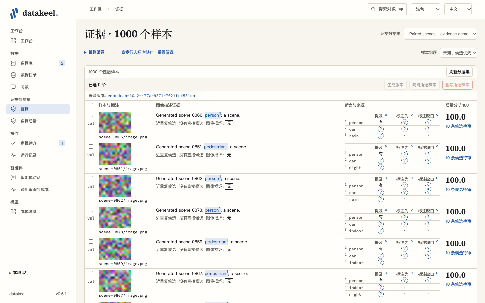
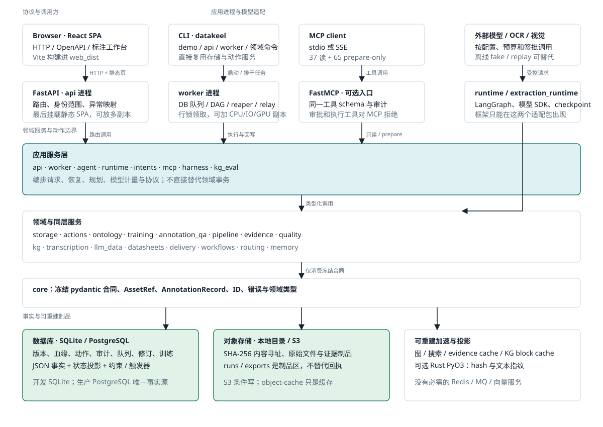

# Datakeel

**可审计的本地优先数据与 AI 数据集工作台 —— 统一多模态样本证据校样、企业指标可追溯问数与受控 Agent/MCP 动作。**

[](https://github.com/chaw1/datakeel/actions/workflows/ci.yml)
[](https://github.com/chaw1/datakeel/releases)
[](pyproject.toml)
[](LICENSE)

[English](README.md) · 简体中文 · [十分钟导览](docs/DEMO.md) · [文档中心](docs/README.zh.md) · [接口参考](docs/API_REFERENCE.zh.md) · [架构决策](docs/ARCHITECTURE.md) · [部署指南](docs/DEPLOYMENT.zh.md) · [更新日志](CHANGELOG.md)

---

## 校样工作台



Datakeel 将数据工程与 AI 数据集研发流程组织在六个导航分组中：**工作台、数据、证据与质量、操作、智能体、模型**。八类对象共用统一档案视图（事实、关系、证据与历史），界面上每一处事实数字都可直接追溯到来源：

- **三态证据与交互锚点**：严格区分「有（`present`）」「无（`absent`）」与「未知（`unknown`）」（圆点表示尚无断言）；支持 `j`/`k`、`a`/`r` 与 `Esc` 快捷键联动高亮文本下划线、概念行与图像标注框，同时将机器证据与人工审核决定分开记录。
- **来源脚注与签批单**：问数结果绑定指标定义版本、负责人、带参数 SQL、来源字段与时间区间；不可逆或外发变更必须在显式签批单确认冻结参数、影响面与摘要后才能执行。
- **全局速查与校样副驾**：按 `⌘K / Ctrl+K` 搜索数据集、文件、版本、动作、表、字段、指标和术语（完整 UUID 截取前八位展示，业务 ID 完整保留），或按 `⌘J / Ctrl+J` 唤起右侧上下文副驾并查看/续规划动作链。
- **开箱离线界面**：内置中英双语与三套对比度验证色板（双铅笔 `pencil`、赭石 `ochre`、石墨 `graphite`），本地打包 OFL 字体及许可声明（[第三方许可](web/public/THIRD-PARTY-LICENSES.txt)），演示模式不访问任何外部域名。

---

## 核心设计保证

- **不可变版本与可追溯数值**：文件版本冻结 SHA-256 清单；企业问数仅从已登记指标 YAML 编译只读参数化 `SELECT` 查询，采用半开时间区间，遇未登记概念或歧义口径返回 `unanswerable` / `clarification` 而绝不编造数字；七章数据集说明书要求逐句引用冻结事实。
- **诚实表达未知证据**：缺失标注或附属文件保持 `unknown` 而非误判为不存在；图片质量、点云清洗、近重复哈希与知识图谱抽取均保留完整溯源记录。
- **冻结计划与人工签批兜底**：所有状态变更先生成带摘要、有效期、影响范围与可逆性标识的计划；内置 LangGraph 智能体与 FastMCP 服务端只能准备计划，无法自行审批或执行不可逆操作。
- **本地优先并支持小团队扩展**：默认使用 SQLite + 本地目录，Python 包内嵌编译好的 React 界面；需要时可切换 PostgreSQL + S3、接入认证反向代理（[部署指南](docs/DEPLOYMENT.zh.md)），并启用可选 Rust 加速扩展（`datakeel-accel`）。

---

## 快速上手

安装 [uv](https://docs.astral.sh/uv/getting-started/installation/) 后，在仓库根目录执行两条命令即可启动离线演示（`.python-version` 自动选择 Python 3.12，无需 Node、Docker、外部数据库或模型密钥）：

```bash
uv sync --locked
uv run datakeel demo
# Web 界面：http://127.0.0.1:8765
# API 文档：http://127.0.0.1:8765/api/docs
# 按 Ctrl+C 同时停止 API 与 worker 进程
```

`demo` 会启动本机 `api` 与 `worker` 进程，并导入确定性本地样例：
- **Field notes · generated demo**：200 张 PNG 与 200 份文本，经过 11 个算子生成 2 个不可变版本；
- **Paired scenes · evidence demo**：1,000 个图像/caption/标注配对样本（含 50 处标注冲突、30 个缺失 sidecar 与 10 个损坏图像），运行 5 个确定性证据算子；
- **Fictional Kitchen Co.**：ERP/CRM/电商/售后 4 个 SQLite 数据源（24 张表、128 个字段、13 个指标、12 个维度、32 条术语、51,992 行数据与 6 个分级数据资产）；
- **Business notes · knowledge graph demo**：24 篇录制短文、3 篇长文及录制图片转录样例。

推荐跟随 **[十分钟导览](docs/DEMO.md)** 体验完整流程，也可直接通过 CLI 运行问数与标准导出：

```bash
uv run datakeel demo --once
uv run datakeel ask '上个季度华东区零售额是多少' --reference-instant 2026-10-01T00:00:00Z
uv run datakeel ask '退货率为什么上升' --reference-instant 2026-10-01T00:00:00Z
uv run datakeel ask '上个季度营业额是多少' --reference-instant 2026-10-01T00:00:00Z
uv run datakeel export --format openlineage --output events.json
uv run datakeel export --format croissant --output croissant.json
```

> 中英文问句共用同一套确定性时间解析、指标/别名规范化、维度分组与拒答护栏。详见[问数图表与多轮追问](docs/ASK.zh.md)与[HTTP API 与流水线参考](docs/API_REFERENCE.zh.md)。

---

## 核心能力矩阵

| 领域 | 核心能力 | 专题文档 |
| --- | --- | --- |
| **多模态证据、媒体与知识图谱** | 五算子证据 DAG（图像感知哈希、caption 提及、标注、标签缺口、64 位 dHash 近重复及可选 Rust 扩展）、图像质量五项体检与 PLY/PCD 点云清洗、本机 `ffmpeg` 音视频预处理、文本与图片知识图谱、容器沙箱自定义算子 | [图片与点云质量](docs/MEDIA_QUALITY.md) · [音视频预处理](docs/MEDIA.md) · [知识图谱](docs/KG.md) · [自定义算子](docs/CUSTOM_OPERATORS.md) · [Rust 加速](docs/RUST_ACCEL.md) · [离线向量内核](docs/VECTOR_FAKE.md) |
| **标注生产、训练集与交付** | 标签集发布与只追加修订、EXIF 自动摆正工作台、团队档驾驶舱（租约、技能派单、AI 预标注与预审）、离线标注一致性评估、带种子分层切分与泄漏检查（COCO/YOLO/HF/JSONL 导出）、大模型 SFT/偏好对试运行清洗、逐句有据说明书、可复现交付包与 `reconcile` 对账 | [生产流程](docs/PRODUCTION.zh.md) · [标注工作台](docs/ANNOTATION_WORKBENCH.zh.md) · [标注质量](docs/ANNOTATION_QA.md) · [训练集切分](docs/TRAINING.zh.md) · [大模型训练数据](docs/LLM_DATA.zh.md) · [说明书](docs/DATASHEETS.md) · [发布与交付](docs/RELEASES.zh.md) |
| **企业目录、问数与数据治理** | SQLite 反射与 `sqlglot` 字段血缘、dbt / Airflow REST v1 / OpenLineage 导入、版本化指标 YAML（`update_metric` / `rollback_metric`）、可追溯问数与选图、可移植字段标准与码表、表质量规则监控与告警、数据资产分级与授权申请、表格时序剖析 | [问数说明](docs/ASK.zh.md) · [元数据导入](docs/METADATA_IMPORTS.md) · [数据标准](docs/STANDARDS.md) · [质量规则](docs/QUALITY_RULES.md) · [数据资产](docs/DATA_ASSETS.md) · [时序剖析](docs/TIMESERIES.md) |
| **受控动作、智能体与工作流** | 冻结摘要签批单、基于 LangGraph 持久断点的离线 `fake-demo` 智能体、只读子 Agent 委派、canary 与提示注入拦截、脱敏跨会话记忆、Token/USD 预算、确定性 YAML 工作流、一句话多步动作链规划（试用，`⌘J`）、服务端角色与权限矩阵 | [受控动作](docs/ACTIONS.md) · [工作流](docs/WORKFLOWS.md) · [智能体与记忆](docs/AGENT.md) · [一句话做事](docs/ONE_SENTENCE.zh.md) · [身份与权限](docs/IDENTITY_ACCESS.zh.md) |

---

## MCP 接入与可选模型配置

`uv run datakeel mcp` 提供 **102 个 FastMCP 工具**（37 个只读查询 + 65 个仅生成冻结计划的动作）。MCP 服务端不暴露签批与执行工具，`approve_plan` 或 `execute_plan` 调用一律拒绝并记入审计，最终需由人工在 Web 界面或 CLI 签批执行。

在 **Claude Desktop**（`claude_desktop_config.json`）或 **Cursor**（`.cursor/mcp.json`）中配置本机路径，`DATAKEEL_HOME` 与演示保持一致即可共享数据：

```json
{
  "mcpServers": {
    "datakeel": {
      "command": "/absolute/path/to/uv",
      "args": [
        "--directory",
        "/absolute/path/to/datakeel",
        "run",
        "datakeel",
        "mcp"
      ],
      "env": {
        "DATAKEEL_HOME": "/absolute/path/to/datakeel/.datakeel"
      }
    }
  }
}
```

也可以通过 `uv run datakeel mcp --transport sse --host 127.0.0.1 --port 8766` 启动独立的本机回环 SSE 服务：

```json
{
  "mcpServers": {
    "datakeel": {
      "url": "http://127.0.0.1:8766/sse"
    }
  }
}
```

- **可选真实模型配置**：通过仓库外环境变量设置 `DATAKEEL_OPENAI_API_KEY` 或 `DATAKEEL_ANTHROPIC_API_KEY`（及可选 `DATAKEEL_OPENAI_BASE_URL` / `DATAKEEL_ANTHROPIC_BASE_URL`）；所用模型须在 [`contracts/model-prices.yaml`](contracts/model-prices.yaml) 登记价目。未设置密钥时默认使用离线 `fake-demo`。
- **OpenTelemetry 追踪导出**：使用 `uv run datakeel export-traces [--conversation-id <id>]` 将脱敏后的 OTLP/HTTP protobuf span（不含提示词、补全、工具载荷与凭证）导出至本地 OTLP Collector、Phoenix 或 Langfuse，详见[接口参考](docs/API_REFERENCE.zh.md#opentelemetry-模型-trace-导出)。

---

## 系统架构



Datakeel 采用模块化单体设计，由无状态 `api` 与行锁抢单 `worker` 两个进程组成，共享 SQLite 或 PostgreSQL 事实库与本地/S3 对象存储。版本是含 SHA-256 校验的不可变文件清单，血缘图由追加式事件投影重建；PostgreSQL 使用 `FOR UPDATE SKIP LOCKED` 领取任务分片（SQLite 使用 `BEGIN IMMEDIATE`），配合心跳、租约校验与事务 outbox 保证幂等终态。

```text
datakeel/       核心领域模型、语义解析、算子、证据、知识图谱、数据目录、指标、问数、流水线、
                质量、血缘、治理、存储、worker、api、本体、受控动作、agent、LangGraph 运行时、
                评估 harness、FastMCP 服务与 CLI
accel/          可选 Rust PyO3/maturin 扩展包（datakeel-accel）
web/            React + TypeScript + Vite 前端源码（构建产物随包提交至 datakeel/web_dist）
contracts/      文件语义、算子清单、证据词表、企业指标语义层、工作流与 golden 测试语料
sandbox/        用于运行已签批自定义算子的容器沙箱镜像定义
docs/           架构决策、使用指南、API/评测参考及容量基准报告
tests/          与源码结构镜像对应的单测、集成、契约与仓库回归测试
```

详见[架构决策](docs/ARCHITECTURE.md)、[持久化 Schema 组合](docs/PERSISTENCE_SCHEMA.md)与[HTTP API 与流水线参考](docs/API_REFERENCE.zh.md)。

---

## 部署与本地构建

### 分进程独立运行

```bash
uv run datakeel db upgrade          # 显式升级数据库（db status 只读检查）
uv run datakeel api --port 8765
# 在第二个终端使用相同的 DATAKEEL_HOME / DATAKEEL_DATABASE_URL / DATAKEEL_S3_* 配置：
uv run datakeel worker
```

### 构建本地 Wheel 与 Docker 镜像

在源码根目录执行（构建需 Python 3.12、`uv`、Node.js 22 与 Rust 1.96；运行生成的 wheel 或镜像不需要 Node）：

```bash
make build-wheel                    # 在 dist/ 生成纯 Python wheel 与带哈希的 requirements.txt
make build-image                    # 构建非 root 本机镜像 datakeel:local
docker run --rm -p 127.0.0.1:8765:8765 -v datakeel-data:/data datakeel:local
```

以上命令均为纯本机构建，不会向 PyPI 或 Docker Hub 推送或发布任何制品。

### 使用 Docker Compose 一键拉起本地 PostgreSQL 栈

执行 `make build-image` 后，可通过仓库根目录的 [`compose.yaml`](compose.yaml) 在回环地址（`127.0.0.1:8765`）同时启动 `postgres:17-alpine`、`migrate`、`api` 与 `worker`：

```bash
docker compose up -d
# 如需向 Compose 的 Postgres 与 /data 卷注入样例数据：
docker compose run --rm api demo --once
```

若需面向小团队通过 Caddy 或 nginx + `oauth2-proxy` 暴露访问，请按[小团队部署指南](docs/DEPLOYMENT.zh.md)配置认证反向代理与[数据库维护说明](docs/DATABASE_MAINTENANCE.md)。

---

## 开发与全仓门禁

```bash
uv sync --locked
(cd web && npm ci)
uv run pre-commit install
make check                          # 公开内容扫描、Rust、Ruff ALL、严格 Pyright、import-linter、
                                    # 规模/Schema 门禁、pytest（总覆盖 >=85% / 核心模块 >=90%）、前端与许可审计
uv run python scripts/check_readme.py
bash scripts/ci-check.sh            # 本地完整 CI 等价入口：含 make check、README 实测与 856 处变异测试
```

GitHub CI 在 SQLite 与 PostgreSQL 两个数据库栈上并行运行完整门禁、4 个 pytest 分片与 2 个变异分片。详见[贡献指南](CONTRIBUTING.md)、[代码规范](docs/CODE_STANDARDS.md)、[离线评测与完整门禁](docs/VERIFICATION.zh.md)及[测试执行提速](docs/TEST_SPEED.md)。

---

## 社区协作、安全与许可

- **使用提问与支持**：见 [SUPPORT.md](SUPPORT.md) 与 [文档中心](docs/README.zh.md)。
- **漏洞私密报告**：请按 [SECURITY.md](SECURITY.md) 通过 GitHub 私密漏洞通道提交，切勿公开披露。
- **行为准则**：参与贡献请遵守 [CODE_OF_CONDUCT.md](CODE_OF_CONDUCT.md)。
- **学术或技术引用**：引用元数据见 [CITATION.cff](CITATION.cff)。
- **开源许可**：采用 [Apache-2.0](LICENSE) 协议。完整运行时依赖清单、上游许可证明与已批准例外（`certifi`、`orjson`、`regex` 及本地打包的 OFL-1.1 字体）见 [THIRD_PARTY_NOTICES.md](THIRD_PARTY_NOTICES.md) 与 [`web/public/THIRD-PARTY-LICENSES.txt`](web/public/THIRD-PARTY-LICENSES.txt)；未引入 ELv2、BSL、AGPL 或 SSPL 运行时依赖。
