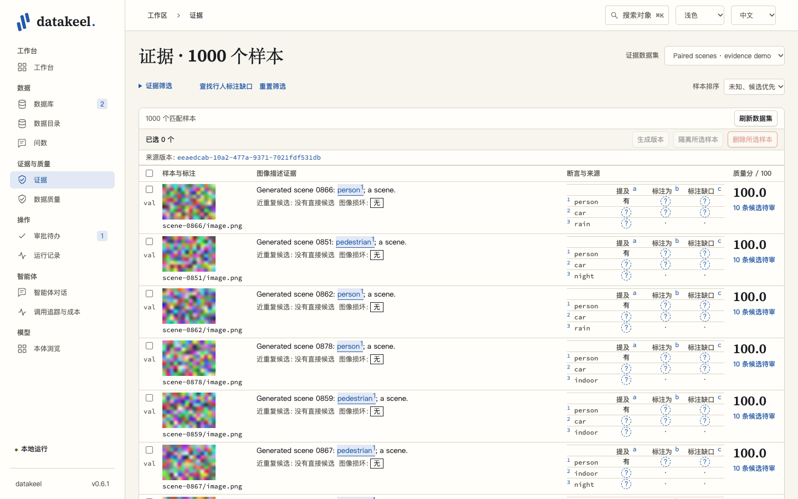
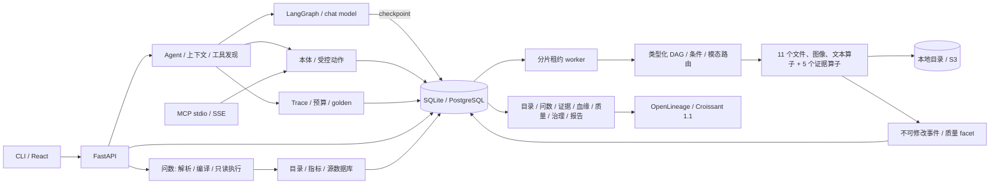

# Datakeel

管理文件版本、检查证据，并基于登记指标回答业务问题；结果可追溯，变更走受控动作。

[十分钟导览](docs/DEMO.md) · [Ten-minute tour](docs/DEMO.en.md)

```bash
uv sync
uv run datakeel demo
# 页面：http://127.0.0.1:8765
# API：http://127.0.0.1:8765/api/docs
# Ctrl+C 停止 API 和 worker
uv run datakeel export --format openlineage --output events.json
uv run datakeel export --format croissant --output croissant.json
uv run pytest
uv run ruff check .
uv run pyright
```

[English](README.md) · [架构](docs/ARCHITECTURE.md) · [代码规范](docs/CODE_STANDARDS.md) · [受控动作](docs/ACTIONS.md) · [更新日志](CHANGELOG.md)

## 校样工作台



界面按工作台、数据、证据与质量、操作、智能体、模型分成六组。工作台集中展示待签批、运行中流水线、最近动作及数据集质量告警。八类对象共用档案模板，包含事实、关系、证据与历史；事实数字可直接追到来源。同名动作合并成可展开的 ×N 档案卡，局部图最多显示 25 个节点。

英文界面的对象标题、面包屑、搜索结果、签批单和关系卡片使用一致的目录英文名；没有英文译名时保留原名。

- **三态标记**区分有、无、未知；圆点表示尚无断言。审核状态与证据值分别显示。
- **证据锚点**把 caption 下划线与上标、同编号概念行和图像框连在一起，悬停会同步描边。1440×900 下首屏可看完整六个样本；详情抽屉支持 j/k 切换断言、a/r 采纳或驳回、Esc 关闭，输入法组字期间不触发业务快捷键。
- **来源脚注**合并重复的抽取器与版本出处；问数结果指向指标、SQL、来源字段及时间区间。澄清候选携带所选指标重新回答原问题，不可答时说明缺失的信息。
- **签批单**列出冻结对象、影响面、外发、可逆性、摘要、有效期和签批人。不可逆操作用红框提示并要求明确签批；参数变化后原单作废，执行结果可追到回执。

按 **⌘K / Ctrl+K** 搜索数据集、文件、版本、动作、表、字段、指标和术语；粘贴唯一 UUID 或前八位可直达对象档案。“就此对象发起对话”只预填草稿，不会直接执行。顶栏可切换中英文与浅色、深色、跟随系统。拉丁字体 Source Serif 4（600/700）和 Source Code Pro（400/500）本地打包，[OFL 许可声明](web/public/THIRD-PARTY-LICENSES.txt)随包发布；正文使用系统黑体栈，中文衬线标题回落系统宋体。demo 页面不访问外部域名。

对独立的本机 demo 重现截图矩阵：

```bash
cd web
npm ci
npm run screenshots -- http://127.0.0.1:8765
# 13 页 × 中英文 × 浅深色 → 仓库根目录 artifacts/screenshots/
cd ..
```

脚本固定浏览器时钟，逐页记录 console 错误。UI 冒烟还会执行受控变更，每轮使用新的 demo 数据目录启动，再在第二个终端从仓库根目录执行：

```bash
DATAKEEL_HOME="$(mktemp -d)" uv run datakeel demo --port 8773
# 第二个终端：
npm --prefix web run smoke:ui -- http://127.0.0.1:8773
# 截图和报告 → 仓库根目录 artifacts/ui-smoke/
```

两个脚本均可在 demo URL 后指定输出目录。完整开发门禁见[代码规范](docs/CODE_STANDARDS.md)，审批与执行规则见[受控动作说明](docs/ACTIONS.md)。

## Quick start

安装 [uv](https://docs.astral.sh/uv/getting-started/installation/)，在仓库根目录执行前两行。`.python-version` 选择 Python 3.12，uv 可自动安装。默认演示无需 Node、Docker、外部服务或模型配置，Python 包已包含编译后的 React 页面。

演示启动 API 和 worker，创建三个文件数据集，并导入下方的企业目录。**Field notes · generated demo** 保留原来的 200 张 PNG、200 段文本和 11 个算子；两段特意生成的空文本被过滤，第二个版本留下 398 份产物，原始 400 份文件仍可下载。新增的 **Paired scenes · evidence demo** 包含 1,000 个图像/caption/标注配对样本，train 800、val 200，注入 50 处标注冲突、30 个缺失标注 sidecar 和 10 个损坏图像，由同一 worker 和 DAG 执行 5 个确定性证据算子。命令打印地址、耗时和抽取计数。再次运行复用导入数据，并增量读取证据缓存；换一个 `DATAKEEL_HOME` 可独立重跑，`demo --legacy-only` 只运行原场景。

页面可切换文件版本、下载产物、点血缘节点查看事件、查看五维质量及六章报告。报告默认采用规则基线；设置 `DATAKEEL_LLM_URL` 后向指定 chat-completions 地址请求正文，2 秒超时或请求失败时回退基线，生成正文后附基线核验。

## 企业目录与可追溯问数

同一个 demo 还生成虚构厨电公司 **Fictional Kitchen Co.**，包含 ERP、CRM、电商、售后四个 SQLite 数据源：20 张表和 4 个视图在目录里对应 **24 个表对象、128 个字段、13 个指标、12 个维度、32 条术语**。生成器写入 51,992 行，并独立计算 `gold.json`；重跑得到相同的 SQLite `.dump` 文本与 gold 字节。SQLite 反射产生包含关系和外键引用；字段派生关系仅来自视图或用户 SQL 的解析，使用 `sqlglot` 30.24.0（MIT）。本版其他文件导入器只保留接口。

打开 **数据目录**，按数据源 → 表 → 字段浏览，查看表负责人、相邻关系及使用该表的指标。指标目录和术语表支持搜索、分页；指标卡展示口径、负责人、版本、caveats 和引用无法解析的原因。**下游影响** 显示有界的字段、表、指标、维度、术语树。**查看血缘** 打开对象档案的关系 tab，指定 `include_catalog=true`、两跳、最多 25 个可见节点；目录关系使用独立边类型，各类对象按列布局。

打开 **问数**，选择 `上个季度华东区零售额是多少`。demo 固定参考时刻为 **2026-10-01T00:00:00Z**，返回 `[2026-07-01, 2026-10-01)` 的 **4,979,475 元**。答案附 `retail_revenue` 指标卡、当时的版本与负责人、口径说明、带参数 SQL、来源表字段、术语匹配高亮及血缘链接。展开 SQL 可查看绑定参数；**回放已保存答案** 读取原结果和原指标版本，不重新执行查询。不启动页面也可直接执行：

```bash
uv run datakeel demo --once
uv run datakeel ask '上个季度华东区零售额是多少' --reference-instant 2026-10-01T00:00:00Z
uv run datakeel ask '退货率为什么上升' --reference-instant 2026-10-01T00:00:00Z
uv run datakeel ask '上个季度营业额是多少' --reference-instant 2026-10-01T00:00:00Z
uv run datakeel eval-ask --json
uv run datakeel rebuild-catalog
```

各命令使用相同的 `DATAKEEL_HOME` 和数据库配置。普通 CLI 问数省略 `--reference-instant` 时使用当前时刻；demo 和评测使用固定时刻。时间范围采用半开区间，此基准下“近 30 天”为 `[2026-09-01, 2026-10-01)`。退货率等未登记概念返回 `unanswerable` 和三个相近指标；“营业额”命中冲突口径，返回 `clarification` 和候选。两种状态均不含数值答案或可执行 SQL。匹配流程是确定性的；候选 ID 重排接口与 fake provider 只用于单元测试，不进入 demo、golden 或 `eval-ask`，CLI 没有 `ask --provider` 选项。SQL 只能由编译器从登记指标生成，执行层只接受 SELECT，并强制只读连接、语句超时和行数上限。

### 指标 YAML 与受控变更

[语义层](contracts/semantic-layer/metrics.yaml) 刻意区分三个口径：出货额使用 ERP 出货价、归供应链负责人；销售额使用 CRM 已入账开票金额、归财务负责人；零售额使用已完成订单实付金额、归零售运营负责人。以下简化示例遵循实际 schema；demo 仅在指标目录为空时初始化完整的指标、维度和术语文件：

```yaml
metrics:
  - id: retail_revenue
    name: 零售额
    synonyms: [终端零售额, 实付零售额, 营业额]
    description: 已完成电商订单的实付金额，未冲抵后续退款。
    owner: 零售运营负责人
    version: 1
    measure:
      table: ecommerce/main/orders
      column: ecommerce/main/orders/paid_amount
      aggregation: sum
    filters:
      - column: ecommerce/main/orders/status
        op: eq
        value: completed
    time:
      column: ecommerce/main/orders/date
      granularity: day
    dimensions: [retail_region, retail_channel, retail_category]
    caveats: [合成数据，金额为人民币元；出货额、销售额和零售额不可互换。]
```

`time` 必填。聚合函数允许 `sum/count/count_distinct/avg/min/max`；过滤字段名为 `op`，仅允许 `eq/ne/in/gte/lte`，只有 `in` 使用数组值。维度绑定登记 `column`，可附静态 `values`；术语通过 `means: {kind: metric|dimension|column, id: ...}` 指向对象。没有 `grain` 或 `values_source`。资产 ID 为 `source/schema/table[/column]`，SQLite 的 schema 为 `main`，名称中的分隔符及空白按段 percent-encode。引用缺失时，指标显示 `unresolved` 与原因，并拒绝执行查询。

目录版本是唯一权威，YAML `version` 仅作导入时的期望当前版本校验，不能覆盖历史；重跑 demo 保留已有指标修改。进入 **数据目录 → 指标 → 修改定义**，修改金额字段、过滤条件或业务描述，点 **审阅修改** 准备 `update_metric`，核对计划后再执行动作。成功回执对应一个新版本。将 `retail_revenue` 从 `paid_amount` 改为 `list_amount`，同一示例问题变为 **5,255,975 元**。其声明的 `inverse_of` 动作 `rollback_metric` 可把旧定义恢复为又一个新版本：通过 `POST /api/actions/rollback_metric/prepare` 传入 `metric_id` 和历史 `version`，再用既有动作执行接口执行返回的计划。**查看历史版本（JSON）** 链接到 [`GET /api/catalog/metrics/retail_revenue/history`](http://127.0.0.1:8765/api/catalog/metrics/retail_revenue/history)，记录含 `plan_id`、actor、前后版本。术语变更同样使用 `update_term` / `rollback_term`。

源导入使用 `import_catalog` / `restore_catalog`。显式重新 prepare+execute 未变化的源时，回执显示 `unchanged`，不增加目录事件，统计包含 `parse_failures`。`rebuild-catalog` 从事件重建对象与关系边，校验含投影器版本的规范化哈希；可用 `--expected-hash` 传入此前保存的哈希。question 资产及注册谓词 `ask.answers_with`、`ask.matched_term`、`ask.unanswerable` 复用证据来源、审核和 `rebuild-evidence`；目录及 question 对象不进入文件选择 manifest。

## 检查证据与选择样本

打开 **证据**，选择 **Paired scenes · evidence demo**，应用示例筛选：val 中 caption 提到 `person`、没有 `annotated_as/person=present` 断言、同时存在 train 直接近重复候选的样本。未修改的生成数据返回 **47 条**，其中一条标注状态为未知。缺少标注文件不能证明图中没有行人。

每行展示版本固定的缩略图、caption 高亮、标注框、紧凑断言矩阵、候选待审数、质量分（沿用文件级五维总分，0–100）和直接近重复候选。共用的来源版本只在表头显示一次，抽取器及版本出处汇总到脚注。可按概念、场景三态、标注缺口、split、质量和 train/val 候选过滤。勾选当前页条目后可 **生成版本 / 隔离所选样本 / 删除所选样本**：前两项走可逆动作并自动执行，删除停在签批单。计划冻结选中文件的 ID 与来源版本，后续断言审核不会悄悄重新选择对象；文件状态发生变化仍会使旧计划失效。

详情抽屉可接受、拒绝断言或恢复为 `candidate`。`decide_assertions` 只改审核状态并追加审计，不改证据内容和来源。查询默认使用 candidate/accepted 断言；详情保留 rejected 断言供再次审核。**查看证据子图** 跳转文件档案的关系 tab，图例与边样式区分 `lineage`、`semantic` 与目录关系。

来源版本已有配对样本元数据但尚未抽取时，点击 **准备运行证据抽取** 会生成绑定所示来源版本的 `run_pipeline` 计划。先查看冻结输入，再明确点击 **执行动作**；页面展示任务与动作回执，轮询进度，并在成功后刷新证据。普通文件数据集会在 **在本地生成或导入配对样本** 中说明配对要求：每个场景放在 `train/` 或 `val/` 下，图像与可选的 `caption.txt`、`annotations.json` 同目录。按页面给出的本地生成、导入命令执行，使用与服务相同的 `DATAKEEL_HOME` 和 `DATAKEEL_DATABASE_URL`；已有样本可跳过生成并修改导入目录。配对导入器保留引用关系，但不会自动抽取。刷新数据库后，在证据页选择新数据集，再准备抽取计划；缺少附属文件仍表示未知证据。

五个算子为 `evidence.image_phash`、`evidence.caption_mentions`、`evidence.annotation_labels`、`evidence.label_gap`、`evidence.near_duplicate`。[词表](contracts/evidence/lexicon.yaml) 把 `pedestrian`、`行人` 及标注类别别名折叠为 canonical `person`；`night` 等场景概念同样使用 `mentions` 谓词。caption 派生状态只取 `present` 或 `unknown`，缺 sidecar 保持未知。只有 caption 提到某概念且已提供的标注文件漏标时，`label_gap` 才是 `present`；本版只有直接测量的 `corrupt` 可取 `absent`。文本锚点是 NFC 归一化后 Unicode 码点的半开区间 `[start, end)`，图像锚点是原图像素 `xyxy`，附原始宽高。

[近重复合同](contracts/evidence/near_duplicate.yaml) 固定 64 位 dHash、前 4 位分桶、汉明距离 ≤8。每个直接样本对只存一次、双向查询，不做传递扩展或自动合并。前缀分桶可能漏检，下方评测如实报告。模型抽取器接口和 fake 适配器仅做单元测试，不进入抽取 DAG、证据评测或模型预算。

## 抽取与复核文本知识图谱

演示增加 **Business notes · knowledge graph demo**：24 篇录制短文、3 篇明确标注的脚本长文，以及 1 个故意截断的样例。打开「知识图谱」，查找 `Vivo`，查看待复核关系：证据句存在，但尾实体不在原文。通过既有复核动作拒绝它，再确认图中该边变为已拒绝。原文核对和人工判断保持独立。

实体保留全部提及位置；关系跨块、跨文档合并重复证据，保留抽取器和模型来源。Schema 提案只读，不自动改变合同。抽取记录展示成功、缓存、失败及未执行块。默认 replay 与 fake 脚本离线运行；外部配置须先签批冻结的目标、模型、输入和预算，worker 才能执行。Agent 与 MCP 共用 `query_kg`、`explain_relation` 和受控动作 `run_kg_extraction`；Agent 按需发现这些工具。

```bash
uv run datakeel eval-kg --json
uv run datakeel eval-kg --profile replay-flash --json
```

报告分别给出原始录制和实际产品候选的评分、仅核对通过子集与关系过滤原因；重放不会产生模型 token 或费用。[Schema、配置、外部题集、可选本机抽取与外发威胁模型](docs/KG.md)说明如何使用自行授权的文本和模型接口。

## 确定性工作流与路由

打开「工作流」，选择「新数据集体检」「指标口径变更」或「低质样本清理」，核对按 schema 生成的输入表单并显式开始。运行记录保留各步骤状态、输出与失败原因。清理流程先自动隔离，删除前暂停等签批；签批后须返回运行页点「签批后继续」。可按[导览中的独立三文件数据集](docs/DEMO.md#8-跑一次低质样本清理并签批约-1-分钟)演练，不改动原来的 400 文件 demo。

Agent 对话会给出匹配的工作流建议，显示模型档位及备用尝试。点击建议只打开预填表单，不自动运行。会话指定模型优先；只有 `model: auto` 按档位选择。默认 fake provider 继续离线运行。

```bash
uv run datakeel workflow list
uv run datakeel workflow validate contracts/workflows/low-quality-cleanup.yaml
uv run datakeel routing validate
uv run datakeel eval-route
```

[YAML、CLI、HTTP/SSE、恢复与路由参考](docs/WORKFLOWS.md)说明合同及失败行为。单独启动 `datakeel api` 时，还须运行 `datakeel worker` 推进排队流水线。失败或断流不从中途重试，只有签批暂停可以恢复。

## 离线聊天演示

打开 **Agent 对话**，选择 **Field notes · generated demo**，并创建会话；UI 新会话默认使用 `fake` provider 和 `fake-demo` 模型。这是确定性的本机演示实现，不是真实语言模型。在同一个会话依次输入：

1. `查找质量低于 60 分的文本文件`。
2. `把这些文件隔离并生成新版本`：可逆动作自动执行，返回执行回执。
3. `删除这些文件`：停在签批单。查看对象数、字节数、有效期和冻结参数后，选择 **签批并删除文件** 或 **退回**；签批仅执行一次，退回不修改文件。

也可直接输入 `把质量低于 60 分的文本样本隔离并生成新版本`。搜索针对原始源文件资产，因此能选到两份空文本；派生产物有独立版本。回执可跳转血缘节点，质量页支持隔离状态筛选；审批待办、运行记录（在“运行类型”中选择“动作”）、本体浏览、Trace 与成本页展示同一套持久化事实。

证据聊天另选 **Paired scenes · evidence demo** 创建会话，输入 `找出 val 里 caption 提到行人但没有 person 标注的样本，附训练集近重复`，再尝试 `解释证据`、`把这些样本生成新版本` 或 `删除这些样本`。离线 provider 调用真实 `query_evidence` 和 `explain_sample`，每次最多展示 **两条样本**，动作只绑定本次返回的 ID 与来源版本；完整结果到证据页分页查看。解释区分未知与不存在。这是限定意图的确定性演示，不是通用语言理解评测。

新建会话时开启 **Dry run**，所有动作只生成计划，不执行。完整历史、工具结果、计划和回执均落库，刷新后恢复会话及最新审批状态，不会重新提交消息。内置 Agent 的模型工具列表不包含 `approve_plan` 或 `execute_plan`，人工确认由 UI 完成。

Agent 使用 LangGraph，在同一 SQLite 或 PostgreSQL 数据库中同步保存 checkpoint。需要审批的计划会持久暂停，进程重启后仍可继续。人工签批后，客户端可恢复挂起计划而不追加用户消息；若已通过签批单执行，恢复时复用原回执。暂停期间发送新消息会使旧断点作废并留下审计，随后正常对话。[动作指南](docs/ACTIONS.md#resuming-a-paused-agent--恢复暂停的-agent) 说明恢复请求和签批校验。

每会话/每日 token 与 USD 预算均持久化，重启不清零。默认每会话 100,000 token / 1 USD、每个 UTC 日 1,000,000 token / 10 USD，可在新建会话表单设置。远程调用前保守预占预算；trace 各段 token 之和等于实际输入，缓存读写是输入的子集。已发送请求失败且用量未知时，trace 标为 `billing_status=unknown`：观测用量保持 0，但 `accounted_tokens` 和估算成本按预占额计入预算。实际用量超限时先记账，再停止工具执行。fake 的费用来自 `contracts/model-prices.yaml` 中的测试价目，不产生真实扣费。

委派工具通过 `tool_search` 加载。输入 `委派目录分析` 可运行独立子会话；嵌套步骤显示工具和 token，所有费用计入根会话。内置目录分析、证据审核和指标管理三个子 Agent，均不能准备不可逆动作。工具数据进入不可信 JSON 信封，canary 泄漏会在保存回复和执行工具前停止；注入仍可能诱导可逆动作，不可逆动作始终需要人工签批。

「记忆」面板支持显式添加、数据集筛选与确认删除，写入前脱敏邮箱和电话；跨会话按相关度和衰减强度取用，当前取用条目显示在 Agent 页。删除后再开会话提同样问题，可确认不再取用。定义、参数、API 和 golden 格式见 [Agent 参考](docs/AGENT.md)。

### 可选真实 provider 配置

运行时支持 OpenAI chat-completions 和 Anthropic messages。离线演示与测试不调用真实服务。将 `DATAKEEL_OPENAI_API_KEY` 或 `DATAKEEL_ANTHROPIC_API_KEY` 作为仓库外环境密钥配置，再通过 `POST /api/agent/conversations` 显式设置 `provider` / `model`：`openai` / `gpt-4.1-mini`，或 `anthropic` / `claude-haiku-4-5-20251001`。这些模型列在 `contracts/model-prices.yaml`，UI 默认创建离线会话。使用 `DATAKEEL_OPENAI_BASE_URL`（通常以 `/v1` 结尾）或 `DATAKEEL_ANTHROPIC_BASE_URL`（服务根地址）覆盖地址；OpenAI 兼容地址可指向其它兼容服务，模型使用前须有价目条目。`DATAKEEL_PROVIDER_TIMEOUT` 默认 30 秒。旧完整端点配置 `DATAKEEL_OPENAI_URL` / `DATAKEEL_ANTHROPIC_URL` 已弃用，仅再兼容一个版本，分别要求以 `/chat/completions` / `/v1/messages` 结尾；显式 BASE_URL 优先。选择真实 provider 并发送消息会发出计费请求；适配通过 LangChain chat model，仅用本机 HTTP fixture 验证协议；模型自动重试关闭。LangSmith 追踪强制关闭，即使设置 `LANGSMITH_TRACING` 或 `LANGCHAIN_TRACING_V2` 也不会启用，本版不提供追踪开关。旧的 `DATAKEEL_LLM_URL` 独立控制报告正文增强。

## 架构



数据库是事实源。版本是含 SHA-256 的文件清单快照，networkx 图由事件重建。Postgres 每次用 `FOR UPDATE SKIP LOCKED` 领取一个分片，SQLite 使用 `BEGIN IMMEDIATE` 串行领取；心跳、有限重试、租约校验和事务 outbox 防止重复终态。

```text
datakeel/
  core/          资产与事件模型
  semantic/      语义解析与生成快照
  operators/     file、image、text、evidence 算子与参数 schema
  evidence/      断言、锚点、查询和抽取合同
  catalog/       SQLite 反射、SQL 字段血缘与目录导入
  metrics/       YAML 指标、引用解析与只读 SQL 编译
  ask/           确定性问数、证据与隔离评测
  sample_enterprise/  随包提供的确定性企业数据与 gold
  pipeline/      类型槽位校验与并行 DAG
  quality/       五维评分与六章报告
  lineage/       幂等事件、图投影与导出
  governance/    模板、元数据校验与合规
  storage/       数据库与本地/S3对象存储
  worker/        领取、心跳、reaper、outbox
  api/           HTTP 路由和 /admin 只读页
  ontology/      版本化类型、对象查询、只读函数
  actions/       冻结计划、审批、执行策略
  agent/         会话、上下文、工具发现、打转检测与计量
  runtime/       LangGraph 执行、LangChain 模型适配与 checkpoint saver
  harness/       持久预算、trace、golden 评估
  mcp/           FastMCP stdio / SSE 工具
  cli/           demo、api、worker、migrate、export、ask、eval、eval-evidence、eval-ask、
                 rebuild-evidence、rebuild-catalog、mcp
web/             React + TypeScript + Vite 源码
contracts/       算子与证据合同、指标语义层、问数及 golden 语料
examples/        可重新生成的样例入口
tests/           单测、集成与回归
scripts/         快照生成与可重复验证
docs/            架构、代码规范和使用指南
```

本体只是已有事实的接口：AssetRef 是唯一身份，版本仍用 manifest，ObjectSet 冻结对象 revision。审批绑定计划摘要且有有效期；参数或目标状态变化后执行失效。成功与失败都保留可归因的审计和血缘证据。

## 独立运行与配置

```bash
uv run datakeel migrate
uv run datakeel api --port 8765
# 另一个终端，使用相同配置：
uv run datakeel worker
# 无页面运行样例并退出：
uv run datakeel demo --once
```

`DATAKEEL_HOME` 默认 `.datakeel`，保存数据库、对象、样例和隔离运行目录。`DATAKEEL_DATABASE_URL=postgresql://user@127.0.0.1:5432/datakeel` 切换 Postgres。`DATAKEEL_S3_BUCKET` 启用 S3，`DATAKEEL_S3_ENDPOINT` 指定兼容端点；访问配置通过标准 AWS 环境变量/profile 提供，留在仓库外。API 与 worker 必须使用同一对象后端。

新建本机 Postgres 的完整 Docker 命令见 [英文 Quick start](README.md#run-the-roles-separately)。默认演示只监听 loopback；多用户认证和生产部署不在本期范围内，当前身份固定为 `local`。

## 工作流

[本机 API 文档](http://127.0.0.1:8765/api/docs) 提供完整请求 schema。

| 工作流       | 接口                                                                                                                                                                           |
| ------------ | ------------------------------------------------------------------------------------------------------------------------------------------------------------------------------ |
| 数据集与导入 | `GET/POST /api/datasets`；导入文件使用 `{filename, content_base64}`                                                                                                            |
| 版本与下载   | `/api/datasets/{id}/versions`、`/files?version={version_id}`、`/files/{file_id}/download`                                                                                      |
| 任务         | `POST /api/tasks`、`GET /api/tasks`、`/api/tasks/{id}/artifacts`                                                                                                               |
| 血缘与影响面 | `/api/lineage/graph?asset={id}&direction=upstream&depth=3`                                                                                                                     |
| 证据         | `POST /api/evidence/query`、`GET /api/evidence/assets/{asset_id}?version_id={version_id}`、`POST /api/evidence/assertions/decide`                                              |
| 证据子图     | `GET /api/lineage/graph?include_semantic=true&asset_id={id}&hops=2&max_nodes=100`                                                                                              |
| 数据目录     | `GET /api/catalog/{collection}`；集合为 `sources`、`tables`、`columns`、`metrics`、`dimensions`、`terms`、`owners`，支持 `limit`、`offset`、`search`、`parent_id`、`source_id` |
| 表与指标详情 | `GET /api/catalog/tables/{asset_id}`、`GET /api/catalog/metrics/{id}`、`GET /api/catalog/metrics/{id}/history`                                                                 |
| 问数与回放   | `POST /api/ask`、`GET /api/ask/{id}`                                                                                                                                           |
| 目录关系     | `GET /api/catalog/neighbors?asset_id={id}`、`GET /api/catalog/impact?asset_id={id}&max_nodes=100`                                                                              |
| 目录子图     | `GET /api/lineage/graph?asset_id=retail_revenue&hops=2&max_nodes=30&include_catalog=true`                                                                                      |
| 质量         | `GET /api/datasets/{id}/quality`、`PUT /quality/config`                                                                                                                        |
| 治理         | `PUT /template`、`GET/PUT /metadata`、`GET /metadata/changes`、`GET /compliance`                                                                                               |
| Agent 会话   | `POST/GET /api/agent/conversations`、`GET /api/agent/conversations/{id}`、`POST /api/agent/conversations/{id}/messages`（SSE）                                                 |
| Agent 恢复   | `POST /api/agent/conversations/{id}/resume`，请求体 `{plan_id, idempotency_key}`（SSE）；`GET /api/agent/conversations/{id}/audit` 查询恢复审计 |
| 受控动作     | `POST /api/actions/{type}/prepare`、`POST /api/approvals/{plan_id}`、`POST /api/actions/{plan_id}/execute`、`GET /api/actions/runs`                                            |
| 本体与计量   | `GET /api/ontology`、`POST /api/ontology/object-sets/evaluate`、`GET /api/harness/traces`、`GET /api/harness/costs?group_by=conversation`                                      |
| 报告与导出   | `/api/datasets/{id}/report`、`/api/export?format=croissant&dataset_id={id}`                                                                                                    |

任务接受 `dataset_id`、`idempotency_key`、可选 `version_id`、`pipeline`、`shards`、`queue`。未指定版本时从导入快照重放；指定版本时消费该不可变快照，提交时即冻结输入列表。默认一个分片保证全数据集去重；显式多分片适合独立文件变换，去重只在各分片内生效，没有跨分片合并去重。队列支持 cpu/io/gpu，本期提供 CPU/IO 算子。

DAG 格式和算子 manifest 见 [合同说明](contracts/README.md)。条件/路由造成空输入时，算子仍记录空批次执行事件；非法 DAG 在入队前拒绝。

证据抽取复用 `run_pipeline` 动作：将 `datakeel.pipeline.evidence.evidence_pipeline()` 返回的完整 DAG 作为 `pipeline` 参数，同时传入 `dataset_id` 和 `shards=1`。算子 manifest 列出五个证据算子；全局近重复抽取拒绝多分片。省略 `pipeline` 仍使用原有默认算子链。

抽取报告提供整体及每算子的 `inputs`、`skipped_cached`、`extracted`、`failed`。默认数据首跑为 5,000 次算子输入、4,990 次成功抽取、10 次图像解码失败；内容不变时重跑缓存命中全部 5,000 次输入，抽取为零。缓存键包含实际输入内容、selector、extractor ID/版本、schema 版本及两份证据合同的哈希。只变更 caption 抽取器版本时仅重抽其 1,000 次输入，其余算子命中缓存，旧 caption 断言失效并留下审计。

`POST /api/evidence/query` 请求体为平铺的 ObjectSet 1.1 加 `cursor`、`page_size`（默认 50，最多 200），结果按 asset ID 升序，下一页传回 `next_cursor`。从 `GET /api/datasets` 取得配对数据集 ID 后替换下例：

```bash
DATASET_ID="replace-with-paired-dataset-id"
curl --fail http://127.0.0.1:8765/api/evidence/query \
  -H 'Content-Type: application/json' --data-binary @- <<EOF
{
  "schema_version": "1.1",
  "dataset_id": "${DATASET_ID}",
  "split": "val",
  "assertion_filters": [
    {"predicate": "mentions", "concept": "person", "value": "present"},
    {"predicate": "annotated_as", "concept": "person", "value": "present", "operator": "not_exists"}
  ],
  "has_near_duplicate_in": "train",
  "page_size": 20
}
EOF
```

这里 `not_exists` 表示没有匹配的标注断言，包含未知情况；只查已确认缺口时应要求 `label_gap/person=present`。旧 ObjectSet 1.0 冻结 manifest 仍可按原序列化方式读取。断言过滤在动作准备时求值，冻结结果对象集。

既有血缘接口增加 `include_semantic`、`asset_id`、`hops`（1–3）、`max_nodes`（1–1,000），语义邻居按资产类型及 ID 排序进行确定性 BFS。`near_duplicate_of` 投影为既有 `similar_to` 类型。抽取事件只引用内容寻址的 knowledge bundle，事件表不写断言正文。以下命令重建断言/缓存投影并重放审核审计：

```bash
uv run datakeel rebuild-evidence
```

命令报告包含 `PROJECTOR_VERSION` 的前后规范化哈希，不一致时退出码非零。在自行清空可丢弃投影后，可用 `--expected-hash` 传入事先保存的哈希，对比原状态。

质量五维权重为完整性25、一致性20、唯一性15、标注25、分布健康15，无标注时默认剔除标注维并重归一，仍返回五维对象。一致性按模态分组，分布使用 Shannon 均匀度。`{"min_size_bytes":999999}` 会降低完整性，`{"thresholds":{"excellent":99}}` 调整等级边界。

模板支持 JSON Schema 或 fields 字段定义（必填/枚举/正则）。可先绑定模板再补元数据；非法保存整体拒绝，合法保存记录字段前后值、来源、原因，并更新目录40/命名30/元数据30的合规分。引用限本地 schema。

OpenLineage 导出是事件数组，逐个元素用官方 RunEvent Schema 校验。Croissant 1.1 描述原始源文件及下载链接。CLI 导出可用 `DATAKEEL_BASE_URL` 指定服务地址，HTTP 导出自动采用请求地址。

## MCP 接入

`uv run datakeel mcp` 默认启动 stdio 服务，由客户端管理输入输出和生命周期。共 **32 个工具**：15 个只读函数（含 `query_kg`、`explain_relation`、`query_evidence`、`get_evidence`、`explain_sample` 及下方四个），15 个**只准备计划**的动作（含 `run_kg_extraction`、`decide_assertions`、目录导入/恢复、指标及术语更新/回滚），以及显式 `approve_plan` / `execute_plan` 两个控制工具。每次调用记录状态、资产引用和调用方归因。外部 MCP 客户端需保留人工审批控制；内置 Agent 则走上面的 UI 确认流程。

Agent 和 MCP 同步提供 `ask_data`、`list_metrics`、`explain_metric`、`impact_of`。`ask_data` 只读源数据，在 Datakeel 保存答案及证据；涉及资产的调用记录 `asset_refs`，空的 `list_metrics` 结果可没有引用。工具、动作与 HTTP 使用同一套类型模型生成 schema。

Claude Desktop 通过 **Settings → Developer → Edit Config** 编辑 `claude_desktop_config.json`，把以下条目合并进已有配置。Cursor 可使用同一 JSON，保存为项目 `.cursor/mcp.json` 或用户 `~/.cursor/mcp.json`。将绝对路径替换为本机路径；`DATAKEEL_HOME` 与 demo 保持一致才能共享数据集。官方说明：[Desktop 本机接入](https://modelcontextprotocol.io/docs/develop/connect-local-servers)、[Cursor MCP 配置](https://cursor.com/docs/mcp)。

```json
{
  "mcpServers": {
    "datakeel": {
      "command": "/absolute/path/to/uv",
      "args": [
        "--directory",
        "/absolute/path/to/datakeel",
        "run",
        "datakeel",
        "mcp"
      ],
      "env": {
        "DATAKEEL_HOME": "/absolute/path/to/datakeel/.datakeel"
      }
    }
  }
}
```

独立启动本机 SSE 服务：

```bash
uv run datakeel mcp --transport sse --host 127.0.0.1 --port 8766
```

Cursor 也可以使用 SSE 地址配置：

```json
{
  "mcpServers": {
    "datakeel": {
      "url": "http://127.0.0.1:8766/sse"
    }
  }
}
```

使用与 API、worker 相同的数据库和对象存储配置。服务使用本机单身份，默认绑定 loopback，不提供多用户认证。接入桌面模型客户端是可选步骤，独立于 Datakeel 的离线演示。

## 评估与完整门禁

```bash
uv run datakeel eval --provider fake
uv run datakeel eval --provider fake --json
uv run datakeel eval-evidence
uv run datakeel eval-evidence --json
uv run datakeel eval-ask
uv run datakeel eval-ask --json
uv run datakeel eval-kg --json
uv run python scripts/mutate.py --output mutation-results.json
```

40 条 golden 保留原有 12 条查询、动作、审批、打转、预算、跨轮指代与 dry-run 等场景，以及证据查询、未知状态解释、按查询结果生成版本和删除待审四条；新增问数、澄清、拒答、受控修改指标后答案变化四条企业场景。另外 12 条覆盖委派、泄漏、注入审批及跨会话记忆。另有 4 条图谱场景覆盖查询、缺失端点解释、自动重放和外发签批且对话执行记录为 0。每条用脚本回复驱动真实本机服务与隔离样例。第二次运行显示上次 ID 和通过数、token、成本差值；`--json` 输出完整结果，有失败则退出码非零。`--provider openai` / `--provider anthropic` 会选择真实付费评估，离线门禁不会运行。

变异脚本要求临时源码副本中的 26 处变异全部为 `KILLED`。缺标注 `unknown → absent` 先被生产断言校验拒绝，再仅在临时变异副本显式旁路该校验，让真实 `explain_sample` 结果进入 golden 内容检查并变红。近重复阈值加 4 则由真实图像链测试杀死：A–B、B–C 距离均为 6，A–C 为 12。新增两处企业变异分别验证候选 ID 边界不接受模型 SQL，以及不可答状态不接受猜测数值；它们是生产边界专项测试，不调用真实模型。运行时变异还检查签批恢复授权与工具调用幂等。工作流及路由变异检查工作流签批恢复授权、意图得分分差、图的环检测，以及切换备用模型前对失败尝试结算预算。新增 canary、委派深度、工具越权、记忆硬删及每次用户提问的记忆增强去重五个变异。图谱增加关闭端点核对、丢弃待复核候选、缓存遗漏模型身份三个变异。知识问数另有两处变异，分别篡改候选审阅标签、按下划线拆分标识符，必须被真实工具结果的 golden 捕获。每个隔离子进程仍限时 60 秒。环境或初始化失败不计为成功杀死变异。

`eval-evidence` 在隔离的本机进程中新生成 1,000 个样本，运行生产抽取 DAG，再执行 [questions.yaml](contracts/evidence/questions.yaml) 的 15 题：近重复 4 题、冲突 4 题、损坏 4 题、无标注 3 题。baseline 只用标签、路径和已有质量事实，with_evidence 加入断言与直接近重复关系。报告包含每题 precision/recall、宏平均、pair 指标、三态计数、抽取计数与耗时，复用 `eval_runs` 表，`provider=evidence`，`suite_digest` 是题集文件 SHA-256。临时样例随评测结束清理，保留报告和 gold 摘要；`--questions path.yaml` 可指定另一份通过校验的题集。

在内置合成数据及当前题集上，实测宏平均 precision 为 **0.336567 → 1.000000**，recall 为 **0.933333 → 0.989542**。直接样本对命中 **48/52**，precision 1.0、recall 0.923077；val→train 命中 **47/51**，recall 0.921569。`threshold_met=true`：recall 增益 ≥0.05、precision 下降 ≤0.02、pair precision ≥0.9、pair recall ≥0.8。宏平均 recall 增益主要来自 `missing-car`：无标注时，仅靠标签的 baseline 无法确认 car。这些数值只说明本生成集和所声明 baseline 的结果，不代表真实数据上的泛化能力。所有结果（包括 `threshold_met: false`）均如实落库并打印，指标未达门槛不让命令失败；执行或校验错误仍会失败。该评测不包含模型抽取、模型 token 或模型费用。

`eval-ask` 新建隔离本机企业数据，对照生成器独立 gold 执行 [20 道题](contracts/ask/questions.yaml)：14 道可答（`ok-`）、4 道不可答（`ua-`）、2 道澄清（`cl-`），参考时刻固定为 `2026-10-01T00:00:00Z`。数值相对误差允许 0.5%；证据按状态检查，可答要求指标、SQL、表字段、匹配证据等齐全，拒答和澄清要求对应断言与候选。报告逐题保留答案、正确性、证据完整性、耗时和题集/gold 摘要，写入既有 `eval_runs`，`provider=ask`。报告门槛为答对至少 13/14、拒答 4/4、证据完整 20/20，另报澄清数量；`threshold_met=false` 如实打印和保存，不让命令失败。题集非法及单题评测之外的执行失败仍会报错。`--questions path.yaml` 可指定另一份合法题集；整个评测不调用模型，不计 token 或模型费用。

完整开发门禁（前端开发需要 Node）：

```bash
uv run python scripts/generate_semantic.py
uv run pytest tests/semantic
(cd web && npm ci && npm run build)
make check
uv run python scripts/check_readme.py
bash scripts/ci-check.sh
```

`make check` 执行格式、Ruff ALL、严格类型、分层、规模、覆盖率与全部前端门禁。`uv run pre-commit install` 安装提交钩子。`bash scripts/ci-check.sh` 是本地 CI 等价入口，在同一门禁之外执行 README 命令与变异测试；默认 SQLite，设置新建本机库的 `DATAKEEL_TEST_DATABASE_URL` 即可重跑 Postgres。

前端构建自动复制到 `datakeel/web_dist`，改源码后需重新构建。开发端口5173代理API8765。语义 Python/TS 快照均有漂移检查，OpenLineage 官方 schema 固定在测试仓中，可离线校验。

对运行中的演示执行 `uv run python scripts/verify_acceptance.py --base-url http://127.0.0.1:8765`。设置 `DATAKEEL_TEST_DATABASE_URL` 后，同一 pytest 集合改用本机 Postgres，每个用例只创建/清理自己唯一命名的 schema。`scripts/verify_acceptance.py --workers` 启动两个真实 worker，验证8个分片全部只尝试一次；该测试数据库应先停掉其它 worker。

S3 提供客户端契约测试，不自动连接真实 S3。LLM 成功分支用本机 fixture 验证。中断执行产生的对象保留用于排查，本期没有自动产物 GC。

## 许可与范围说明

项目 Apache-2.0，样例全部自行生成。Python 直接运行依赖采用 Apache、MIT 家族或 BSD 家族许可；锁定依赖中的宽松传递组件还包括 PSF、ISC、Zlib、CC0。FastMCP 采用 Apache-2.0，email-validator 为宽松的 Unlicense。Python 按包精确例外包括原样使用的 `certifi` 根证书数据（`MPL-2.0`）、原样使用的 `orjson`（`MPL-2.0 AND (Apache-2.0 OR MIT)`）及 `regex`（`Apache-2.0 AND CNRI-Python`）。[运行时许可清单](THIRD_PARTY_NOTICES.md) 列出完整传递闭包及核验证据。前端还打包本期明确批准的 Source Serif 4 与 Source Code Pro 拉丁字体，采用 SIL Open Font License 1.1（OFL-1.1），原样使用 `@fontsource` 包中的字体文件；版权与许可声明和 React 运行时声明一起写入 `THIRD-PARTY-LICENSES.txt`，随编译后应用分发。未引入 ELv2、BSL、AGPL、SSPL 运行时，保留上游许可声明。

### 问负责人、上游和下游

离线 demo 还会导入「企业文档 · Enterprise documents」六篇虚构文档，并用录制抽取图谱。在问数页点击负责人、库存上游、orders 下游三个新例句，或手动输入 `营业额谁负责？`，查看分开的「系统记录」与「文档里的说法」、原文证据、来源和两种审阅标签。图谱实体详情显示可接受、拒绝的对应资产。[关联与问数规则](docs/KG.md#catalog-associations-and-knowledge-questions--对应资产与知识问数)解释唯一/歧义关联及一致性标记。

`eval-ask` 默认另跑 23 条知识/路线用例的初始、审后两态。原 20 条指标用例的夹具、统计和阈值保持独立；`knowledge.states` 保存逐条结果，`knowledge.threshold_met` 要求两态全过。指标数值回答另外附最多五条相关知识。关联与作答全程用确定性规则，不调用模型，也不增加运行时依赖。
