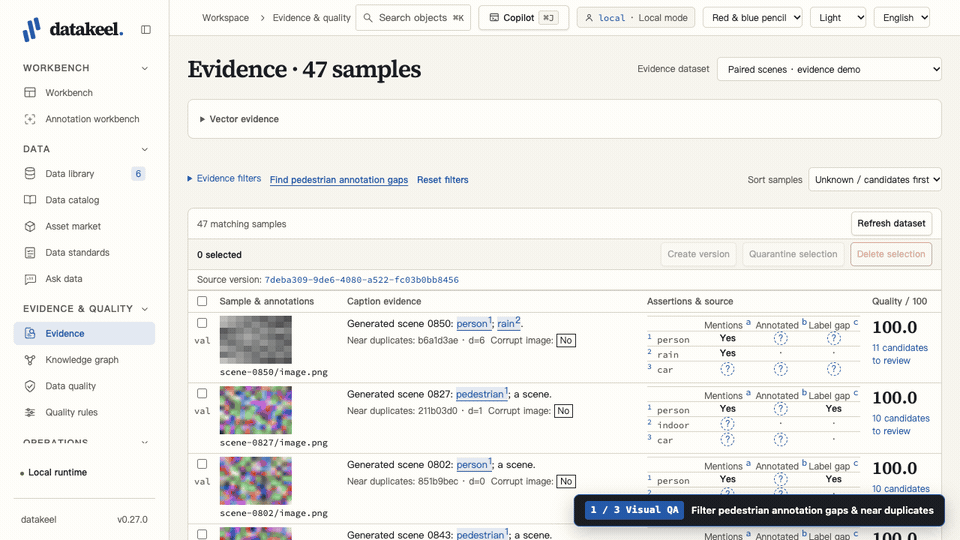
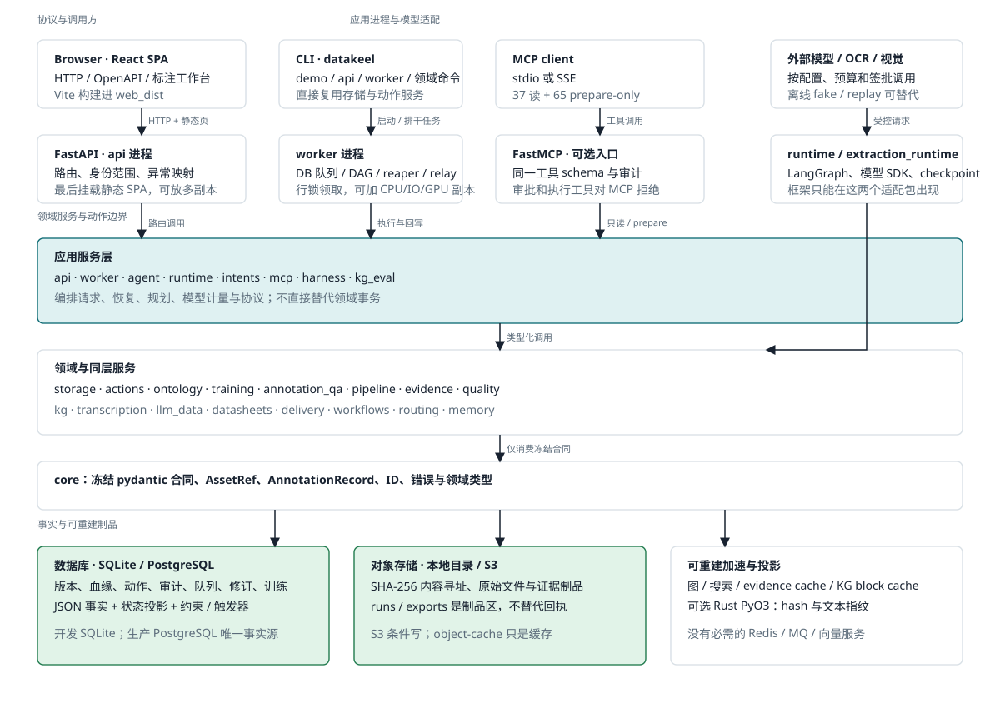

<p align="center"></p>
<h1 align="center">Datakeel</h1>
<p align="center"><strong>本地优先的可审计数据工作台：AI 样本校样、可追溯问数与人工签批智能体</strong></p>
<p align="center">审阅多模态训练样本、冻结可离线核验的 SHA-256 数据集发布包、把业务数字追溯到已登记 SQL 与血缘，并让 Agent/MCP 写操作经过人工签批。</p>

<p align="center">
  <a href="https://pypi.org/project/datakeel/"></a>
  <a href="https://datakeel.jiawis.com/zh/"></a>
  <a href="https://github.com/chaw1/datakeel/releases"></a>
  <a href="https://github.com/chaw1/datakeel/actions/workflows/ci.yml"></a>
  <a href="pyproject.toml"></a>
  <a href="LICENSE"></a>
</p>

<p align="center">
  <a href="README.md">English</a> ·
  <a href="https://datakeel.jiawis.com/zh/">官网与文档</a> ·
  <a href="#快速上手">快速上手</a> ·
  <a href="docs/DATASET_DELIVERY.zh.md">5 分钟图片查重与离线验包</a> ·
  <a href="docs/DEMO.md">演示导览</a> ·
  <a href="docs/README.zh.md">文档中心</a> ·
  <a href="CHANGELOG.md">更新日志</a>
</p>



*18 秒本地离线演示录屏：样本证据校样、可追溯参数化 SQL 问数、智能体计划与人工签批单。想用 5 分钟亲手复现训练集/测试集查重与离线验包？见 [如何检查图片训练集和测试集是否重复，并让客户离线验收](docs/DATASET_DELIVERY.zh.md)（附 3 张图样例）。*

## 快速上手

安装 [uv](https://docs.astral.sh/uv/getting-started/installation/) 后一行命令即可启动离线演示（源码开发可在仓库根目录执行 `uv sync --locked && uv run datakeel demo`）。演示会启动本机 API 与 worker，提供内置 Web 界面，并向本地 SQLite 导入生成样例。模型调用使用内置的离线模型服务。

```bash
uvx datakeel demo
# Web 界面：http://127.0.0.1:8765
# API 文档：http://127.0.0.1:8765/api/docs
# Ctrl+C 同时停止 API 和 worker。
```

先从「证据」页打开一张图片，查看它的描述与标注。也可以进入「问数」，将参考日期设为 `2026-10-01`，问「上个季度华东区零售额是多少」。导览使用同一份演示数据。 [演示导览](docs/DEMO.md)

<details>
<summary>用命令行运行演示、问数与导出</summary>

```bash
uv run datakeel demo --once
uv run datakeel ask '上个季度华东区零售额是多少' --reference-instant 2026-10-01T00:00:00Z
uv run datakeel ask '退货率为什么上升' --reference-instant 2026-10-01T00:00:00Z
uv run datakeel ask '上个季度营业额是多少' --reference-instant 2026-10-01T00:00:00Z
uv run datakeel export --format openlineage --output events.json
uv run datakeel export --format croissant --output croissant.json
```

演示提供文件处理、配对图片证据、企业指标和知识图谱四组生成数据。图片证据包含 1,000 张样本，以及可在界面核对的标注冲突、缺失的配套文件和损坏文件。

</details>

## 可以用它做什么

| 工作 | 可以核对的结果 | 指南 |
| --- | --- | --- |
| 图片集跨划分查重与离线验包 | 下载 3 张图样例，本地查出 train/test 精确与 dHash 重复图片，排除后生成 2 张图修正版，再用 `datakeel reconcile` 离线核验交付包。 | [5 分钟查重与离线验包案例](docs/DATASET_DELIVERY.zh.md) |
| 审阅样本 | 从候选问题跳到图片、描述、标注或来源事件。证据区分「有」「无」「未知」。 | [证据审阅](docs/DEMO.md#2-审一个样本再生成版本约-2-分钟) |
| 准备训练数据 | 比较不可变版本、检查切分泄漏，并按任务需要导出 COCO、YOLO、Hugging Face 或 JSONL。 | [训练集](docs/TRAINING.zh.md) |
| 发布与交付 | 签批已冻结的发布计划，下载可复现的交付包，用 `datakeel reconcile` 核对清单。 | [数据集发布](docs/RELEASES.zh.md) |
| 解释一个业务数字 | 核对指标定义版本、来源字段、带参数 SQL 与时间窗口，按维度继续追问或查看血缘。 | [问数](docs/ASK.zh.md) |
| 审阅智能体建议 | 核对受影响对象、外发范围与费用，由人在 Web 或 CLI 签批和执行。 | [受控动作](docs/ACTIONS.md) · [MCP](#mcp-与模型) |

中英文界面提供样本校样快捷键，并可用 `⌘K / Ctrl+K` 查找对象、用 `⌘J / Ctrl+J` 打开带当前对象上下文的副驾。 [界面设计](docs/design/UI-DIRECTION-B.md)

标注生产、音视频处理、大模型数据检查、知识图谱和目录导入的专题指南收录在 [文档中心](docs/README.zh.md) 与 [在线文档站](https://datakeel.jiawis.com/zh/docs/)。

## 定位边界与常见对比

Datakeel 不替代数仓或模型训练框架，而是把平时分散在多套工具里的三件事放进同一条可审计工作流：

| 维度 | Datakeel | 常见单点工具组合 |
| --- | --- | --- |
| 部署与起步 | 本地优先，SQLite + 回环 Web 界面两条命令启动；团队可切换 PostgreSQL + S3。 | 数据目录常需多组件集群，视觉质检与标注常依赖云端 SaaS。 |
| 视觉校样与切分泄漏 | 三态证据（有 / 无 / 未知）、图像校样与跨划分精确 / dHash / SimHash 泄漏检查。 | 常分散在可视化工具（FiftyOne）、标注平台（Label Studio）与零散脚本之间。 |
| 可核验数据集交付 | 冻结发布计划签批、不可变 SHA-256 清单与 `datakeel reconcile` 离线对账。 | 文件版本工具（DVC）只记录哈希，不绑定人工审查结论与泄漏证明。 |
| 可追溯业务问数 | 绑定已登记指标口径、参数化 SQL 与血缘，遇歧义或越权明确追问或拒答。 | 自由生成型 Text-to-SQL 容易编造口径，缺少指标版本绑定。 |
| 智能体与 MCP 安全 | stdio / SSE MCP 仅暴露受审计读取与计划准备，不可逆与外发动作停在人工签批单。 | 通用数据库 MCP 常直接执行写入，缺少绑定计划摘要的审批边界。 |

<details>
<summary>常见问题（FAQ）</summary>

- **试用需要外部数据库或模型 API Key 吗？** 不需要。`uv run datakeel demo` 直接在本地 SQLite 中运行，使用离线演示模型加载 1,000 张图片证据、企业指标与知识图谱样例。
- **如何排查训练集与测试集的重复泄漏？** 支持精确哈希、64 位感知哈希 dHash、文本 SimHash 与组键泄漏检查，支持在浏览器中并排对比并将核查证明写入签批清单。
- **接入 MCP 后智能体会不会误删或私自改口径？** 不会。MCP 服务不暴露任何审批或写操作执行工具，必须由人在 Web 界面或 CLI 签批冻结计划摘要后才执行。
- **小团队如何共享部署？** 可切换到 PostgreSQL 和 S3 兼容对象存储，配合 Caddy 或 nginx + oauth2-proxy 反向代理运行，详见 [部署指南](docs/DEPLOYMENT.zh.md)。

</details>

## 架构



Datakeel 运行 API 与带租约保护的 worker，使用 SQLite 或 PostgreSQL 记录事实，用本地或 S3 兼容存储保存对象。文件版本冻结 SHA-256 清单，血缘可从只追加事件重建，对外发或不可逆的动作由人签批确切的计划。 [架构决策](docs/ARCHITECTURE.md) · [持久化 Schema](docs/PERSISTENCE_SCHEMA.md) · [接口参考](docs/API_REFERENCE.zh.md)

## MCP 与模型

MCP 服务提供可审计查询和计划准备，可通过本机 stdio 或回环 SSE 接入。将 `DATAKEEL_HOME` 设置为 Web 界面使用的目录，即可查看同一批数据。 [受控动作](docs/ACTIONS.md)

<details>
<summary>MCP 客户端配置示例</summary>

为 Claude Desktop（`claude_desktop_config.json`）或 Cursor（`.cursor/mcp.json`）配置本地 stdio 时，请替换相应的绝对路径：

```json
{
  "mcpServers": {
    "datakeel": {
      "command": "/absolute/path/to/uv",
      "args": [
        "--directory",
        "/absolute/path/to/datakeel",
        "run",
        "datakeel",
        "mcp"
      ],
      "env": {
        "DATAKEEL_HOME": "/absolute/path/to/datakeel/.datakeel"
      }
    }
  }
}
```

如需独立的回环 SSE 服务，运行 `uv run datakeel mcp --transport sse --host 127.0.0.1 --port 8766`：

```json
{
  "mcpServers": {
    "datakeel": {
      "url": "http://127.0.0.1:8766/sse"
    }
  }
}
```

</details>

接入真实模型可在仓库外配置 `DATAKEEL_OPENAI_API_KEY` 或 `DATAKEEL_ANTHROPIC_API_KEY`，也可设置对应的 `DATAKEEL_OPENAI_BASE_URL` 或 `DATAKEEL_ANTHROPIC_BASE_URL`。所用模型须登记在 [价目表](contracts/model-prices.yaml)。

用 `uv run datakeel export-traces [--conversation-id <id>]` 将脱敏 OTLP/HTTP span 导出至采集器、Phoenix 或 Langfuse。 [Trace 导出参考](docs/API_REFERENCE.zh.md#opentelemetry-模型-trace-导出)

## 部署与贡献

GitHub Releases 提供 wheel、带哈希的依赖清单、许可说明和 SHA-256 校验文件。小团队共享部署可参考身份认证代理和 PostgreSQL 方案。 [发行文件](https://github.com/chaw1/datakeel/releases) · [部署指南](docs/DEPLOYMENT.zh.md) · [SQLite 维护](docs/DATABASE_MAINTENANCE.md)

<details>
<summary>分别启动进程或构建本地产物</summary>

```bash
uv run datakeel db upgrade
uv run datakeel api --port 8765
# 第二个终端使用相同数据库和对象存储配置。
uv run datakeel worker
```

源码构建使用 Python 3.12、uv、Node.js 22 和 Rust 1.96。下面的命令构建本地产物。

```bash
make build-wheel
make build-image
docker run --rm -p 127.0.0.1:8765:8765 -v datakeel-data:/data datakeel:local
```

完成本地镜像构建后，可以用 Compose 在回环地址运行 API、worker、迁移任务和 PostgreSQL。

```bash
docker compose up -d
docker compose run --rm api demo --once
```

</details>

<details>
<summary>运行仓库质量门禁</summary>

```bash
uv sync --locked
(cd web && npm ci)
uv run pre-commit install
make check
uv run python scripts/check_readme.py
bash scripts/ci-check.sh
```

CI 在 SQLite 与 PostgreSQL 上执行门禁、测试及变异检查。测试输入与门禁条件见 [评测与验证](docs/VERIFICATION.zh.md) 和 [代码规范](docs/CODE_STANDARDS.md)。

</details>

[贡献指南](CONTRIBUTING.md) · [支持与提问](SUPPORT.md) · [私密安全报告](SECURITY.md) · [行为准则](CODE_OF_CONDUCT.md) · [引用](CITATION.cff)

Datakeel 采用 [Apache-2.0](LICENSE) 许可。依赖与内置字体许可见 [第三方声明](THIRD_PARTY_NOTICES.md) 和 [前端声明](web/public/THIRD-PARTY-LICENSES.txt)。
