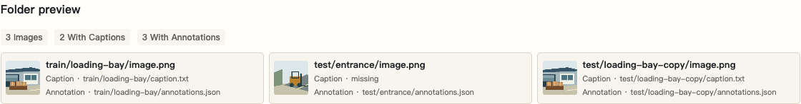

# Review and deliver an image dataset

[简体中文](DATASET_DELIVERY.zh.md)

Use the browser to import an image folder, review leakage across training and test partitions,
correct an immutable version, and deliver a package that the recipient can verify offline.

## Import a folder

Start Datakeel on your machine and open **Data library → Import images**. Choose the root folder.
Names and partitions come from the relative paths in the selection. PNG, JPEG and WebP are supported.
A batch can contain up to 2,000 images and sidecar files combined, with a total limit of 256 MiB.
The following layout has one sample per folder.

```text
warehouse/
  train/
    loading-bay/
      image.png
      caption.txt
      annotations.json
  test/
    gate/
      image.png
      annotations.json
```

Caption and annotation files are optional. Review the preview for unpaired and unreadable images.
The import dialog initially selects **Skip unreadable images** when it detects any.
Confirm the folder and give the dataset a name. The import dialog opens the Versions view after
publication. A delivery review needs at least two populated partitions. A folder without partition
names can still be imported, but it cannot meet that check by itself.



## Check and correct a candidate

Open **Dataset delivery review** in the dataset's Versions view. Select a candidate version and, if
available, a baseline. Run the directory split check. The review shows partition sizes and
cross-partition matches. Examine both images, the original split and the matching signal before
choosing which sample to exclude from the correction.

Create a corrected version and run the check again. This creates a new version with the retained
samples. The old version remains available for comparison. Checks are scoped to the candidate;
confirm that the corrected version is selected before preparing its publication.

## Approve and deliver

After the check passes, enter a release tag and review the publication plan. Publication waits for
the existing human approval. The service verifies the saved directory split against the exact
version and records the check policy, split identity, counts and baseline in the frozen
`delivery_review` metadata.

Open the published release and choose **Export delivery package**. Send the resulting archive to
the recipient. They can run this command locally with the name of the downloaded archive.

```bash
uv run datakeel reconcile v1.0.0.tar.gz --manifest MANIFEST.json --json
```

The release archive contains the selected version's image payloads and portable metadata, including
the review proof. `datakeel reconcile` independently verifies `delivery_review` against the
manifest's `source_version` and total partitioned file count, surfacing the verified partition
breakdown and zero-leakage check in both human-readable and `--json` output. See
[delivery verification](RELEASES.md#export-and-verify-independently) for the checks performed on the
recipient's copy and [training datasets](TRAINING.md#leakage-evidence) for leakage signals.
