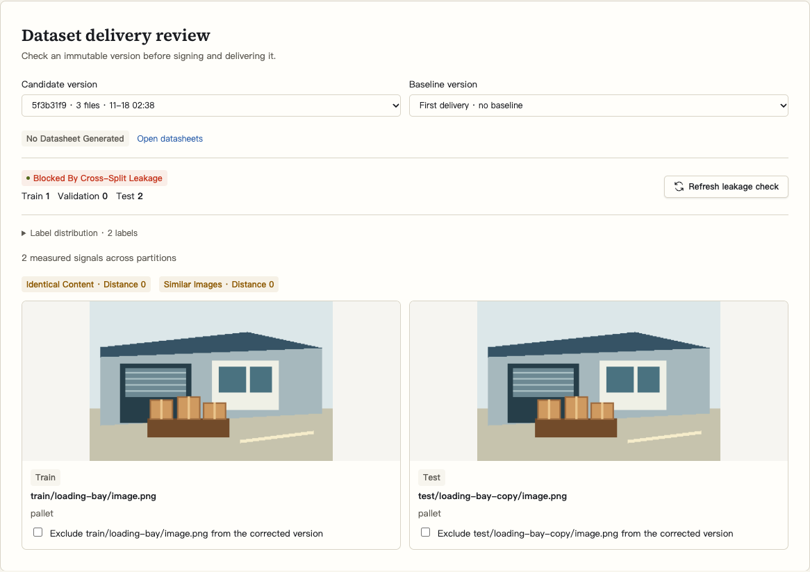

# Detect train/test duplicate images and deliver an offline-verifiable dataset

[简体中文](DATASET_DELIVERY.zh.md)

Find duplicate images leaked between train and test folders locally, create a corrected version, and let recipients verify the signed archive offline.

This 5-minute walkthrough uses a downloadable 3-image sample where one image intentionally appears in both `train/` and `test/`. Everything runs locally on SQLite with zero cloud API keys, no external database, and no uploads to third-party servers.

## What you will verify in 5 minutes

| Checkpoint | What Datakeel shows |
| --- | --- |
| 1. Where is the duplicate? | **Blocked by cross-split leakage** (`Train 1 · Validation 0 · Test 2`), flagging `train/loading-bay/image.png` and `test/loading-bay-copy/image.png` with `Identical Content · Distance 0` and `Similar Images · Distance 0`. |
| 2. How many images remain after fixing? | **2 files** (`Train 1 · Validation 0 · Test 1`) in a new immutable version after excluding `test/loading-bay-copy/image.png`. The original 3-file version stays intact as the baseline, and re-checking shows `0` leakage pairs. |
| 3. What does the recipient see offline? | `uvx datakeel reconcile v1.0.0.tar.gz` exits `0`, prints `PASS` across all 6 categories, and verifies `Delivery review: directory-leakage-v1 (train=1, test=1; signals=exact, image, text, group; leakage=0)` without a server or database. |

## 1. Download the 3-image sample and start Datakeel

Download and unzip the deterministic 3-image fixture:

- [Download `warehouse-leakage-sample.zip` (5 KB)](samples/warehouse-leakage-sample.zip)

```bash
unzip warehouse-leakage-sample.zip
```

The unzipped folder contains three annotated warehouse images across `train/` and `test/`. `train/loading-bay/image.png` and `test/loading-bay-copy/image.png` are byte-identical duplicates, and `test/entrance/` intentionally omits `caption.txt` so you can see missing-sidecar detection in the import preview:

```text
warehouse-leakage-sample/
  train/
    loading-bay/
      image.png
      caption.txt
      annotations.json
  test/
    loading-bay-copy/
      image.png
      caption.txt
      annotations.json
    entrance/
      image.png
      annotations.json
```

Start Datakeel locally in one command (install [uv](https://docs.astral.sh/uv/getting-started/installation/) first if needed):

```bash
uvx datakeel demo
# Web UI: http://127.0.0.1:8765
```

If you are running from a source checkout, use `uv sync --locked && uv run datakeel demo`.

## 2. Import the folder and find cross-split duplicates

Open `http://127.0.0.1:8765`, go to **Data library → Import images**, click **Choose image folder**, and select the unzipped `warehouse-leakage-sample` folder.

- Supported formats: PNG, JPEG, and WebP (up to 2,000 images and sidecar files per batch, 256 MiB total).
- Relative paths supply sample names and partition names (`train/`, `val/`, `test/`). Caption and annotation files are optional; unreadable images are skipped by default when detected.
- In **Folder preview**, confirm you see **3 Images**, **2 With Captions**, and **3 With Annotations** (`test/entrance/image.png` shows `Caption · missing`).


Enter a dataset name such as `Warehouse images` and click **Import dataset**. Datakeel imports the files into an immutable version and opens the **Versions** tab.

In **Dataset delivery review**, click **Check imported splits**.

### Result 1: Where is the duplicate?

Datakeel marks the 3-file candidate **Blocked by cross-split leakage** (`Train 1  Validation 0  Test 2`) and displays **2 measured signals across partitions** side by side:

- **Matched pair**: `train/loading-bay/image.png` (`Train`, `pallet`) and `test/loading-bay-copy/image.png` (`Test`, `pallet`).
- **Signals**: `Identical Content · Distance 0` (exact SHA-256) and `Similar Images · Distance 0` (64-bit perceptual dHash).



## 3. Exclude the leaked copy and verify the corrected version

Check **Exclude `test/loading-bay-copy/image.png` from the corrected version**, then click **Review corrected version** and **Execute action**.

### Result 2: How many images remain after fixing?

- Datakeel creates a new immutable version containing **2 files** (`train/loading-bay/image.png` and `test/entrance/image.png`).
- The original **3-file** version remains unchanged and selectable as the **Baseline version** for audit comparison.
- With the new 2-file version selected as **Candidate version**, click **Check imported splits** again. The status switches to **Ready for release review** with `Train 1  Validation 0  Test 1` and **0 leakage pairs**.

Checks are bound to each candidate version; confirm the 2-file corrected version is selected before preparing a release.

## 4. Sign, export, and verify offline on the recipient's machine

Expand **Sign and deliver this candidate**, enter semantic version tag `v1.0.0`, click **Review release plan**, and confirm **Approve and publish release**.

During publication, the server re-verifies that the checked directory split matches the exact candidate version and freezes the proof—rule, checked signals, split ID, counts, zero-leakage status, and baseline version ID—into the release's `delivery_review` metadata.

Open the published release `v1.0.0`, click **Export delivery package**, and send the resulting archive (for example `v1.0.0.tar.gz`) to the recipient.

### Result 3: What the recipient sees when verifying offline

The recipient needs no Datakeel server, database, object store, or network access. With `uvx` installed (or `uv run datakeel reconcile ...` in a source checkout), they run:

```bash
uvx datakeel reconcile v1.0.0.tar.gz
```

Verified terminal output for the 2-file release (exit status `0`):

```text
文件数 / File count: 通过 / PASS
字节数 / Bytes: 通过 / PASS
内容哈希 / Content hashes: 通过 / PASS
标注与标签 / Annotations and labels: 通过 / PASS
元数据 / Metadata: 通过 / PASS
血缘引用 / Lineage: 通过 / PASS
交付审查证明 / Delivery review: directory-leakage-v1 (train=1, test=1; signals=exact, image, text, group; leakage=0)
```

For CI pipelines or automated acceptance gates, pass `--json`:

```bash
uvx datakeel reconcile v1.0.0.tar.gz --manifest MANIFEST.json --json
```

Verified `--json` output (UUIDs, `split_id`, and `created_at` vary per run):

```json
{
  "categories": [
    { "differences": [], "name": "file_count", "passed": true },
    { "differences": [], "name": "bytes", "passed": true },
    { "differences": [], "name": "hashes", "passed": true },
    { "differences": [], "name": "annotations", "passed": true },
    { "differences": [], "name": "metadata", "passed": true },
    { "differences": [], "name": "lineage", "passed": true }
  ],
  "delivery_review": {
    "baseline_version_id": "<original-3-file-version-id>",
    "checked_signals": ["exact", "image", "text", "group"],
    "distributions": [
      { "count": 1, "labels": [], "split": "train" },
      { "count": 0, "labels": [], "split": "val" },
      { "count": 1, "labels": [], "split": "test" }
    ],
    "image_threshold": 8,
    "leakage_pairs": 0,
    "rule": "directory-leakage-v1",
    "sample_count": 2,
    "split_algorithm_version": "1.3-iterative-text",
    "split_id": "<checked-split-id>",
    "version_id": "<corrected-2-file-version-id>"
  },
  "passed": true
}
```

### How the recipient knows the archive was not tampered with

- Exit status is `0` only when all six categories pass, `1` on any mismatch or tampered manifest/payload, and `2` when the archive or manifest cannot be parsed.
- `datakeel reconcile` hashes every payload file against `MANIFEST.json`, checks the canonical `manifest_sha256` checksum, and independently verifies that `delivery_review.version_id` matches `MANIFEST.json`'s `source_version` and total partitioned file count.
- Flipping even one byte of an image or editing a field inside `MANIFEST.json` or `RECORDS.json` causes `reconcile` to exit `1`, fail `hashes` or `metadata`, and omit `delivery_review` from the passing receipt.

## Using your own annotated image folder

- Put samples under at least two populated partition folders such as `train/` and `test/` (or `train/`, `val/`, `test/`). Unsplit folders can still be imported, but delivery review requires at least two populated partitions.
- Datakeel checks **exact SHA-256**, **64-bit perceptual dHash** (default Hamming distance threshold `8`, catching re-encoded or resized near-duplicates across splits), **SimHash text fingerprints**, and **group keys**.
- See [delivery verification](RELEASES.md#export-and-verify-independently) for archive structure and tamper exercises, and [training datasets](TRAINING.md#leakage-evidence) for leakage signal details.
