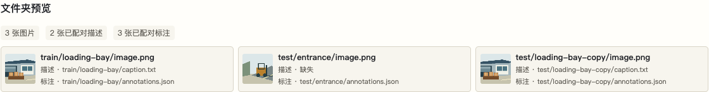
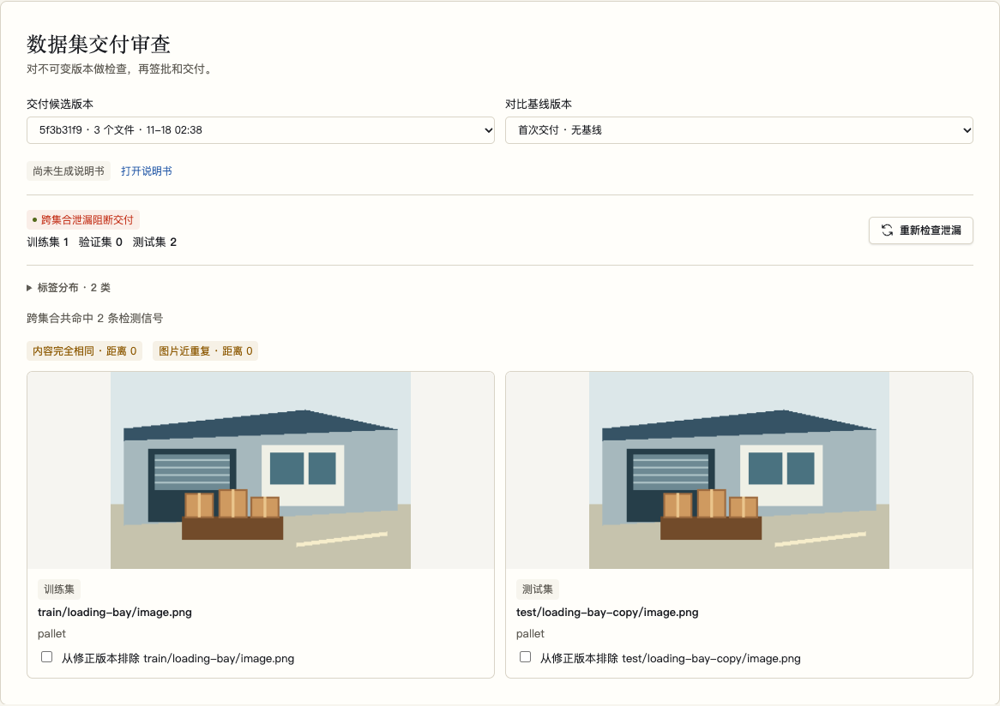

# 如何检查图片训练集和测试集是否重复，并让客户离线验收

[English](DATASET_DELIVERY.md)

在本地检查标注图片是否同时混入训练集和测试集，排除重复样本生成不可变修正版本，并让接收方无需数据库或联网，一条命令离线验包确认交付的就是审核过的那一版。

这份 5 分钟可验证案例提供了一份可下载的 3 张图样例，其中故意把同一张仓库图片同时放进了 `train/` 和 `test/`。全程在本地 SQLite 运行，不需要云端模型 API Key、外部数据库或上传数据到第三方服务。

## 5 分钟内你会亲眼确认的三个结果

| 验收点 | 你应该看到的结果 |
| --- | --- |
| 1. 哪里重复？ | 状态显示**跨集合泄漏阻断交付**（`训练集 1 · 验证集 0 · 测试集 2`），并排展示 `train/loading-bay/image.png` 与 `test/loading-bay-copy/image.png`，命中`内容完全相同 · 距离 0`和`图片近重复 · 距离 0`。 |
| 2. 修完剩几张？ | 勾选排除 `test/loading-bay-copy/image.png` 后生成新的不可变修正版本，仅剩 **2 个文件**（`训练集 1 · 验证集 0 · 测试集 1`）；原始 3 张图版本保留作为对比基线，重新检查泄漏数为 **0**。 |
| 3. 接收方离线验包终端显示什么？ | 接收方运行 `uvx datakeel reconcile v1.0.0.tar.gz`，退出码为 `0`，六类校验全部显示`通过 / PASS`，并输出 `交付审查证明 / Delivery review: directory-leakage-v1 (train=1, test=1; signals=exact, image, text, group; leakage=0)`。 |

## 1. 下载 3 张图样例并本地启动 Datakeel

下载并解压确定性的 3 张图样例包：

- [下载 `warehouse-leakage-sample.zip`（5 KB）](samples/warehouse-leakage-sample.zip)

```bash
unzip warehouse-leakage-sample.zip
```

解压后包含 3 张带标注的仓库图片，其中 `train/loading-bay/image.png` 与 `test/loading-bay-copy/image.png` 字节完全相同，`test/entrance/` 故意缺少 `caption.txt`，便于在导入预览里顺带观察缺失配套文件的提示：

```text
warehouse-leakage-sample/
  train/
    loading-bay/
      image.png
      caption.txt
      annotations.json
  test/
    loading-bay-copy/
      image.png
      caption.txt
      annotations.json
    entrance/
      image.png
      annotations.json
```

安装 [uv](https://docs.astral.sh/uv/getting-started/installation/) 后，一条命令在本机启动 Datakeel：

```bash
uvx datakeel demo
# Web 界面：http://127.0.0.1:8765
```

如果你在源码仓库目录运行，可执行 `uv sync --locked && uv run datakeel demo`。

## 2. 导入目录并查出跨划分重复图片

打开 `http://127.0.0.1:8765`，进入「资料库 → 导入图片」，选择刚解压的 `warehouse-leakage-sample` 根目录。

- 支持 PNG、JPEG 和 WebP，单批最多 2,000 个图片与配套文件，总大小上限 256 MiB。
- 系统根据相对路径自动识别样本名与划分（`train/`、`val/`、`test/`）。描述和标注文件均可选；检测到无法解码的图片时界面默认选中跳过。
- 在「文件夹预览」里确认看到 **3 张图片**、**2 张已配对描述**、**3 张已配对标注**（`test/entrance/image.png` 显示`描述 · 缺失`）。



填写数据集名称（例如 `Warehouse images`）并确认导入，完成后会自动打开版本页。

在「数据集交付审查」面板点击**检查导入的划分**。

### 结果 1：哪里重复？

系统会把 3 个文件的候选版本标记为**跨集合泄漏阻断交付**（`训练集 1  验证集 0  测试集 2`），并排展示**跨集合共命中 2 条检测信号**：

- **重复样本对**：`train/loading-bay/image.png`（训练集，`pallet`）与 `test/loading-bay-copy/image.png`（测试集，`pallet`）。
- **命中信号**：`内容完全相同 · 距离 0`（精确 SHA-256）与 `图片近重复 · 距离 0`（64 位感知哈希 dHash）。



## 3. 排除重复样本并生成修正版本

勾选**从修正版本排除 `test/loading-bay-copy/image.png`**，依次点击**审阅修正版本**并执行动作。

### 结果 2：修完剩几张？

- 系统生成一个新的不可变版本，包含 **2 个文件**（`train/loading-bay/image.png` 和 `test/entrance/image.png`）。
- 原始的 **3 个文件**版本保持不可变，仍可作为「对比基线版本」随时核对差异。
- 确认「交付候选版本」已切换到新的 2 文件版本后，再次点击**检查导入的划分**，状态会变为**可以审阅发布计划**（`训练集 1  验证集 0  测试集 1`，跨划分泄漏对数为 **0**）。

每次检查都绑定特定候选版本；准备发布前请核对当前选中的是已通过检查的修正版本。

## 4. 签批交付包，并由接收方离线验包

展开**签批并交付此候选版本**，在「语义化版本标签」填写 `v1.0.0`，点击**审阅发布计划**并人工签批发布。

服务端会核对保存的目录划分确实来自待发布版本、重新验证零泄漏，并把校验规则、检测信号、划分标识、分区计数与基线版本 ID 冻结进 `delivery_review` 元数据。

打开已发布的 `v1.0.0` 记录，点击**导出交付包**，把下载得到的压缩包（如 `v1.0.0.tar.gz`）发给接收方。

### 结果 3：接收方离线验包时终端显示什么？

接收方不需要部署 Datakeel 服务端、数据库、对象存储或联网，只要本机有 `uvx`（或在源码目录用 `uv run datakeel reconcile ...`），执行：

```bash
uvx datakeel reconcile v1.0.0.tar.gz
```

2 文件修正版交付包实测终端输出（退出码 `0`）：

```text
文件数 / File count: 通过 / PASS
字节数 / Bytes: 通过 / PASS
内容哈希 / Content hashes: 通过 / PASS
标注与标签 / Annotations and labels: 通过 / PASS
元数据 / Metadata: 通过 / PASS
血缘引用 / Lineage: 通过 / PASS
交付审查证明 / Delivery review: directory-leakage-v1 (train=1, test=1; signals=exact, image, text, group; leakage=0)
```

如果接收方要接入自动化验收脚本或 CI，加上 `--json`：

```bash
uvx datakeel reconcile v1.0.0.tar.gz --manifest MANIFEST.json --json
```

实测 `--json` 输出结构（各 UUID、`split_id` 与 `created_at` 随每次运行生成）：

```json
{
  "categories": [
    { "differences": [], "name": "file_count", "passed": true },
    { "differences": [], "name": "bytes", "passed": true },
    { "differences": [], "name": "hashes", "passed": true },
    { "differences": [], "name": "annotations", "passed": true },
    { "differences": [], "name": "metadata", "passed": true },
    { "differences": [], "name": "lineage", "passed": true }
  ],
  "delivery_review": {
    "baseline_version_id": "<原始-3-文件版本-ID>",
    "checked_signals": ["exact", "image", "text", "group"],
    "distributions": [
      { "count": 1, "labels": [], "split": "train" },
      { "count": 0, "labels": [], "split": "val" },
      { "count": 1, "labels": [], "split": "test" }
    ],
    "image_threshold": 8,
    "leakage_pairs": 0,
    "rule": "directory-leakage-v1",
    "sample_count": 2,
    "split_algorithm_version": "1.3-iterative-text",
    "split_id": "<已核验划分-ID>",
    "version_id": "<修正后-2-文件版本-ID>"
  },
  "passed": true
}
```

### 接收方如何确认压缩包未被篡改或掉包？

- 仅当六类校验全部通过时退出码为 `0`；出现任意文件增删、字节改动或清单不一致时退出码为 `1`；归档或清单损坏无法读取时退出码为 `2`。
- `datakeel reconcile` 会逐文件重算 SHA-256、校验规范化后的 `manifest_sha256`，并独立核对 `delivery_review.version_id`、来源版本与各划分总文件数是否一致。
- 只要改动某张图片的任意 1 个字节，或篡改 `MANIFEST.json` / `RECORDS.json` 中的审查记录，对账就会以退出码 `1` 失败，并在 `hashes` 或 `metadata` 中点名差异文件，不再输出通过的 `delivery_review` 证明。

## 用在你自己的标注图片目录上

- 将图片按至少两个非空划分目录组织（如 `train/`、`test/`，或 `train/`、`val/`、`test/`）。没有划分目录的图片也可以导入，但交付审查要求至少两个非空划分。
- 跨划分检查同时覆盖**精确 SHA-256**、**64 位感知哈希 dHash**（默认汉明距离阈值 `8`，可抓出缩放或重新压缩后的近似重复图）、**文本 SimHash** 与**组键泄漏**。
- 更多交付包格式与单字节篡改演练参见[导出与离线对账](RELEASES.zh.md#导出与离线对账)，泄漏检测信号细节参见[泄漏检查](TRAINING.zh.md#泄漏检查)。
