# A ten-minute tour

[中文](DEMO.md) · [Back to the README](../README.md)

`uv run datakeel demo` generates local samples, evidence, and business data, then starts the API and worker. This tour uses a fresh `DATAKEEL_HOME`, an isolated port, and the fake model. It needs no database server, object store, or model credentials.

On first use, run `uv sync --locked` from the repository root to install dependencies, then copy this one-line launcher. Port `8773` must be available; if it is occupied, choose a free port and update the URLs below.

```bash
DATAKEEL_HOME=$(mktemp -d) uv run datakeel demo --port 8773
```

Open <http://127.0.0.1:8773/> and wait for the initialization tasks to finish. The screenshots use **Chinese UI text and the Light theme**; choose 中文 to match them. English labels are included below. All data is generated, and IDs and timestamps vary between runs. The tour changes this temporary workspace. Press Ctrl+C in the launch terminal when finished; use the launcher again for a fresh replay.

## If you already have local configuration

If you previously set `DATAKEEL_*` environment variables, replace the one-line launcher with this isolated launch. It clears inherited database, storage, and model settings and creates a fresh temporary directory for the tour. Only the explicitly configured sandbox image and runtime endpoint are retained; execution is forced to `container` and the development subprocess backend is disabled. For section 11, build the image and export its digest before running this launcher.

```bash
uv run python - <<'PY'
import os
import subprocess
import tempfile

sandbox_keys = {"DATAKEEL_SANDBOX_IMAGE", "DATAKEEL_SANDBOX_DOCKER_HOST"}
environment = {
    key: value for key, value in os.environ.items()
    if not key.startswith("DATAKEEL_") or key in sandbox_keys
}
environment["DATAKEEL_SANDBOX_BACKEND"] = "container"
environment["DATAKEEL_SANDBOX_ALLOW_SUBPROCESS"] = "false"
environment["DATAKEEL_HOME"] = tempfile.mkdtemp(prefix="datakeel-tour-")
environment["DATAKEEL_BASE_URL"] = "http://127.0.0.1:8773"
subprocess.run(
    ["uv", "run", "datakeel", "demo", "--port", "8773"],
    env=environment,
    check=True,
)
PY
```

## 1. Workbench: find the objects behind the status (30 seconds)

Open Workbench (工作台). Confirm that active pipelines have returned to zero, then inspect pending approvals, recent actions, and quality alerts. Recent actions link to their details, so you do not need to remember IDs.

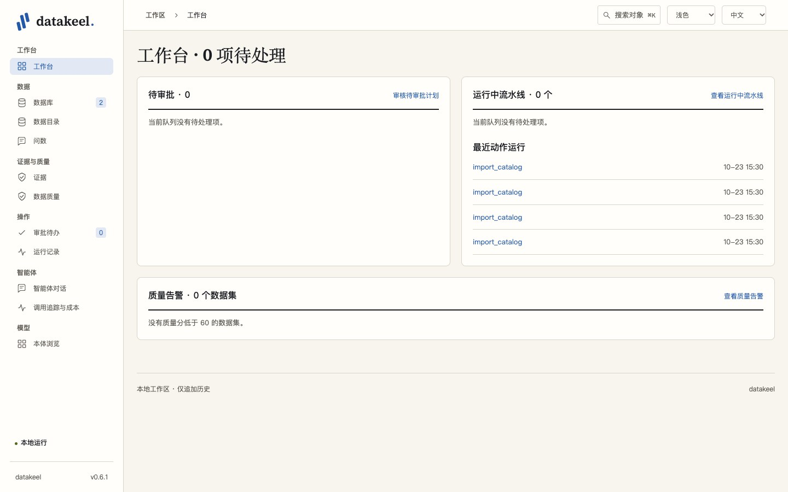

## 2. Review a sample and create a version (2 minutes)

Open Evidence (证据), confirm that Evidence dataset (证据数据集) is `Paired scenes · evidence demo`, and click Find pedestrian annotation gaps (查找行人标注缺口). Page through the results to find and inspect `val/scene-0817/image.png`. The drawer combines the image, caption, annotations, and assertion matrix. Unknown evidence is distinct from measured absence.

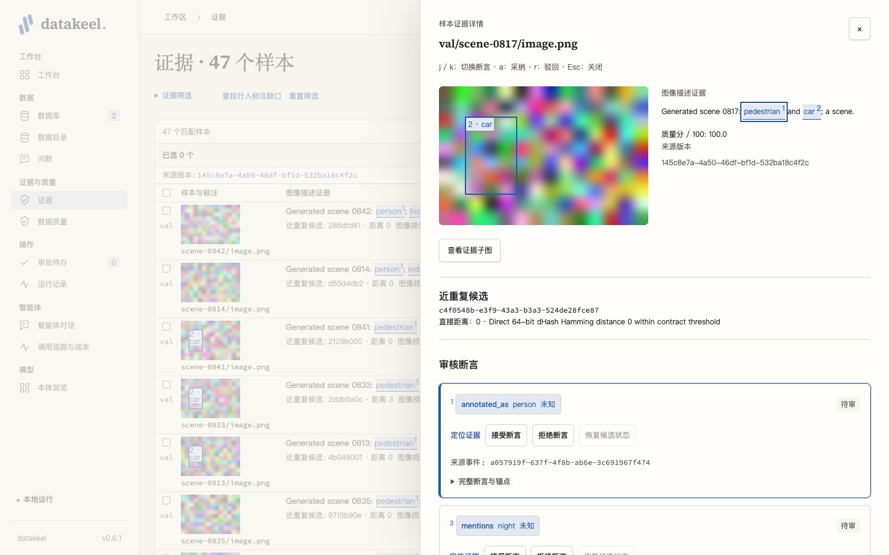

On the `mentions` assertion for a person, click Locate evidence (定位证据) to highlight its caption anchor, then Accept assertion (接受断言). The decision is recorded separately, preserving the extracted evidence.

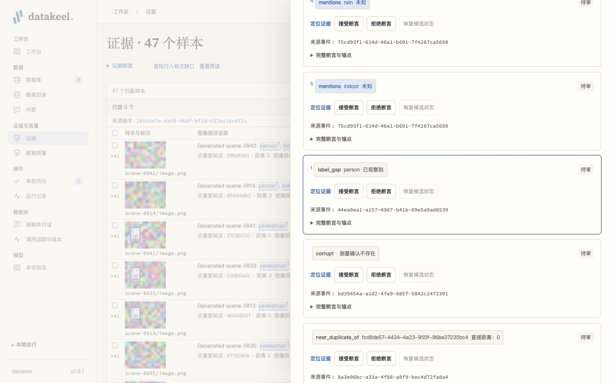

Press Esc, select this sample, and click Create version (生成版本). Open the dataset from Data library (数据库) and choose Versions (版本). The new version contains the one selected file; earlier manifests remain available.

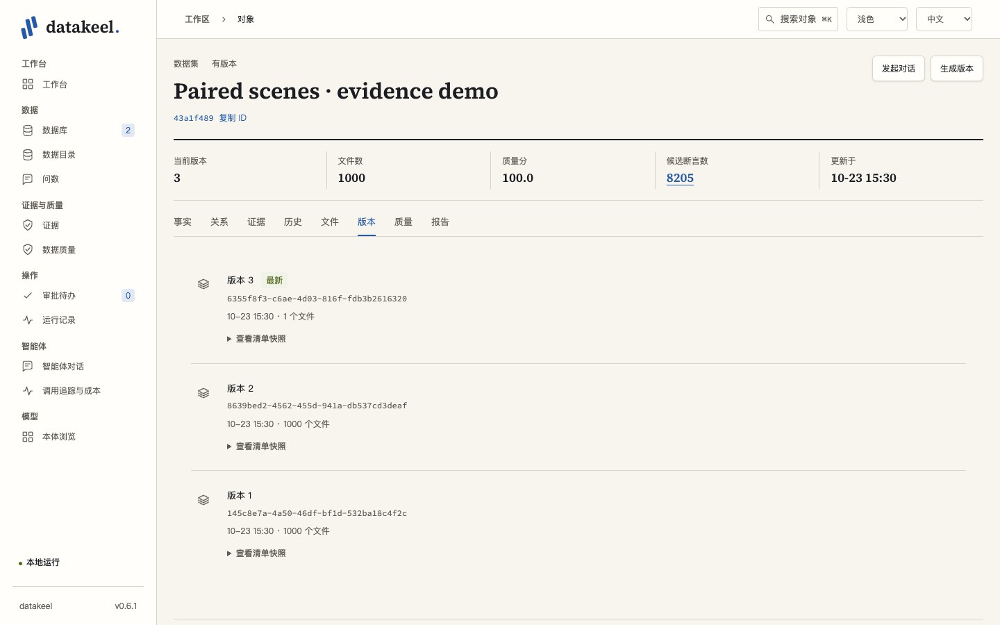

## 3. Let the Agent propose deletion, then approve it (2 minutes)

Open Agent (智能体对话). Select `Paired scenes · evidence demo` for the new conversation, expand the conversation budget (会话预算), set its limit to `1000000`, and create the conversation (新建会话). The local `fake-demo` provider uses no paid model; the budget is an execution limit.

Send these two messages in order. Keep the example questions in Chinese even if you choose the English UI:

```text
查找 val 中 caption 提到行人、没有行人标注并且与 train 近重复的证据样本
```

```text
删除这些样本
```

The first finds validation samples whose captions mention a pedestrian, lack a matching annotation, and have a near duplicate in training. The second requests deletion. The fake conversation selects at most two query matches; this is a different selection from the reviewed `scene-0817`. Check the plan's actual object list. No deletion has executed yet.

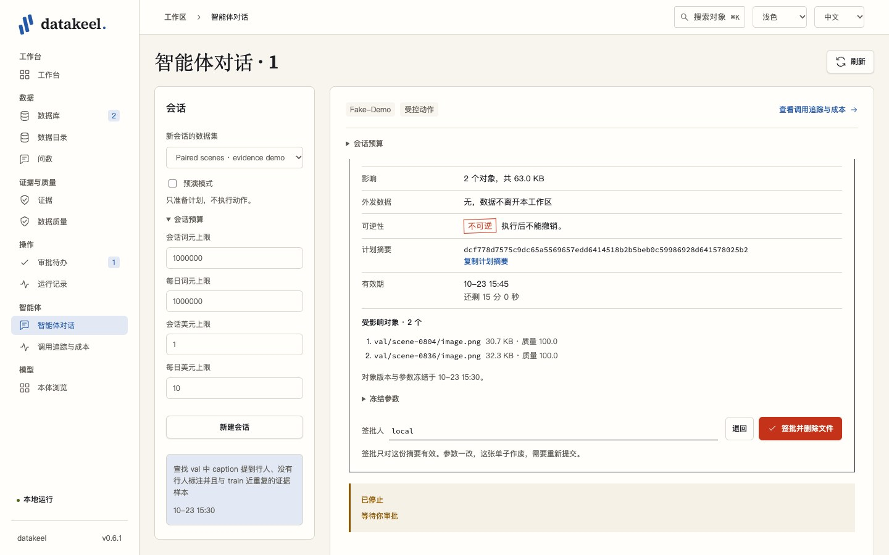

Open Approvals (审批待办). Review the objects, impact, irreversible-action notice, and digest, then click Approve and delete files (签批并删除文件). The approval applies to this frozen plan and cannot be reused with changed parameters.

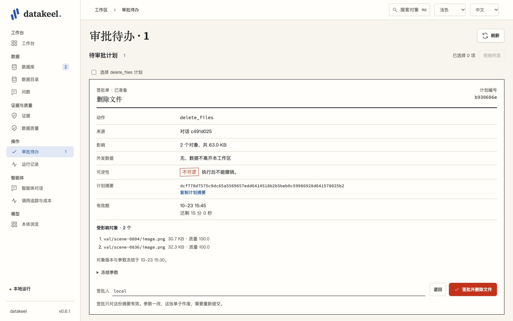

After execution, open the lineage receipt (查看血缘回执). The relations view connects the action, receipt event, and affected objects so the result can be traced back to its cause.

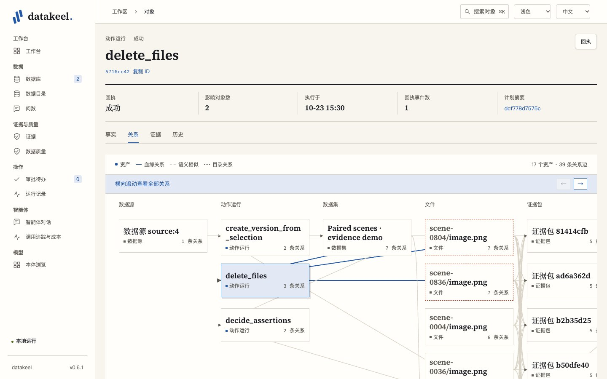

## 4. Understand a number through the data catalog (1 minute)

Open Data catalog (数据目录), expand `ecommerce`, and select `ecommerce/main/orders`. Open Downstream impact (下游影响) for `paid_amount`. The view shows that `retail_revenue` depends on this amount field: the business definition has a concrete source.

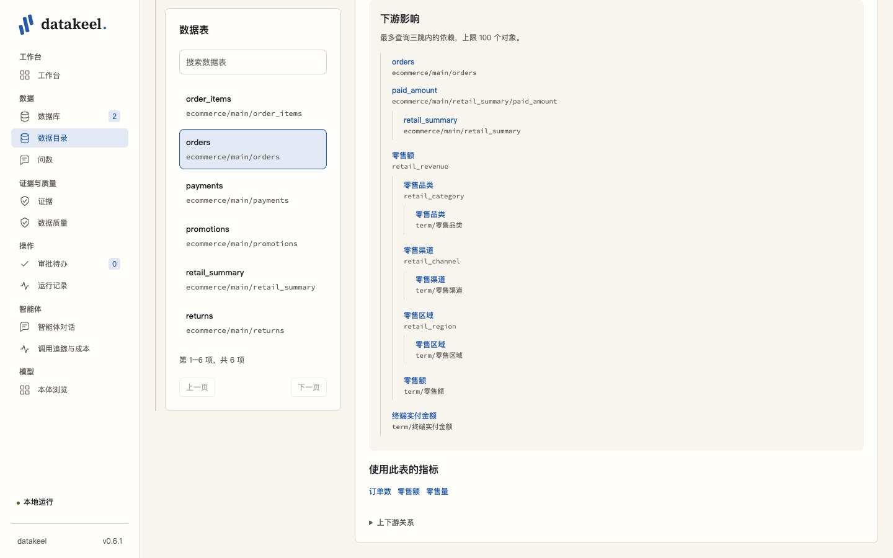

## 5. Ask: answer, clarify, and decline (2 minutes)

Open Ask (问数), keep the demo reference date `2026-10-01`, and try three questions:

1. Ask `上个季度华东区零售额是多少` (last quarter's East China retail revenue), then submit with 开始问数. The answer is `4,979,475`, with metric version 1, source references, filters, and query evidence.
2. Ask `上个季度营业额是多少` (last quarter's turnover). More than one business definition matches, so the page presents alternatives before calculating. Select a candidate to continue.
3. Reopen Ask and enter `下个月零售额是多少` (retail revenue next month). The time parser does not support this interval. The page reports that it cannot answer, preserves the registered definition, and executes no query. Unknown concepts such as return rate may suggest protected metrics; those disclosures require an approved grant.


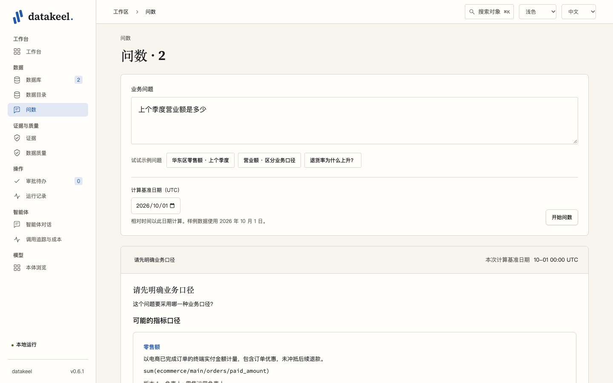

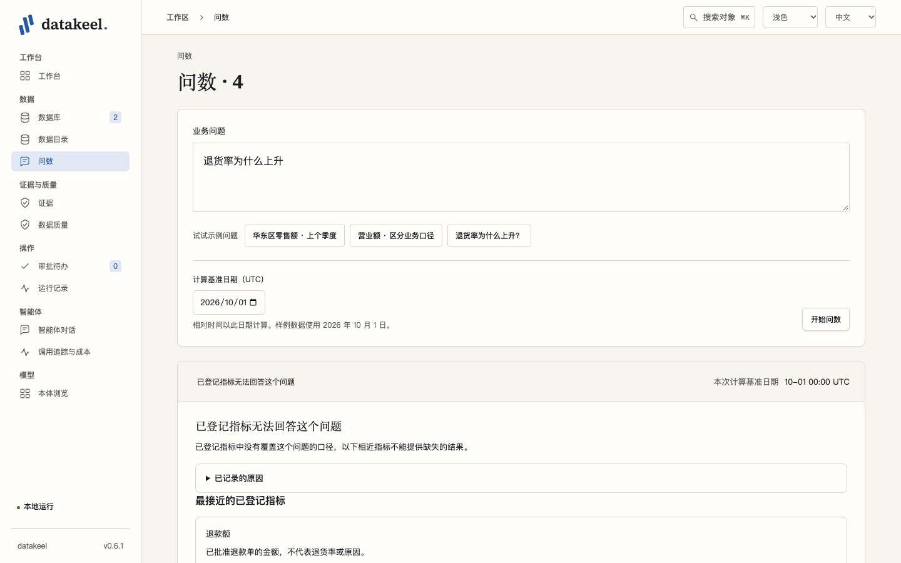

## 6. Change a metric, then restore its definition (2 minutes)

Return to Data catalog → Metrics (指标目录), open `retail_revenue`, and choose Edit definition (修改定义). Change Amount or count field (金额或计数字段) from `paid_amount` to `ecommerce/main/orders/list_amount`. Click Review change (审阅修改), inspect the reversible plan, then execute it (执行动作).

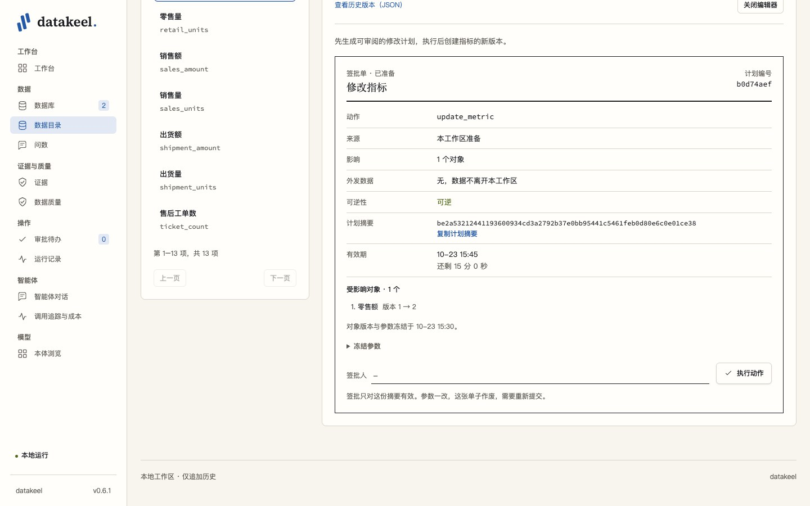

Ask `上个季度华东区零售额是多少` again. The answer becomes `5,255,975` and the metric advances to version 2. The changed number is tied to the changed definition.

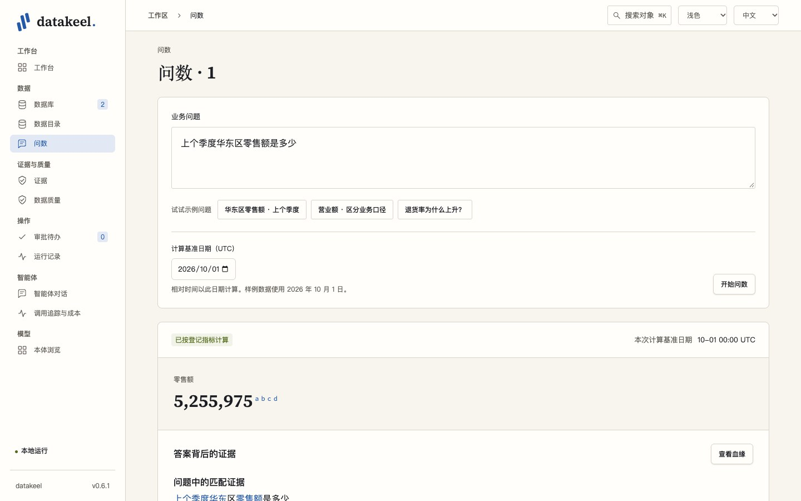

Return to Data catalog → Metrics, select `retail_revenue` again, click Open object (打开对象), then choose the object page’s History (历史) tab. Beside version 1, click Roll back to this version (回滚到此版本). The approval sheet shows one affected metric, 零售额 (retail revenue), and current version 2 → resulting version 3. Review the reversible plan and click Execute action (执行动作). The page refreshes to version 3, and versions 1 and 2 remain in the history.

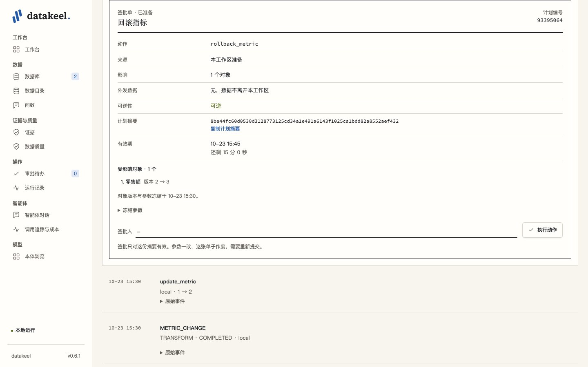

Return to Ask and enter `上个季度华东区零售额是多少`. Submit the same question again. The answer returns to `4,979,475`, now using version 3. A rollback is itself an auditable change, so the version advances.


## 7. Find the object again with ⌘K / Ctrl+K (30 seconds)

Press ⌘K on macOS or Ctrl+K elsewhere, type `retail_revenue`, select Retail revenue (零售额 in Chinese), and press Enter to open the metric object. In English, the object title, breadcrumb, relationship card and approval sheet use the same name; objects without a translation keep their original names. The Chinese interface retains its existing labels.

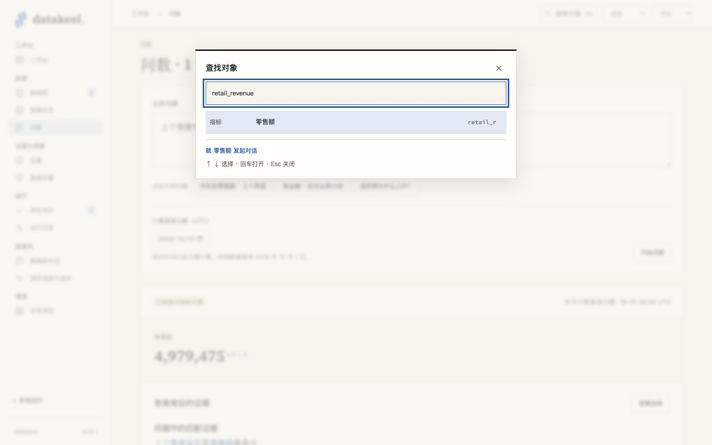

## 8. Run a cleanup workflow and approve it (1 minute)

In a second terminal, import an independent `Workflow cleanup demo` with two empty texts and one useful text. The original 400-file dataset stays separate, and the cleanup selects only this new dataset.

```bash
curl --fail http://127.0.0.1:8773/api/datasets \
  -H 'Content-Type: application/json' --data-binary @- <<'JSON'
{
  "name": "Workflow cleanup demo",
  "files": [
    {"filename": "empty-a.txt", "content_base64": ""},
    {"filename": "empty-b.txt", "content_base64": ""},
    {"filename": "observation.txt", "content_base64": "QSBnZW5lcmF0ZWQgb2JzZXJ2YXRpb24gd2l0aCBlbm91Z2ggdGV4dCB0byBiZSB1c2VmdWwu"}
  ]
}
JSON
```

Refresh the browser and open Workflows (工作流) → Low-quality sample cleanup (低质样本清理). Choose `Workflow cleanup demo`, keep Maximum quality score (质量分数上限) at `60`, and click Run workflow (运行工作流). The timeline shows selection, automatic quarantine, and deletion waiting for approval. All three files still exist; the two empty files are quarantined.

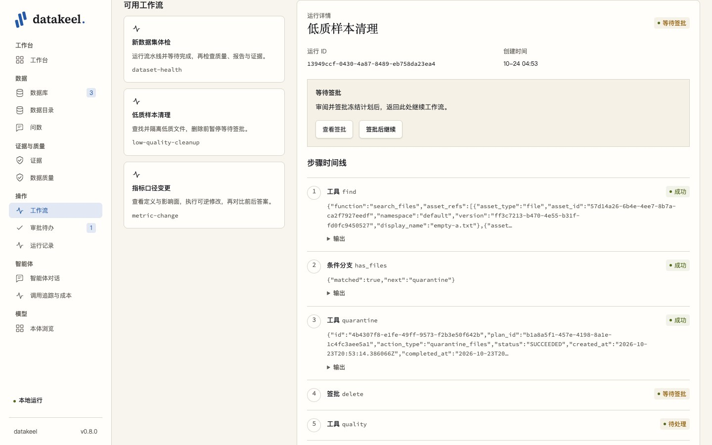

Open Review approval (查看签批), check that the frozen plan contains only the two empty files, and choose Approve and delete files (签批并删除文件). Use Return to workflow (返回工作流): the run is still paused. Click Continue after approval (签批后继续). The workflow reuses the deletion receipt, checks quality, and completes with only `observation.txt` remaining. Reloading preserves the run and timeline.

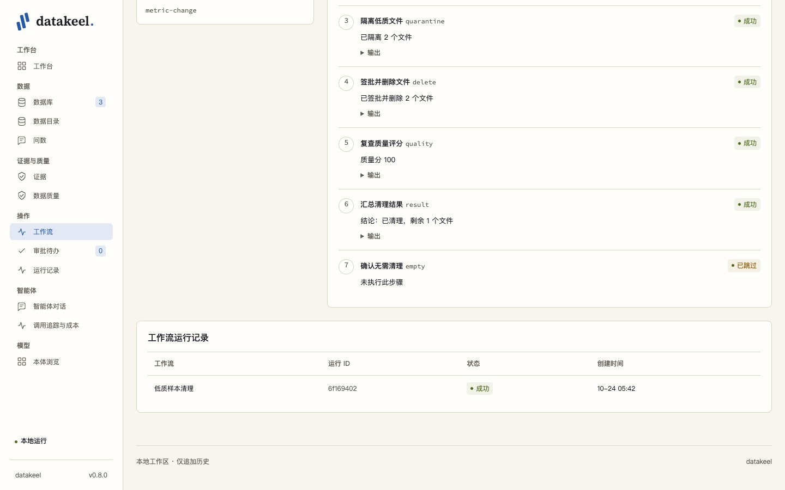

The other two workflows share this entry point. Agent's Run as workflow suggestion only opens the form with its dataset prefilled. See the [workflow reference](WORKFLOWS.md) for definitions, CLI commands, failures and API contracts.

## 9. Add and delete a memory (1 minute)

Open **Memory** and add a global entry: `Catalog reports use the approved active-record definition.` Start a new Agent conversation and ask `How do catalog reports use active records?`. Inspect **Memories used this turn** and its source. This verifies actual retrieval; the offline provider's fixed answer does not demonstrate language understanding.

Return to Memory, delete that entry and confirm. Start another conversation and ask the same question; the deleted entry must no longer appear as used. Historical references show it as deleted. Try `Delegate a catalog review` and expand the specialist's tools and tokens. The [Agent reference](AGENT.md) explains retrieval and deletion boundaries.

## 10. Reject a relation that needs review (1 minute)

Open **Knowledge graph** and select **Business notes · knowledge graph demo**. Search for `Vivo` in **Find an entity**, then choose **Inspect relation**. The drawer highlights the evidence sentence and identifies the tail entity that could not be located in the source. The recorded claim remains visible for review.

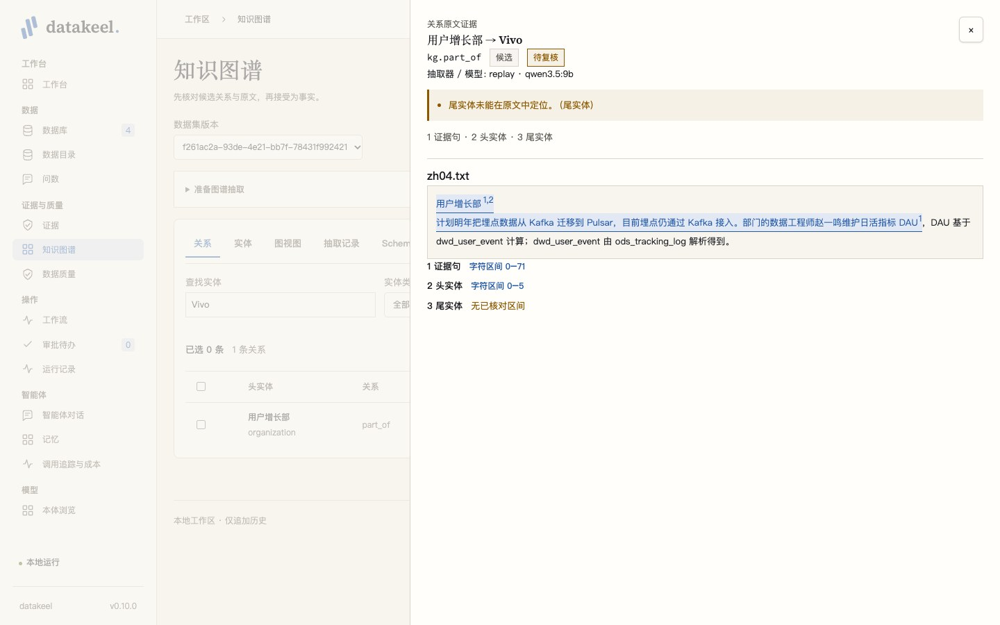

Close the drawer, select that relation and click **Reject selected**. Switch to **Graph**: the edge is now red and dashed with **Rejected** status; the original source check still says **Needs review**. **Extraction runs** also shows the deliberately truncated block, while **Schema proposals** lists excluded claims. The three long documents are clearly attributed to a fake script, not a real model.

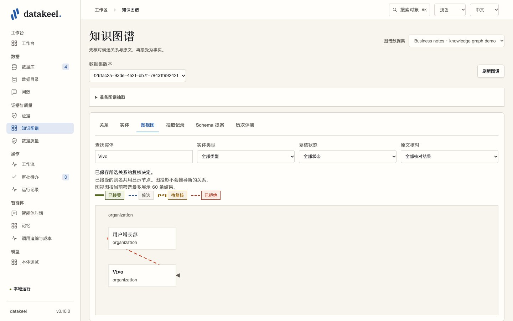

See the [knowledge graph reference](KG.md) for schema configuration, offline evaluation and consent before external extraction.

## 11. Write, review and run a sandboxed operator (3 minutes)

This section additionally needs a Docker-compatible runtime installed by you. Follow [container setup](CUSTOM_OPERATORS.md#container-setup--容器配置), build the image, set `DATAKEEL_SANDBOX_IMAGE`, and start this fresh demo with the same environment. Only generated text is used; no model or external dataset is needed.

In a second terminal, create an independent three-line fixture:

```bash
curl --fail http://127.0.0.1:8773/api/datasets \
  -H 'Content-Type: application/json' --data-binary @- <<'JSON'
{
  "name": "Custom operator demo",
  "files": [
    {"filename": "lines.txt", "content_base64": "a2VlcCBmaXJzdApkaXNjYXJkIHNlY29uZAprZWVwIHRoaXJkCg=="}
  ]
}
JSON
```

Read [filter_lines.py](../examples/custom_operators/filter_lines.py) and copy the entire file. Refresh the browser and open **Custom operators**. Enter `filter_lines`, select **Text**, paste the complete source, and **Submit for code review**. The sheet shows all source lines, SHA-256 and static findings. Review them and choose **Approve and register custom operator code**. An absence of findings does not establish safety; containment still comes from the container.

Under **Approved versions**, select `Custom operator demo`, enter `{"contains":"keep"}` and choose **Run in pipeline**. Wait for the worker, then refresh. Check the successful sandbox record, exit reason and actual image digest. In **Data library**, open this dataset's **Relations** and inspect the custom operator lineage event. Its `code_hash` must equal the complete reviewed hash; inspect the parameter digest and resource usage too. The generated `filtered-0.txt` contains only `keep first` and `keep third`.

Add a comment to the source and submit it again. Check that the new sheet has another hash while the original approved version remains. The changed code needs another approval before it can run. A second example, [tag_images.py](../examples/custom_operators/tag_images.py), labels generated images with `{"label":"generated-fixture"}`. See the [custom operator reference](CUSTOM_OPERATORS.md) for contracts, CLI, validation and threat-model limits. This section is separate from the existing screenshot replay script below.

## 12. Compare, release and verify a delivery (2 minutes)

Return to **Evidence** and select the same generated paired dataset used in step 2. Find the pedestrian annotation gaps again, select a sample and click **Create version**. Clear the selection, select that same sample plus one additional sample and create another version. These are two independent frozen selections; use their actual IDs in **Data library → dataset → Versions**.

Select the single-file version as **Before version** and the two-file version as **After version**, then click **Compare versions**. Inspect **Added**, **Removed**, **Content changed**, **Metadata only** and **Unchanged**, along with annotation, quality and evidence decision summaries. The two selections naturally demonstrate added and unchanged files; the other categories may have zero counts.

Expand **Publish a release**, select the two-file version, use tag `v1.0.0` and enter `Reviewed generated samples` as the release notes. Click **Review release plan**, inspect the source version and frozen file impact, then **Approve and publish release**. Expand `v1.0.0` in **Releases** and click **Export delivery package**. Save the download as `delivery.tar.gz`.

In a terminal with Datakeel installed, run `datakeel reconcile delivery.tar.gz --manifest MANIFEST.json`. All six categories pass without contacting the demo. Follow the byte-change snippet in the [delivery guide](RELEASES.md#export-and-verify-independently) to extract a copy and alter one payload byte, then run `datakeel reconcile received --manifest MANIFEST.json`. The report names the corrupted file in **Content hashes** and exits unsuccessfully. Return to release details, click **Reconcile stored objects** and reload: the platform's intact objects still pass, and the archived six-category report remains visible.

The release portion is a separate optional walkthrough after the screenshot replay below. It changes only the generated workspace and local downloaded copies. The [delivery guide](RELEASES.md) documents the manifest, receipt records, APIs and CLI commands.

## 13. Confirm field standards and inspect conformance (1 minute)

Open **Data standards → Field standards**, search `customer_id`, and inspect the bilingual business meaning, type, owner and lifecycle status. Switch to **Code lists** to read reference value meanings. Editing prepares a frozen plan and saves only after approval.

Open **Mapping suggestions**, search a column, and read the name, type and observed-value reasons behind its candidates. Click **Review mapping**, check the column and target standard, then **Approve and Confirm standard mapping**. Low-evidence columns explicitly receive no suggestion; confirmed columns retain their current mapping.

In **Coverage**, switch between database, table and owner groups and inspect mapping coverage, mapped-column compliance and violation Top N. Follow a table or column link, open **Facts**, and expand its standards checks to see failed rules, counts and redacted examples. **Standards report** combines field quality with the deterministic rule report. **Change history** can prepare an approval plan to restore an earlier revision.

The demo includes separately generated clean and deliberately nonconforming tables. If an older workspace has no standards demo, run `uv run datakeel standards demo` with the same `DATAKEEL_HOME` and refresh. See the [data standards reference](STANDARDS.md). This flow uses rules and needs no model.

## 14. Create a table rule and follow its recovery (2 minutes)

Open **Quality rules → Create rule**. Use ID `tour_orders_amount`, name `Orders have nonnegative paid amounts`, source ID `ecommerce`, schema `main`, table `orders`, and column `paid_amount`. Select **Range**, retain `{"minimum": 0}`, set threshold to `0` and owner to `commerce-team`, and leave the schedule blank. The demo orders table has 18,000 rows: explicitly set **Scan row limit** to `20000`; the default `10000` correctly reports that its budget was exceeded. Choose **Review change**, inspect the frozen definition, then **Approve and create quality rule**.

Select the rule in the list, choose **Run now**, then **Execute action** in the plan. The demo worker runs the task; **Passed** appears within the five-second refresh cycle. Edit the parameters to `{"minimum": 1000000000000}`, review and approve the change, and run again. Generated demo amounts are below this lower bound, so the result is **Failed** and an **Open** issue appears. Enter an assignee, choose **Claim issue**, review and execute its plan. Running another failed check increments the same issue's failure count.

Restore `{"minimum": 0}`, approve the edit and run again. The issue becomes **Recovered, awaiting confirmation**. **Confirm resolution** and execute that plan to close it. Recent results retain each observation; the trend distinguishes actual values from thresholds. Open the `ecommerce/main/orders` table object from **Data catalog** to see its related rules and status. After an edit, latest status uses only the current revision; older results remain available.

See the [quality-rule reference](QUALITY_RULES.md) for YAML, UTC cron, timeouts and scan limits, baselines, signed alerts and scoring. This is a manual extension to the tour; the screenshot replay below still covers the original steps.

## 15. Review annotation agreement and sampling acceptance (1 minute)

Open the dataset **Aster harbor · annotation quality demo** and choose the **Annotation quality** tab. The top card compares three fictional reviewers: Fleiss' κ, Krippendorff's α, pairwise Cohen's κ with raw agreement, and an expandable K×K confusion matrix, followed by box match rate, mean IoU and span F1. Select **Initial harbor annotations** in the batch list: **Sampling acceptance** shows the approved AQL 6.5 rejection (sample 8, Ac 1, 2 defective), and **Suspected annotation errors** lists 19 review items with reasons and evidence, exportable as rework JSON or CSV. Switch back to **Reworked harbor annotations**: the rework comparison shows 19 corrected findings, 1 new finding, and both rejected units changed.

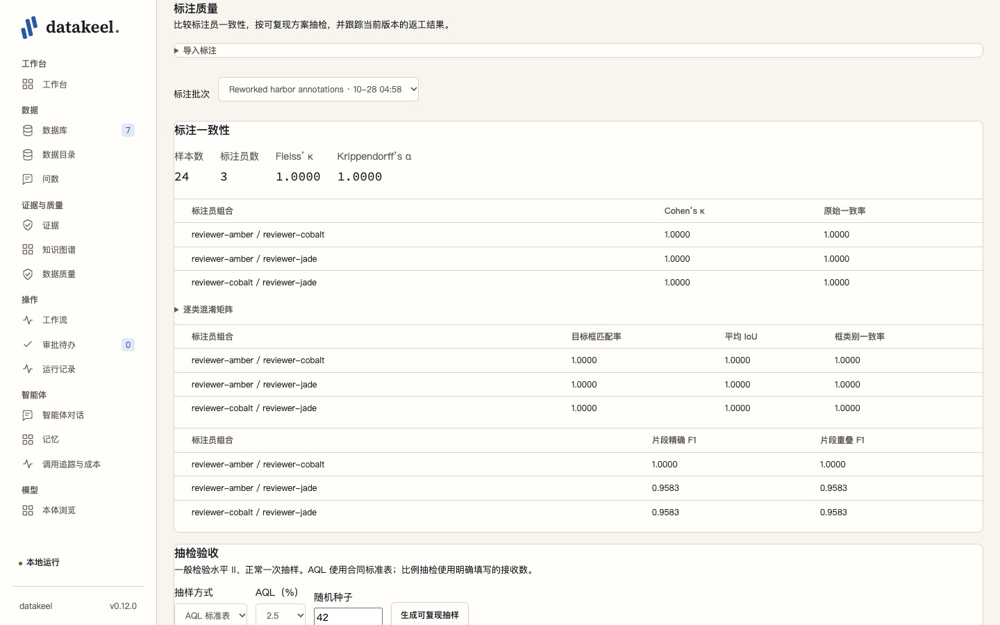

See the [annotation quality reference](ANNOTATION_QA.md) for metric definitions, the AQL table and the suspicion rules.

## 16. Generate a cited dataset datasheet (2 minutes)

Open **Data library**, choose **Paired scenes · evidence demo**, and select **Datasheet**. Under **Dataset version**, choose **Version 1**, the imported version that carries the evidence assertions. Keep English and **Offline template**, click **Generate draft**, review the reversible plan, then choose **Execute action**. The document has all seven chapters; Motivation, Uses and Distribution say that the platform has no record. Hover over a sentence to see its source fact, then click it to expand the fact ID, source object, field, value and recording time. Expand **Removed sentences**: the template keeps every sentence. Download the Markdown and HTML files; the HTML keeps a citation on every sentence.

Because the demo pipeline already created Version 2, this datasheet shows **Out of date**. Choose **Publish datasheet**: it prepares an approval sheet and publishes only after you approve. Then choose **Regenerate for latest version**, execute the plan, and pick the Version 1 document under **Compare with a saved datasheet**. **Changes between the two datasheets** lists the changed chapters and facts above the two documents shown side by side. To try the model path without credentials, select **Configured model** with **Offline fake**; the plan is queued under **Runs** and the result appears after **Refresh datasheets**. Finally switch the interface to Chinese, open **Images and diagrams · knowledge graph demo**, and generate a Chinese datasheet that cites the graph entities. See the [datasheet reference](DATASHEETS.md) for citation and model boundaries. This section is a manual walkthrough; the screenshot replay below covers the earlier sections, and `npm run smoke:ui` exercises this one.

## 17. Split training data, check leakage and export (2 minutes)

Open an annotated dataset in **Data library → Versions** and select its source version in **Training sets**. Name the split `baseline-80-10-10`, keep ratios `0.8 / 0.1 / 0.1`, seed `42`, primary-label balancing and duplicate avoidance. Balancing uses each sample’s first label in sorted order; the distribution charts retain all labels. If samples share a video or collection batch, enter that metadata field in **Group metadata field** to keep related samples together. For two sets, use `0.8 / 0.2 / 0`.

Click **Preview distribution** to inspect each class's counts, percentages and bars across train, validation and test. A preview does not create history and cannot be exported. Click **Save immutable split** to pin the membership to this version. Select saved splits, expand **Inspect sample membership**, then save another name with another seed and use **Compare with another split** to inspect both distributions side by side.

Click **Check leakage**. Clean data reports no cross-set matches within the selected thresholds. Otherwise, the report lists direct evidence pairs for identical content, image similarity, text similarity and shared groups, including both sample IDs, their sets and the measured distance. To inspect an imported partition, select **Use existing train / val / test directories**, save it and run the check; the existing directory assignments are preserved.

Under **Export training data**, select a format compatible with the annotations. If samples have multiple annotations, select an **Annotation author** to define the training labels. Enter `training.tar.gz`. Click **Review export plan**, inspect the frozen source version, split, format and affected samples, and execute the controlled action after approval when required. Use **Download training archive** after success. Check both light and dark themes for readable tables, charts, evidence and plans. See [training datasets](TRAINING.md) for formats, thresholds and reproducibility. This is a manual extension to the tour; the screenshot replay retains its existing steps.

## Replay the tour and generate screenshots

Run this against a **fresh demo that has not been used yet**. The script follows the real UI in the order above. Both metric changes and rollbacks use UI controls to prepare a plan, review the approval sheet, and execute it. Direct API calls only read or poll evidence, except for creating the independent three-file fixture before cleanup.

```bash
npm --prefix web ci
# Install Chromium on Linux; macOS uses an installed Chrome by default.
npm --prefix web exec -- playwright install chromium
npm --prefix web run smoke:tour -- http://127.0.0.1:8773
```

The script writes 21 JPEG screenshots at `1440 × 900` to `docs/images/demo/`, each at most 400,000 bytes, directly from the browser without image post-processing. `artifacts/demo-tour/tour.json` records the actions, response status codes, objects and versions, screenshot dimensions and sizes, browser errors, and blocked external requests. Page text is saved beside it. The script also checks consistent impact counts in Chinese and English for both metric plans, the answer sequence `4,979,475 → 5,255,975 → 4,979,475`, and metric versions `1 → 2 → 3`. The cleanup step also checks two quarantined files, explicit continuation after approval, one deletion record, one remaining file, and the unchanged original 400-file dataset. The graph step checks missing-tail evidence and the persisted rejection style; the annotation step checks that the reworked batch and Fleiss' κ are shown. Success requires zero console or page errors and zero external requests. Start another fresh temporary workspace for every replay.

## Knowledge questions / 知识问数

After demo initialization, open Ask data and select the owner, upstream or downstream examples, then enter `shipments 表从哪来？` or `营业额谁负责？` for further questions. The first separates the registered supply-chain role from the candidate document claim about 周岩; the second marks `erp_raw_shipments` as missing from the catalog; the third asks you to choose 销售额 or 零售额.

演示初始化后，在问数页点击负责人例句并作答，再手动输入 shipments 上游、营业额负责人两个问题。第一题把系统角色和文档中周岩的说法分开展示；第二题标明原始表「目录里没有」；第三题请用户选择歧义指标。点击文档说法进入原文关系抽屉。切到知识图谱，选择「企业文档 · Enterprise documents」，打开实体的「对应资产」并接受或拒绝关联。审阅后重问可以看到状态变化；重关联、同版本重抽取仍保留人审。全部来自六篇虚构文档的离线录制，不需要模型密钥。

## Data assets: discover, apply, use and audit

The default demo publishes six fictional enterprise assets through controlled actions, covering datasets, tables, metrics and all four classifications. It does not issue hidden grants.

1. Open **Asset market**, search `Shipment`, filter **Request access** and the `enterprise` tag, and open the shipment amount card. Inspect its definition, sanitized sample, quality evidence, lineage and related metrics.
2. Apply as operator `analyst`, enter a purpose such as quarterly analysis, select query scope and a future expiry. The request shows **Pending**.
3. Choose **Approve application**, review and approve the plan, then explicitly execute it. The grant shows its subject, scope, expiry and ID. Approving a plan alone does not create a grant. Web approvals are recorded as `local` and applicants cannot review their own application, so do not apply as `local` in step 2.
4. Open **Ask data**, use operator `analyst`, ask `上个季度华东区出货额是多少` with reference instant `2026-10-01T00:00:00Z`, and inspect the registered metric's real read-only result. An ungranted operator is refused and directed to apply.
5. Return to the card's usage audit, filter `analyst`, and verify the `ask` entry and grant ID. The global person filter searches usage across assets.
6. Revoke the grant through another reviewed, approved and executed plan. New questions and old-answer replay now refuse access. Expiry has the same effect without a background job; earlier audit remains.

**Create asset draft** packages an existing object; publication, edits and withdrawal retain all revisions. See [Data assets](DATA_ASSETS.en.md) for configuration and API/CLI details.

## Import dbt and orchestration metadata

Import the fictional dbt project artifacts into the current local workspace:

```sh
uv run datakeel import dbt --source-id shop \
  --manifest tests/fixtures/dbt/manifest.json \
  --catalog tests/fixtures/dbt/catalog.json \
  --run-results tests/fixtures/dbt/run_results.json
```

Open **Catalog → Import metadata**. Reuse your database source ID, select a local `manifest.json`, and optionally include `catalog.json` and `run_results.json`. Import the artifacts and inspect the new, changed, deleted-at-source, and unchanged counts. Switch to Airflow to import an offline REST v1 DAG export. The imported-object browser filters DAGs, tasks, consumers, and metric drafts; select an object to inspect its schedule, ownership, latest state, freshness, and lineage.

Metric drafts remain outside the semantic layer until their complete definition is reviewed and explicitly approved in the standard confirmation plan. Repeating an identical import should report unchanged objects. Removed source objects keep their deletion marker. See [Metadata imports](METADATA_IMPORTS.en.md) for CLI, HTTP, export formats, and OpenLineage authentication.
